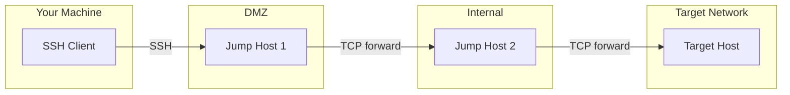
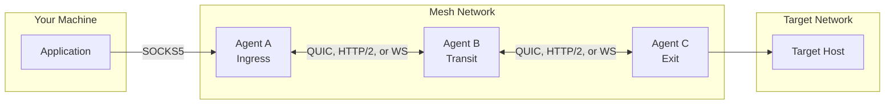
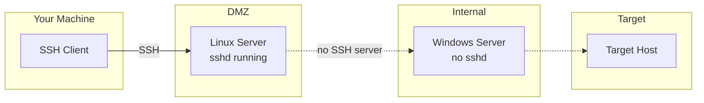
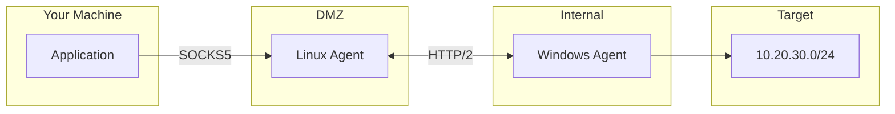

<div style={{textAlign: 'center', marginBottom: '2rem'}}>
  
</div>

# SSH Jump Hosts vs Muti Metroo

SSH jump hosts (`ProxyJump`, `ssh -J`) and Muti Metroo both let you reach hosts that are not directly reachable from where you are. They take different approaches: SSH chains authenticated sessions through existing SSH servers, while Muti Metroo runs its own agents that form a mesh and route traffic between them. This page compares the two so you can choose.

## Summary

| Aspect | SSH jump hosts | Muti Metroo |
| ------ | -------------- | ----------- |
| **What runs on each hop** | An SSH server (OpenSSH `sshd`) | The `muti-metroo` agent, a single binary |
| **Privileges on each hop** | An account on the host; installing `sshd` needs administrator rights | None; the agent runs as an unprivileged user |
| **Topology** | A linear chain, given per connection | Any topology; routes propagate automatically |
| **Traffic types** | TCP (port forwards, `ssh -D` SOCKS proxy) | TCP and UDP through the SOCKS5 proxy; ICMP echo through `muti-metroo ping` |
| **Application access** | SSH-aware tools, explicit port forwards, or a SOCKS proxy | All traffic from the workstation through [Mutiauk](/mutiauk) (which needs root or Administrator), a SOCKS proxy, or port forwards |
| **Authentication** | SSH keys or passwords, per hop and per user | TLS between agents (CA verification and mutual TLS optional), agent ID pinning, optional SOCKS username/password |
| **Encryption** | SSH session encryption | TLS 1.3 on every peer link, plus end-to-end encryption between ingress and exit |
| **Transports** | SSH over TCP, any port; through HTTP proxies with `ProxyCommand` | QUIC, HTTP/2, or WebSocket; WebSocket through HTTP proxies |
| **Lifetime** | Per session; reconnect by hand or with tools such as `autossh` | Agents run continuously and reconnect on their own |
| **Remote commands and file copy** | Built in (`ssh`, `scp`, `sftp`) | `muti-metroo shell`, `upload`, and `download`; disabled by default and require the management signing key |
| **Platforms** | Clients everywhere; `sshd` is common on Linux and macOS and an optional feature on Windows | Linux, macOS, and Windows |

## How each one works

### SSH jump hosts: a chain of sessions

With `ProxyJump`, your SSH client connects to the first jump host, asks it to forward a TCP connection to the next host, and runs the next SSH session through that forwarded connection. Each hop is a separate SSH session with its own authentication, and the session to the final host is encrypted end to end through the jump hosts.



Every hop needs a running SSH server that allows TCP forwarding, and you need credentials for every hop.

### Muti Metroo: a mesh of agents

Muti Metroo agents connect to each other as peers. Exit agents advertise the networks they can reach, the advertisements spread through the mesh, and an ingress agent sends each client connection to the matching exit. Transit agents relay the traffic end-to-end encrypted, without the session keys.



See [Architecture](/concepts/architecture) for details.

## Multi-hop configuration

### SSH

In `~/.ssh/config`:

```text
Host jump1
    HostName jump1.example.com
    User jumpuser

Host jump2
    HostName 192.168.1.10
    User jumpuser
    ProxyJump jump1

Host target-server
    HostName 10.20.30.40
    User admin
    ProxyJump jump2
```

Or on the command line:

```bash
ssh -J jumpuser@jump1.example.com,jumpuser@192.168.1.10 admin@10.20.30.40
```

Each new target needs its own host entry or command line.

### Muti Metroo

Each agent lists the peers it dials. The exit agent advertises the network:

```yaml
# Agent B (transit): dials Agent C; Agent A dials Agent B
listeners:
  - transport: quic
    address: "0.0.0.0:4433"

peers:
  - id: "auto"
    transport: quic
    address: "192.168.1.50:4433"
```

```yaml
# Agent C (exit)
listeners:
  - transport: quic
    address: "0.0.0.0:4433"

exit:
  enabled: true
  routes:
    - "10.20.30.0/24"
```

Every host in `10.20.30.0/24` is then reachable through Agent A's SOCKS proxy, with no per-target configuration:

```bash
curl -x socks5h://localhost:1080 http://10.20.30.40/
```

See [Your First Mesh](/getting-started/first-mesh) for a complete walkthrough.

## Windows on the path

SSH jump chains need an SSH server on every intermediate host. On Windows, OpenSSH Server is an optional feature that an administrator must install, enable, and open in the firewall. Where that is not permitted, the chain cannot pass through that host.



A Muti Metroo agent runs on Windows as an ordinary process, without administrator rights, and can dial out to other agents:

```powershell
.\muti-metroo.exe run -c config.yaml
```



## Traffic types

### SSH

OpenSSH forwards TCP:

```bash
# Local port forward
ssh -L 8080:10.20.30.40:80 admin@jump1.example.com

# Dynamic SOCKS proxy
ssh -D 1080 admin@jump1.example.com
curl -x socks5h://localhost:1080 http://10.20.30.40/
```

The `ssh -D` SOCKS proxy handles TCP connections only. UDP and ICMP, for example DNS queries to an internal resolver or `ping`, are not forwarded.

### Muti Metroo

The SOCKS5 proxy handles TCP connections and UDP (SOCKS5 UDP ASSOCIATE, or the UDP STREAM extension that Mutiauk uses). ICMP echo is available from the CLI, through a chosen agent:

```bash
# TCP through the SOCKS proxy
curl -x socks5h://localhost:1080 http://10.20.30.40/

# ICMP echo from the agent with the given ID
muti-metroo ping a1b2c3d4e5f60718293a4b5c6d7e8f90 10.20.30.40
```

With [Mutiauk](/mutiauk), which creates a TUN interface and needs root or Administrator, applications use the mesh without any proxy settings, including UDP and ICMP:

```bash
curl http://10.20.30.40/
dig @10.20.30.1 internal.example.com
ping 10.20.30.40
```

See [UDP Relay](/features/udp-relay) and [ICMP Relay](/features/icmp-relay).

## Firewalls and proxies

SSH runs on any TCP port, so an SSH server listening on 443 passes many firewalls that block 22. Through an HTTP proxy, SSH needs a `ProxyCommand`:

```bash
ssh -o ProxyCommand='nc -X connect -x proxy.example.com:8080 %h %p' admin@jump1.example.com
```

Muti Metroo chooses a transport per link:

| Transport | Runs over | Notes |
| --------- | --------- | ----- |
| QUIC | UDP | Any port; blocked where UDP is filtered |
| HTTP/2 | TCP with TLS | Any port, commonly 443 |
| WebSocket | TCP with TLS | Any port, commonly 443; can run behind a reverse proxy or CDN |

```yaml
peers:
  - id: "auto"
    transport: ws
    address: "wss://relay.example.com:443/mesh"
```

Muti Metroo agents connect to their peers directly. Peer entries accept `proxy` and `proxy_auth`, but the current release does not apply them, so a network that allows outbound traffic only through an HTTP proxy is a case for SSH. See [Transports](/concepts/transports).

## Connection lifetime

An SSH session ends when the network connection drops, and you reconnect and re-authenticate. Tools such as `autossh` (reconnects), `mosh` (roaming), and `tmux` or `screen` (session persistence) help.

Muti Metroo agents keep their peer connections up and reconnect with exponential backoff (1s initial delay, up to 60s, with jitter, retrying indefinitely by default). A dropped link does not need operator action, although client connections that were using it are closed and must be reopened. Agents can run as a system service:

```bash
sudo muti-metroo service install -c /etc/muti-metroo/config.yaml
```

See [Connections configuration](/configuration/connections) for the reconnection settings and [System Service](/deployment/system-service) for service installation.

## Security

| | SSH jump hosts | Muti Metroo |
| --- | --- | --- |
| **Hop authentication** | SSH keys or passwords for each hop | TLS between agents. By default certificates are self-signed and not verified, and any agent that can reach a listener can connect; CA verification and mutual TLS restrict this. Peer entries can pin the expected agent ID. |
| **Client authentication** | Each user authenticates to each hop | Optional SOCKS username/password on the ingress agent |
| **Intermediate hops** | Jump hosts forward the encrypted inner session and cannot read it; the destination's host key authenticates the session end to end | Transit agents relay end-to-end encrypted streams without the session keys; the stream key exchange is not authenticated, so a compromised transit agent can intercept a session |
| **Where traffic leaves encryption** | The final SSH host (for `-L` and `-D`, traffic to the destination is unencrypted unless the application encrypts it) | The exit agent (traffic to the destination is unencrypted unless the application encrypts it) |
| **Remote command execution** | Any authenticated user with a shell | Disabled by default; requires requests signed with the management signing key |

See [Security Overview](/security/overview) and [TLS and mTLS](/security/tls-mtls).

## When to use SSH jump hosts

- SSH access to the hosts on the path already exists.
- The path is a short, fixed chain.
- You work with SSH-native tools such as `git`, `scp`, and `rsync`.
- You need one-off access and do not want to deploy anything.
- Every host on the path runs an SSH server you can use.
- Outbound traffic must go through an HTTP proxy.

```bash
ssh -J admin@bastion.example.com admin@10.20.30.40
ssh -L 5432:10.20.30.41:5432 -J admin@bastion.example.com admin@10.20.30.40
```

## When to use Muti Metroo

- A host on the path has no SSH server and you cannot install one, for example a Windows host.
- You need UDP or ICMP, not only TCP.
- The topology has several sites, branches, or redundant paths.
- Only HTTPS (port 443) is allowed outbound, or UDP is blocked.
- Access should stay up without a person keeping sessions open.

## Using both

The two are not exclusive. You can use SSH to install and manage agents, and the mesh to carry traffic. SSH itself also runs through the mesh:

```bash
ssh -o ProxyCommand='nc -x localhost:1080 %h %p' admin@10.20.30.40
```

## See Also

- [Architecture](/concepts/architecture): how agents connect and relay traffic
- [Transports](/concepts/transports): QUIC, HTTP/2, and WebSocket and when to use each
- [Mutiauk](/mutiauk): route all traffic from a host through the mesh without proxy settings
- [End-to-End Encryption](/security/e2e-encryption): what transit agents can and cannot see
- [System Service](/deployment/system-service): run agents continuously
