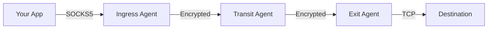
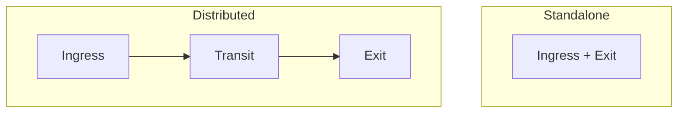

<div style={{textAlign: 'center', marginBottom: '2rem'}}>
  
</div>

# Agent Roles

Each agent in a mesh plays one or more roles: it accepts client connections (ingress), relays traffic between other agents (transit), or opens connections to destinations (exit). One agent can do all three, or you can give agents separate jobs.

## Roles at a glance

| Role | What it does | Enabled by |
| ---- | ------------ | ---------- |
| **Ingress** | Accepts SOCKS4, SOCKS4a, and SOCKS5 client connections and sends them into the mesh | `socks5.enabled: true` |
| **Transit** | Relays streams and route advertisements between its peers | Always on; any agent with more than one peer relays between them |
| **Exit** | Advertises routes and opens the real connections to destinations | `exit.enabled: true` with `exit.routes` or `exit.domain_routes` |



Port forwarding adds two related roles: an agent with `forward.listeners` accepts connections on a local port (forward ingress), and an agent with `forward.endpoints` connects them to a target service (forward exit). See [Port Forwarding](/features/port-forwarding).

## Ingress

An ingress agent is where client traffic enters the mesh. Point curl, SSH, a browser, or [Mutiauk](/mutiauk) at its SOCKS listener.

The ingress agent:

- Runs the SOCKS proxy (SOCKS4, SOCKS4a, and SOCKS5, detected automatically)
- Picks the exit for each destination from its route table: domain routes first, then CIDR routes after resolving the name locally
- Opens an end-to-end encrypted stream to that exit and relays the client's data over it

Typical placements: an operator workstation (local proxy on `127.0.0.1:1080`), or a gateway host that a team connects to.

See [SOCKS5 Proxy](/features/socks5-proxy) and [SOCKS5 configuration](/configuration/socks5).

## Transit

Every agent relays traffic for its peers. An agent becomes a transit hop by being connected to two or more agents that need to reach each other through it. There is no transit setting.

A transit agent:

- Forwards streams between peers without holding their session keys
- Passes route advertisements on to its other peers

Typical placements: a cloud relay that office networks dial out to, a DMZ host that can reach both an external and an internal segment, or an intermediate hop between regions.

## Exit

An exit agent is where traffic leaves the mesh.

The exit agent:

- Advertises the CIDR ranges and domain patterns it serves
- Accepts only destinations that match its own routes
- Resolves domain names for domain routes using its own DNS settings
- Opens the real TCP connections, and handles UDP and ICMP when those features are enabled

Typical placements: inside a private network to reach internal hosts, or on an internet-facing host to give traffic a specific egress location.

See [Exit Routing](/features/exit-routing) and [Exit configuration](/configuration/exit).

Every agent in the mesh is reachable by its agent ID for management operations (shell, file transfer, ping, and status queries), whether or not it has exit routes. Exit routes only control which destinations an agent opens connections to on behalf of clients.

## Combining roles

| Combination | Typical use |
| ----------- | ----------- |
| **Ingress + Exit** | A standalone proxy on a single host |
| **Ingress only** | A workstation or laptop that sends all traffic to remote exits |
| **Exit only** | An agent inside a target network that dials out to a relay |
| **Ingress + Exit + listeners** | A single agent that other agents also connect to |



## Choosing a layout

| Goal | Layout |
| ---- | ------ |
| Proxy traffic from one host | One agent with ingress and exit |
| Reach a remote office network | Ingress on your workstation, exit inside the office |
| Connect several sites | A transit agent in the cloud that each site's agent dials, with an exit at each site |
| Give a team access to internal resources | An ingress agent per user or per location, an exit inside the network |
| Egress from several regions | Regional exit agents, each advertising its own routes |

Connection direction (which agent dials which) is independent of roles. See [Architecture: Connection model](/concepts/architecture#connection-model).

## Checking agent roles

The `/api/topology` endpoint lists the roles of the local agent and every known remote agent:

```bash
curl -s http://localhost:8080/api/topology | jq '[.local_agent] + .agents | .[] | {display_name, roles}'
```

The `roles` array contains `ingress`, `exit`, `forward_ingress`, and `forward_exit` as they apply. An agent with none of these is listed as `transit`.

## Recommendations

- **Keep exits few and specific.** Advertise only the ranges an exit needs to serve; reserve `0.0.0.0/0` for agents that should carry general internet traffic.
- **Keep transit agents free of sensitive access.** A relay does not need routes into internal networks, and while it relays traffic as designed it never holds the session keys. A compromised relay is a different case; see [End-to-End Encryption](/security/e2e-encryption#limits-of-the-protection).
- **Enable the HTTP API on each agent** you want to monitor or manage with the CLI.

## See Also

- [Architecture](/concepts/architecture): how agents connect and how connection direction relates to traffic
- [Routing](/concepts/routing): how exit routes propagate to ingress agents
- [Transports](/concepts/transports): choosing a transport for each link
- [Exit Routing](/features/exit-routing): configuring what an exit serves
- [Deployment Scenarios](/deployment/scenarios): complete layouts for common situations
