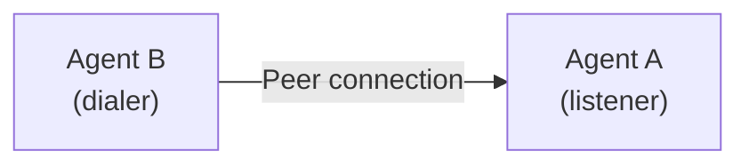
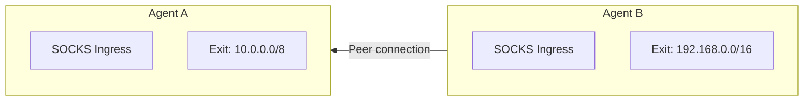
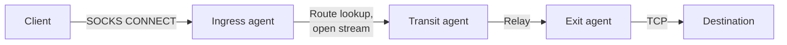
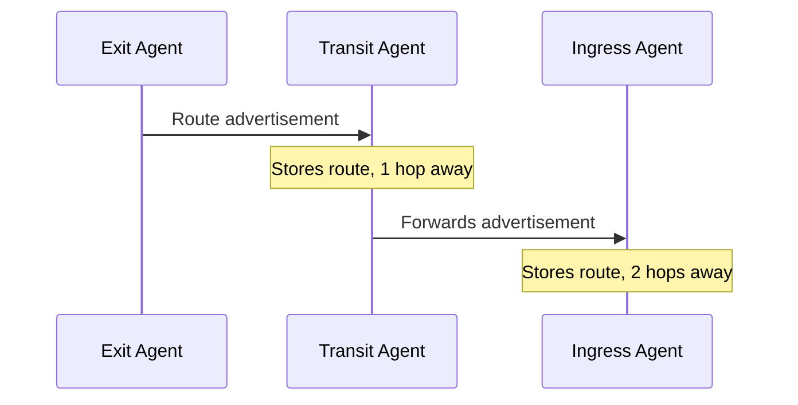

  

# Architecture

A Muti Metroo mesh is a set of agents connected to each other by peer connections. Each agent is the same single binary running in userspace, without root privileges, kernel modules, or a TUN device. There is no central coordinator: once agents are connected, they exchange route advertisements and relay traffic for each other.

## Building blocks

| Term | Meaning |
| ---- | ------- |
| **Agent** | One running `muti-metroo` process with its own 128-bit agent ID, stored in its data directory. |
| **Listener** | A transport endpoint (QUIC, HTTP/2, or WebSocket) on which an agent accepts peer connections. Configured under `listeners`. |
| **Peer** | An outbound connection that an agent dials to another agent's listener. Configured under `peers`. |
| **Peer connection** | The TLS-protected transport link between two agents, regardless of which side dialed. |
| **Stream** | One client connection (for example a TCP connection made through the SOCKS proxy) carried across the mesh from ingress to exit. Many streams share each peer connection. See [Streams](/concepts/streams). |
| **Route** | An advertisement that an agent can reach a CIDR range, a domain pattern, or a port forward key. See [Routing](/concepts/routing). |
| **Role** | What an agent does with traffic: ingress, transit, or exit. See [Agent Roles](/concepts/agent-roles). |

## What runs inside an agent

Which services an agent runs depends on its configuration:

| Service | Enabled by | Purpose |
| ------- | ---------- | ------- |
| SOCKS proxy | `socks5.enabled` | Accepts SOCKS4, SOCKS4a, and SOCKS5 clients and sends their connections into the mesh (ingress). |
| Exit handler | `exit.enabled` | Advertises CIDR and domain routes and opens the real connections to destinations (exit). |
| Port forwarding | `forward.listeners`, `forward.endpoints` | Exposes a service reachable from one agent on a local port of another. |
| HTTP API | `http.enabled` | Health checks, dashboard and topology data, and the API that the CLI management commands use. |
| Transport listeners | `listeners` | Accept inbound peer connections. |
| Peer connections | `peers` | Dial other agents and reconnect when the link drops. |

Every agent relays traffic and route advertisements for its peers, whatever else it is configured to do.

## Connection model

Two things are easy to conflate: the direction in which a peer connection is established, and the direction in which traffic flows. They are independent.

### Peer connections and streams

A **peer connection** is created when one agent dials another. If Agent B lists Agent A under `peers`, Agent B dials Agent A, and Agent A must have a matching entry under `listeners`:

**Streams** are the individual client connections carried over peer connections. Once two agents are connected, either agent can open streams through the other, whichever side dialed.

### Bidirectional routing

In this topology Agent B dials Agent A:

Traffic flows in both directions over that single connection:

- A SOCKS client of Agent A can reach `192.168.0.0/16` through Agent B's exit.
- A SOCKS client of Agent B can reach `10.0.0.0/8` through Agent A's exit.

Reversing the connection (Agent A dials Agent B) gives the same result.

### Practical implications

- **Choose connection direction by network constraints, not by traffic direction.** An agent behind NAT or a firewall that blocks inbound connections can dial out to a publicly reachable agent and still serve as an exit.
- **An agent can have both listeners and peers.** It can accept connections from some agents and dial others.
- **Route advertisements travel over every peer connection** regardless of which side dialed.

## Data flow

When a client connects through the SOCKS proxy of an ingress agent:

1. The ingress agent receives the SOCKS request and looks up a route for the destination (domain routes first, then CIDR routes).
2. It opens a stream along the path to the exit agent that advertised the matching route.
3. Transit agents relay the stream without being able to decrypt it.
4. The exit agent checks the destination against its own routes and opens the real connection.
5. Data flows in both directions until either side closes the connection.

## Route advertisement flow

Exit agents advertise their routes to their peers, and each agent passes the advertisement on to its other peers. Each agent stores the route with a metric one higher than the agent it learned it from:

See [Routing](/concepts/routing) for route selection and expiry.

## Security model

| Layer | Protection |
| ----- | ---------- |
| Peer connections | TLS 1.3 on every transport. Certificates are self-signed and generated at startup unless you configure a CA; CA verification and mutual TLS are optional. |
| Peer identity | A peer entry's `id` can pin the expected agent ID of the remote agent; `id: "auto"` accepts any agent. |
| Stream payload | End-to-end encryption between ingress and exit with X25519 key exchange and ChaCha20-Poly1305. Transit agents cannot read the payload. |
| SOCKS clients | Optional username/password authentication. |
| HTTP API | Optional bearer token (`http.token_hash`). |
| Privileged operations | Shell, file transfer, and dynamic configuration changes require requests signed with the management signing key. Sleep and wake require a signature on agents that have the signing public key configured. |
| Topology | Optional management key that encrypts node information, so only operators with the private key can read the mesh layout. |

A WebSocket listener with `plaintext: true` has no TLS of its own and relies on a reverse proxy in front of it to terminate TLS.

See [Security Overview](/security/overview) for details.

## See Also

- [Agent Roles](/concepts/agent-roles): what ingress, transit, and exit agents do and how to combine them
- [Transports](/concepts/transports): choosing between QUIC, HTTP/2, and WebSocket for each link
- [Routing](/concepts/routing): how routes propagate, expire, and are selected
- [Your First Mesh](/getting-started/first-mesh): connect two agents and send traffic through them
- [Security Overview](/security/overview): TLS, end-to-end encryption, and authentication in detail
