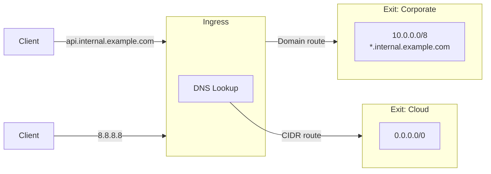
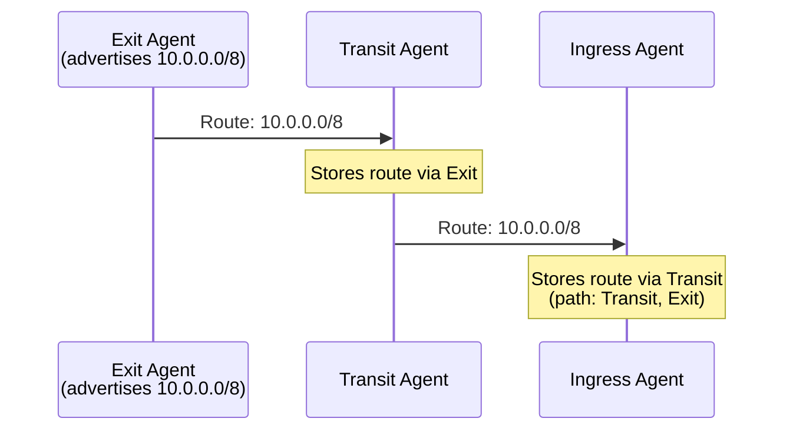
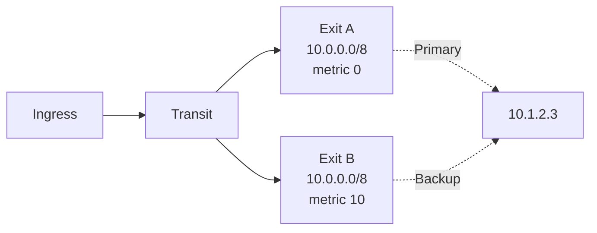

<div style={{textAlign: 'center', marginBottom: '2rem'}}>
  
</div>

# Routing

You do not configure paths through the mesh. Exit agents advertise what they can reach, the advertisements spread to every connected agent, and each ingress agent picks the matching route when a client connects.

For example:

- An exit agent inside a corporate network advertises `10.0.0.0/8`.
- An exit agent in the cloud advertises `0.0.0.0/0`.
- A client connecting to `10.1.2.3` goes through the corporate exit, because `/8` is more specific than `/0`.
- A client connecting to `8.8.8.8` goes through the cloud exit, the only route that matches.

## Route types

| Type | Matches | Example | Where DNS is resolved | Configured with |
| ---- | ------- | ------- | --------------------- | --------------- |
| **CIDR** | IPv4 and IPv6 addresses | `10.0.0.0/8` | At the ingress agent | `exit.routes`, `muti-metroo route add` |
| **Domain** | Host names | `*.internal.example.com` | At the exit agent | `exit.domain_routes` |
| **Forward** | Port forward keys | `web-server` | Not applicable | `forward.endpoints`, `muti-metroo forward endpoint add` |

Domain routes let an exit resolve names that only its own network's DNS knows about. They only apply when the client sends the host name to the proxy instead of an IP address: use `socks5h://` rather than `socks5://` with curl, or SOCKS4a rather than SOCKS4.



Every agent is also reachable by its agent ID for management operations (shell, file transfer, ping, and status queries), whether or not it advertises any routes. Agents announce their presence automatically when they join the mesh; no configuration is needed.

## Route propagation

Each exit agent sends its routes to its peers, and every agent passes the advertisement on to its own peers. An agent does not send an advertisement back to an agent that has already seen it, so advertisements do not loop.



Exits re-send their routes every `routing.advertise_interval` (default `2m`), and immediately when a route is added or removed at runtime. To push the current routes right away:

```bash
curl -X POST http://localhost:8080/routes/advertise
```

See [Routing configuration](/configuration/routing) for the interval and TTL settings.

## Route selection

### Order of checks

When a client connects to a **host name**:

1. The ingress agent checks its **domain routes**. If one matches, the stream goes to that exit, and the exit resolves the name.
2. Otherwise the ingress agent resolves the name itself (the [mesh host registry](/configuration/hosts) first, then DNS) and continues with the resulting IP address.

When a client connects to an **IP address**, or after step 2, the ingress agent uses its **CIDR routes**.

### CIDR matching

The most specific matching prefix wins:

| CIDR | Advertised by |
| ---- | ------------- |
| `192.0.2.4/32` | Agent A |
| `192.0.2.0/24` | Agent B |
| `0.0.0.0/0` | Agent C |

| Destination | Selected | Reason |
| ----------- | -------- | ------ |
| `192.0.2.4` | Agent A | `/32` is the most specific match |
| `192.0.2.100` | Agent B | `/24` is more specific than `/0` |
| `198.51.100.7` | Agent C | Only `/0` matches |

When several routes have the same prefix length, the route with the lowest metric wins. If the metrics are also equal, the route from the agent with the lowest agent ID wins, so the choice is the same on every restart.

### Domain matching

| Pattern | Matches | Does not match |
| ------- | ------- | -------------- |
| `api.example.com` | `api.example.com` | `www.example.com` |
| `*.example.com` | `www.example.com` | `example.com`, `a.b.example.com` |

An exact pattern is checked before a wildcard. Wildcards match a single label only. When several exits advertise the same pattern, the lowest metric wins.

### Route metrics

Each exit route has a base metric: the `metric` field of an entry in `exit.routes`, or `--metric` on `muti-metroo route add`. It defaults to `0`. Give a backup exit a higher metric than the primary exit for the same range to make the primary preferred.

To see which route an agent would use for a destination:

```bash
muti-metroo route trace 192.0.2.4
```

See [`route trace`](/cli/route) for the output.

## Route expiration and withdrawal

Routes are removed from an agent's table when:

- **The peer they were learned through disconnects.** The agent drops every route learned over that connection immediately.
- **The advertising agent stops refreshing them.** Routes not refreshed within `routing.route_ttl` (default `5m`) expire.
- **The advertising agent removes them.** Removing a runtime route (`muti-metroo route remove`, `muti-metroo forward remove`, `muti-metroo forward endpoint remove`, or a disconnecting expose session) sends a withdrawal through the mesh, so other agents drop it at once instead of waiting for the TTL.

When a route disappears, new connections use the next best matching route, if there is one. Connections already open over the removed path are not moved.

## Redundant exits

Several exits can advertise the same range:



- Agents store both routes.
- New connections use Exit A, which has the lower metric.
- If Exit A disconnects, its route is removed and new connections use Exit B.

See [High Availability](/deployment/high-availability) for complete examples.

## Recommendations

- **Advertise specific ranges.** A `/24` gives more control than `/0`, and lets other exits serve other ranges.
- **Keep default routes few.** In most meshes only one exit, or one primary and one backup, should advertise `0.0.0.0/0`.
- **Set metrics deliberately** when more than one exit serves the same range.

## See Also

- [Exit Routing](/features/exit-routing): configure CIDR and domain routes on an exit
- [Routing configuration](/configuration/routing): advertisement interval, route TTL, and related settings
- [`route` command](/cli/route): add, remove, list, and trace routes at runtime
- [Agent Roles](/concepts/agent-roles): which agents advertise routes and which use them
- [Streams](/concepts/streams): what happens after a route is selected
