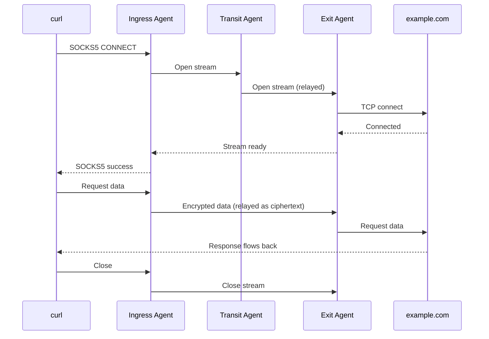
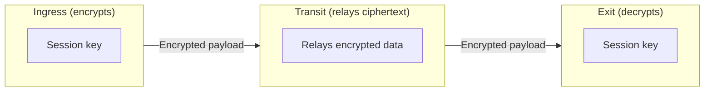

  

# Streams

A stream is one client connection carried across the mesh: a curl request, an SSH session, a forwarded port connection, or a single browser connection. Streams run from the ingress agent, through any transit agents, to the exit agent. Many streams share each peer connection, so opening a new client connection does not open a new connection between agents.

## Life of a stream

When you run `curl -x socks5h://localhost:1080 https://example.com`:

1. The ingress agent selects a route (see [Routing](/concepts/routing)) and asks the exit agent, along the route's path, to open the connection.
2. The exit agent checks the destination against its own routes and connects to it.
3. The ingress agent reports success to the SOCKS client only after the exit has connected. If the exit refuses the destination or cannot connect, the SOCKS client receives an error instead.
4. Data flows in both directions until either side closes.

## End-to-end encryption

Each stream is encrypted between the ingress and exit agents with a session key the two agents agree on when the stream opens. Transit agents relay the encrypted data without that key, and a modified frame fails authentication and is rejected. This is on top of the TLS that protects every peer connection. The key exchange itself is not authenticated, so a transit agent under an attacker's control can intercept a session; see [the limits](/security/e2e-encryption#limits-of-the-protection).

No configuration is needed. See [End-to-End Encryption](/security/e2e-encryption) for the algorithms and what the encryption does and does not protect against.

## Behavior visible to applications

- **TCP semantics are preserved, including half-close.** When one side shuts down its sending direction, the other side sees end-of-file and can still send its reply. Protocols that rely on this, such as some uses of `nc` and SSH, work through the mesh.
- **Streams do not survive a path failure.** If a peer connection on the stream's path drops, streams over it close and the application sees the connection end. New connections use whatever route is available at that time.

## Limits

Each agent caps the number of concurrent streams it carries at `limits.max_streams_total` (default 10000); a stream open beyond the cap is refused. A SOCKS or port-forward stream open times out if the exit has not answered within 30 seconds. The other keys in the `limits` section and their current effect are listed on the [Limits configuration](/configuration/limits) page.

See [Limits configuration](/configuration/limits) for every key and its default.

## See Also

- [Routing](/concepts/routing): how the ingress agent chooses the exit for a stream
- [End-to-End Encryption](/security/e2e-encryption): how stream payloads are protected
- [Limits configuration](/configuration/limits): stream counts, buffer size, and the stream open timeout
- [Connections configuration](/configuration/connections): the idle timeout that closes quiet connections at the exit
- [Performance troubleshooting](/troubleshooting/performance): diagnosing slow or stalled streams
