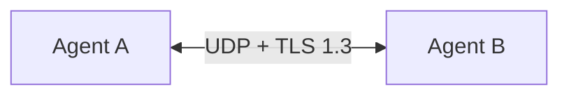
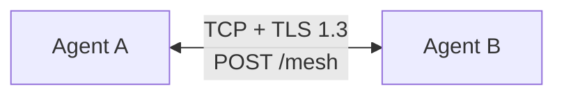
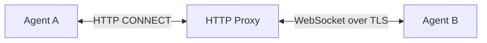
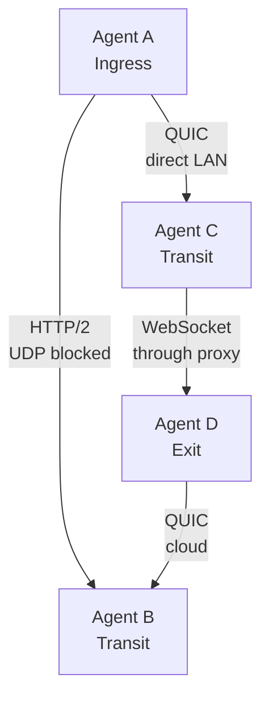

<div style={{textAlign: 'center', marginBottom: '2rem'}}>
  
</div>

# Transports

A transport is the protocol that carries a peer connection between two agents. Muti Metroo supports QUIC, HTTP/2, and WebSocket. Each listener and each peer entry picks one with its `transport` field (`quic`, `h2`, or `ws`), and a single mesh can mix all three.

## Comparison

| | QUIC (`quic`) | HTTP/2 (`h2`) | WebSocket (`ws`) |
| --- | --- | --- | --- |
| **Runs over** | UDP | TCP | TCP |
| **Encryption** | TLS 1.3 | TLS 1.3 | TLS 1.3, or none behind a TLS-terminating reverse proxy (`plaintext: true`) |
| **URL path** | Not used | Listener `path`, default `/mesh` | Listener `path`, default `/mesh` |
| **Outbound HTTP proxy** | No | No | Yes (`proxy`, `proxy_auth`) |
| **Needs open** | A UDP port | A TCP port | A TCP port, or only an HTTP proxy |
| **Typical use** | Links where UDP is allowed | Links where only TCP, typically 443, is allowed | Links that must go through an HTTP proxy, reverse proxy, or CDN |

All three carry the same traffic and support the same features. End-to-end encryption of stream payloads is independent of the transport.

## QUIC



QUIC runs over UDP with TLS 1.3 built in, and has the least protocol overhead of the three. Use it when the network between two agents allows UDP on the chosen port: between servers you control, from home and most residential networks, and between cloud regions.

Some corporate networks block or throttle outbound UDP. If a QUIC peer cannot connect from such a network, switch that link to HTTP/2 or WebSocket.

```yaml
listeners:
  - transport: quic
    address: "0.0.0.0:4433"
```

## HTTP/2



HTTP/2 runs over TCP with TLS 1.3, as a long-lived HTTPS request to the listener's path. Use it when UDP is blocked but direct outbound TCP, typically to port 443, is allowed.

A peer that dials a `host:port` address uses the path `/mesh`. To dial a different path, give the address as a URL, for example `https://relay.example.com:443/tunnel`.

HTTP/2 listeners always use TLS; there is no plaintext mode. HTTP/2 peers cannot be configured to go through an HTTP proxy; use WebSocket for that.

```yaml
listeners:
  - transport: h2
    address: "0.0.0.0:443"
    path: "/mesh"
```

## WebSocket



WebSocket runs over TCP as an HTTP upgrade to the listener's path. It is the only transport that:

- **Dials through an HTTP proxy.** Set `proxy` (and optionally `proxy_auth`) on the peer entry.
- **Can sit behind a reverse proxy or CDN that terminates TLS.** Set `plaintext: true` on the listener and bind it to a local address that only the reverse proxy can reach.

```yaml
peers:
  - id: "auto"
    transport: ws
    address: "wss://relay.example.com:443/mesh"
    proxy: "http://proxy.example.com:8080"
```

As with HTTP/2, a peer that dials a `host:port` address uses the path `/mesh`; give a `wss://` URL to dial a different path.

See [Reverse Proxy Deployment](/deployment/reverse-proxy) for the plaintext listener setup.

## Mixed transports

Each peer connection uses its own transport, chosen for the network between those two agents. Routes and streams cross transport boundaries without any extra configuration:



An agent can also run several listeners with different transports at once, so peers in different networks can each use the transport that works for them.

## Choosing a transport

| From | To | Use |
| ---- | -- | --- |
| Home or office network | Cloud server | QUIC; HTTP/2 if UDP is blocked |
| Cloud server | Cloud server | QUIC |
| Network with UDP blocked, direct TCP allowed | Anywhere | HTTP/2 or WebSocket |
| Network with only an HTTP proxy for outbound traffic | Anywhere | WebSocket with `proxy` |
| Anywhere | Agent behind a TLS-terminating reverse proxy or CDN | WebSocket (`plaintext: true` on the listener) |

When unsure, start with QUIC, and change the link to HTTP/2 or WebSocket if it cannot connect. `muti-metroo probe` tests whether a listener is reachable with a given transport before you configure the peer.

## See Also

- [Listeners configuration](/configuration/listeners): every listener option, including TLS and plaintext mode
- [Peers configuration](/configuration/peers): peer options, including proxy settings
- [Reverse Proxy Deployment](/deployment/reverse-proxy): running a WebSocket listener behind Nginx, Caddy, or Apache
- [`probe` command](/cli/probe): test connectivity to a listener
- [Connectivity troubleshooting](/troubleshooting/connectivity): diagnosing peers that do not connect
