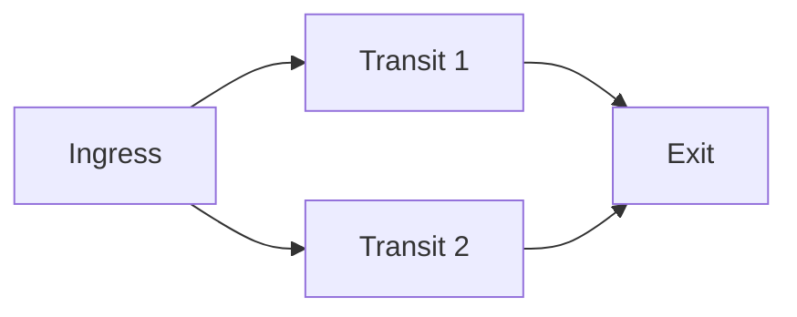
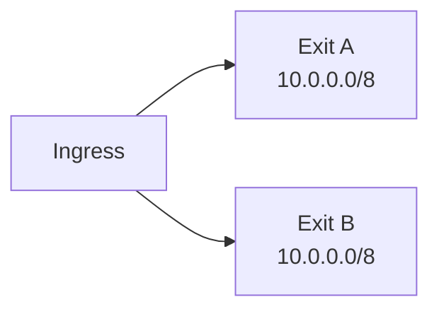
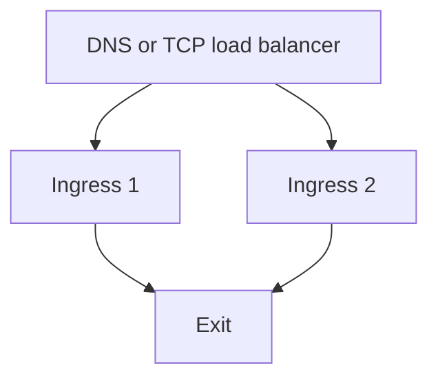
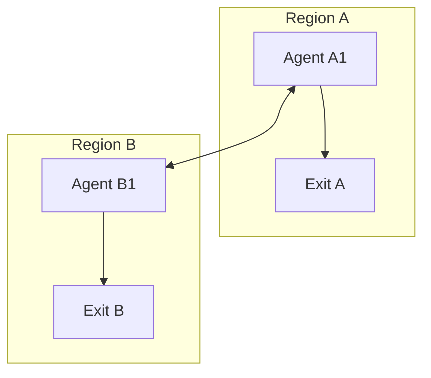

<div style={{textAlign: 'center', marginBottom: '2rem'}}>
  
</div>

# High Availability

A mesh survives the loss of an agent when another path or another exit can carry the same traffic. This page describes how route selection reacts to failures, then shows the common redundancy patterns.

## How failover works

Every exit agent advertises its routes periodically (`routing.advertise_interval`, default 2 minutes), and the advertisement floods through the mesh. Each agent keeps, for every route and every exit that advertises it, one path: the one with the lowest metric. Metric is the exit's configured route metric plus one per hop. When two paths have the same metric, the agent keeps the path whose advertisement arrived first.

When an agent looks up a destination, it picks the most specific matching route, then the route with the lowest metric. Between routes with the same prefix and metric from different exits, no particular exit is guaranteed; give them different metrics to control which one is used.

When something fails:

| Failure | What the agents do | Recovery time |
|---------|--------------------|---------------|
| A directly connected peer goes away | Routes learned through that peer are removed as soon as the connection is detected as closed. A path through another peer is learned from the exit's next advertisement. | Disconnect detection (up to `connections.timeout`, default 90 seconds) plus up to one `advertise_interval` |
| An agent further away goes away | Its neighbors remove their routes, but agents beyond them are not told. They keep the stale route until it expires. | Up to `routing.route_ttl` (default 5 minutes) |
| An exit goes away while another exit advertises the same CIDR | Once the stale route is removed or expires, the other exit's route is used. | As above, depending on whether the exit was a direct peer |
| The failed agent comes back | It reconnects with exponential backoff and advertises again. A path with a lower metric replaces the current one when its advertisement arrives. | Reconnect delay plus up to one `advertise_interval` |

Streams that were running over the failed path are closed. Clients reconnect and their new connections use the new path.

:::warning
While an ingress agent has no route for a destination, it does not reject the connection. It connects to the destination directly from its own host. During a failover gap, SOCKS clients may therefore reach destinations from the ingress host's network instead of the exit's network, or fail if the ingress host cannot reach them.
:::

### Faster failover

Shorter intervals make agents notice failures and learn new paths sooner, at the cost of more control traffic:

```yaml
routing:
  advertise_interval: 30s
  route_ttl: 90s

connections:
  idle_threshold: 30s
  timeout: 45s
```

Keep `route_ttl` at least two or three times `advertise_interval`, so one lost advertisement does not expire a working route. After a failure, trigger an advertisement on the exit to spread the alternative path immediately:

```bash
curl -X POST http://localhost:8080/routes/advertise
```

See [Routing configuration](/configuration/routing) for the routing keys and [Connections](/configuration/connections) for the keepalive keys.

## Pattern 1: Redundant transit

The ingress agent peers with two transit agents, and both peer with the exit.



```yaml
# Ingress agent
peers:
  - id: "a1b2c3d4e5f60718293a4b5c6d7e8f90"
    transport: quic
    address: "transit1.example.com:4433"
  - id: "0f1e2d3c4b5a69788796a5b4c3d2e1f0"
    transport: quic
    address: "transit2.example.com:4433"

socks5:
  enabled: true
  address: "127.0.0.1:1080"
```

Both paths have the same hop count, so the ingress uses whichever path delivered the exit's advertisement first. If that transit fails, the ingress drops the route and learns the path through the other transit on the next advertisement. There is no preferred transit; to prefer one, make the other path longer.

## Pattern 2: Multiple exits

Two exits advertise the same CIDR.



Set a higher metric on the backup exit's route so the primary is always preferred while it is reachable:

```yaml
# Exit A (primary)
exit:
  enabled: true
  routes:
    - "10.0.0.0/8"
```

```yaml
# Exit B (backup)
exit:
  enabled: true
  routes:
    - cidr: "10.0.0.0/8"
      metric: 10
```

Without a metric difference, the ingress picks the exit with fewer hops, and between exits at the same distance it may use either. Routes added at runtime with [`muti-metroo route add --metric`](/cli/route) accept a metric too.

Both exits must be able to reach the destination network, and exit-side DNS (`exit.dns`, used for domain routes) should resolve the same names on both.

## Pattern 3: Redundant ingress

Clients reach two ingress agents through DNS or a TCP load balancer. SOCKS connections are independent, so any ingress can serve any connection.



DNS round robin:

```text
proxy.example.com.  300  IN  A  192.0.2.10
proxy.example.com.  300  IN  A  192.0.2.11
```

HAProxy in TCP mode:

```text
frontend socks
    bind *:1080
    mode tcp
    default_backend socks_ingress

backend socks_ingress
    mode tcp
    balance roundrobin
    server ingress1 192.0.2.10:1080 check
    server ingress2 192.0.2.11:1080 check
```

If SOCKS authentication is enabled, configure the same users on every ingress.

## Pattern 4: Redundant sites

Combine the patterns across regions: each region has its own ingress, transit, and exits, and the regions peer with each other. Routes from the other region carry more hops, so local exits win while they are reachable and the other region's exits take over when they are not.



## Monitoring

Check each agent's health endpoint and alert when peer or route counts drop below what the topology needs:

```bash
curl -s http://localhost:8080/healthz | jq '{peers: .peer_count, routes: .route_count}'
```

```json
{
  "peers": 2,
  "routes": 3
}
```

```bash
#!/bin/sh
# Alert when an agent's API does not answer.
for agent in ingress1.example.com:8080 ingress2.example.com:8080; do
  curl -sf "http://$agent/health" > /dev/null || echo "ALERT: $agent is not healthy"
done
```

The HTTP API listens on the address in `http.address`; expose it only on networks your monitoring system uses. [`muti-metroo mesh-test`](/cli/mesh-test) checks reachability of every agent in the mesh from one place.

## Test failover

Fail one component at a time and observe the routes on the ingress:

```bash
muti-metroo route status
muti-metroo route trace 10.0.0.5
```

Then stop a transit or exit agent, wait for the recovery time from the table above, and run the same commands again. Confirm that a SOCKS request still succeeds:

```bash
curl -x socks5h://localhost:1080 http://10.0.0.5/
```

## See Also

- [Routing concepts](/concepts/routing) for route advertisement and selection
- [Routing configuration](/configuration/routing) for `advertise_interval` and `route_ttl`
- [Exit](/configuration/exit) for route metrics on exit agents
- [Health API](/api/health) for the `/health` and `/healthz` responses
- [Deployment Scenarios](/deployment/scenarios) for complete example topologies
