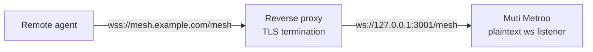

import Tabs from '@theme/Tabs';
import TabItem from '@theme/TabItem';

<div style={{textAlign: 'center', marginBottom: '2rem'}}>
  
</div>

# Reverse Proxy Deployment

An agent can accept peers through an existing web server. The web server terminates TLS on port 443 with its own certificate and forwards WebSocket upgrade requests on one path to a plaintext WebSocket listener on loopback. Use this to share a public HTTPS endpoint with other sites, to reuse certificates managed by the web server, or to run an agent on a host where you can only change web server settings.



Only the WebSocket transport supports this mode. QUIC and HTTP/2 listeners always terminate TLS themselves.

## Agent configuration

Add a WebSocket listener with `plaintext: true`, bound to loopback:

```yaml
agent:
  display_name: "Backend Agent"
  data_dir: "/var/lib/muti-metroo"

listeners:
  - transport: ws
    address: "127.0.0.1:3001"
    path: "/mesh"
    plaintext: true

http:
  enabled: true
  address: "127.0.0.1:8080"
```

- `plaintext` is accepted only for `transport: ws`. The listener needs no certificate.
- `path` must match the path the proxy forwards to. The listener answers WebSocket upgrades on exactly that path and returns `404 Not Found` for any other path.
- Bind to `127.0.0.1` so the unencrypted port is reachable only from the proxy on the same host.

To open the listener on a running agent instead of editing the config, use [`muti-metroo listener add`](/cli/listener):

```bash
muti-metroo listener add ws 127.0.0.1:3001 --path /mesh --plaintext
```

Check the backend before configuring the proxy:

```bash
muti-metroo probe --transport ws --plaintext 127.0.0.1:3001 --path /mesh
```

```text
Probing ws (plaintext)://127.0.0.1:3001...

[OK] Connection successful!
  Transport:    ws
  Address:      127.0.0.1:3001
  Remote ID:    ed65187723415eea4de1ea73e3a540fc
  RTT:          0ms
```

## Proxy configuration

The proxy must:

- Offer TLS 1.3. Agents refuse to connect with older TLS versions.
- Pass the `Upgrade` and `Connection` headers so the WebSocket handshake reaches the agent.
- Keep idle connections open longer than the agent's keepalive interval, `connections.idle_threshold` (5 minutes by default). If the proxy closes idle connections sooner, raise its timeout or lower `idle_threshold`.

<Tabs>
  <TabItem value="nginx" label="Nginx" default>

```nginx
# /etc/nginx/sites-available/muti-metroo
server {
    listen 443 ssl;
    server_name mesh.example.com;

    ssl_certificate     /etc/letsencrypt/live/mesh.example.com/fullchain.pem;
    ssl_certificate_key /etc/letsencrypt/live/mesh.example.com/privkey.pem;
    ssl_protocols TLSv1.2 TLSv1.3;

    location = /mesh {
        proxy_pass http://127.0.0.1:3001;
        proxy_http_version 1.1;
        proxy_set_header Upgrade $http_upgrade;
        proxy_set_header Connection "upgrade";
        proxy_set_header Host $host;
        proxy_read_timeout 1h;
        proxy_send_timeout 1h;
        proxy_buffering off;
    }
}
```

```bash
sudo ln -s /etc/nginx/sites-available/muti-metroo /etc/nginx/sites-enabled/
sudo nginx -t
sudo systemctl reload nginx
```

  </TabItem>
  <TabItem value="caddy" label="Caddy">

Caddy obtains the certificate automatically and proxies WebSocket upgrades without extra settings.

```text
# /etc/caddy/Caddyfile
mesh.example.com {
    reverse_proxy /mesh 127.0.0.1:3001
}
```

```bash
sudo systemctl reload caddy
```

  </TabItem>
  <TabItem value="apache" label="Apache">

Requires `mod_ssl`, `mod_rewrite`, `mod_proxy`, `mod_proxy_http`, and `mod_proxy_wstunnel`:

```bash
sudo a2enmod ssl rewrite proxy proxy_http proxy_wstunnel
```

```apacheconf
# /etc/apache2/sites-available/muti-metroo.conf
<VirtualHost *:443>
    ServerName mesh.example.com

    SSLEngine on
    SSLCertificateFile /etc/letsencrypt/live/mesh.example.com/fullchain.pem
    SSLCertificateKeyFile /etc/letsencrypt/live/mesh.example.com/privkey.pem
    SSLProtocol -all +TLSv1.2 +TLSv1.3

    ProxyPreserveHost On
    ProxyTimeout 3600

    RewriteEngine On
    RewriteCond %{HTTP:Upgrade} websocket [NC]
    RewriteCond %{HTTP:Connection} upgrade [NC]
    RewriteRule ^/mesh$ ws://127.0.0.1:3001/mesh [P,L]
</VirtualHost>
```

```bash
sudo a2ensite muti-metroo
sudo apache2ctl configtest
sudo systemctl reload apache2
```

  </TabItem>
</Tabs>

## Apache without server access (.htaccess)

On shared hosting, or any host where you cannot edit the Apache configuration, an `.htaccess` file can forward one URL path to the agent. Apache must already serve the domain over HTTPS, `mod_proxy`, `mod_proxy_http`, and `mod_proxy_wstunnel` must be enabled, and the host must allow `RewriteRule` with the `[P]` flag in `.htaccess` files. Ask the hosting provider if unsure.

Run the agent under [PM2](/deployment/pm2#running-without-root) or another user-level supervisor, with its files outside the document root. Configure the listener on loopback with a trailing slash in the path:

```yaml
listeners:
  - transport: ws
    address: "127.0.0.1:3001"
    path: "/mesh/"
    plaintext: true
```

Create the directory `public_html/mesh/` and place this `.htaccess` file in it. Put nothing else in that directory.

```apacheconf
RewriteEngine On
RewriteCond %{HTTP:Upgrade} websocket [NC]
RewriteCond %{HTTP:Connection} upgrade [NC]
RewriteRule ^(.*)$ ws://127.0.0.1:3001/mesh/$1 [P,L]
```

Only WebSocket upgrade requests are forwarded. Other requests to `/mesh/` are handled by Apache as usual.

Some shared hosts block `127.0.0.1` and assign each account its own loopback address. If binding to `127.0.0.1` fails, use the address the provider documents in both the listener and the `RewriteRule`.

Remote agents dial `wss://example.com/mesh/`, with the trailing slash.

## Connect peers through the proxy

Remote agents use the WebSocket transport and the full `wss://` URL, including the path:

```yaml
peers:
  - id: "f49038d87149b6c548ef6d8192a59106"
    transport: ws
    address: "wss://mesh.example.com/mesh"
```

The peer `id` is the backend agent's ID (the `agent_id` file in its data directory, or the `Agent ID` line printed at startup). The connection is rejected if a different agent answers.

Test the public endpoint from the remote side:

```bash
muti-metroo probe --transport ws mesh.example.com:443 --path /mesh
```

By default, agents do not verify the proxy's certificate; the peer ID check and [end-to-end encryption](/security/e2e-encryption) protect the connection. To verify it, set `tls.strict: true` and `tls.ca` on the peer to the CA certificate that issued the proxy's certificate. Verification uses only that CA, not the system trust store, and the CA certificate must use an ECDSA key. See [TLS Certificates](/configuration/tls-certificates).

To let other agents discover this agent's public address automatically, add an `advertise` block to the listener with the public host, port, and path. See [Configuration - Listeners](/configuration/listeners).

## What changes behind a proxy

- **mTLS is not available.** TLS ends at the proxy, so the agent never sees a client certificate.
- **Peer identity and end-to-end encryption are unchanged.** The handshake still checks agent IDs, and stream payloads are encrypted between ingress and exit. The proxy cannot read them.
- **The proxy sees connection metadata**: client IP addresses, connection times, and traffic volume.

## Troubleshooting

**`probe` reports `expected handshake response status code 101 but got 404`.** The path does not match. The path in the proxy rule, the listener `path`, and the path in the peer's `wss://` URL must be identical, including any trailing slash.

**`probe` reports `got 502` or `got 503`.** The proxy cannot reach the agent. Check that the agent is running and listening:

```bash
ss -tlnp | grep 3001
curl -i http://127.0.0.1:3001/mesh
```

A plain HTTP request to the listener path returns `426 Upgrade Required`, which confirms the listener is up.

**Peers connect and drop after a fixed time.** The proxy's idle or read timeout is shorter than the agent's keepalive interval. Raise the proxy timeout, or lower `connections.idle_threshold` on the agents.

**TLS errors on the remote side.** The proxy does not offer TLS 1.3, or strict verification is enabled with a CA that did not issue the proxy's certificate.

## See Also

- [Configuration - Listeners](/configuration/listeners): `plaintext`, `path`, and `advertise` reference
- [Transports](/concepts/transports): QUIC, HTTP/2, and WebSocket compared
- [probe CLI](/cli/probe): testing listeners and endpoints
- [PM2 Process Manager](/deployment/pm2): running the agent without root
- [Connectivity Troubleshooting](/troubleshooting/connectivity): diagnosing peers that do not connect
