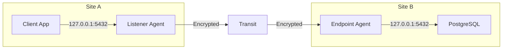

<div style={{textAlign: 'center', marginBottom: '2rem'}}>
  
</div>

# Port Forwarding

Port forwarding publishes a TCP service by name. An agent that can reach the service registers it under a routing key (an **endpoint**). Any other agent opens a local TCP port for the same key (a **listener**). Clients connect to the listener's port as if the service were local, and the mesh carries each connection to the endpoint agent, which connects to the service.



Compared with the [SOCKS proxy](/features/socks5-proxy), port forwarding needs no proxy support in the client and no exit route for the service's IP. The client only knows a local port, and the service only needs to be reachable from the endpoint agent.

Endpoint keys are advertised through the mesh like routes, so every agent learns which keys exist and where they are served. This works as a small service registry: services register a key, and clients anywhere open a listener for it.

## Publish a service

On the agent that can reach the service, add an endpoint:

```yaml
forward:
  endpoints:
    - key: "postgres-main"
      target: "127.0.0.1:5432"
```

On the agent where clients run, add a listener for the same key:

```yaml
forward:
  listeners:
    - key: "postgres-main"
      address: "127.0.0.1:5432"
      max_connections: 50
```

Clients on the listener host now connect to `127.0.0.1:5432`:

```bash
psql -h 127.0.0.1 -p 5432 -U app appdb
```

All keys are described in [Forward Configuration](/configuration/forward).

## Add forwards at runtime

Endpoints and listeners can also be added to a running agent, locally or on a remote agent with `--target`:

```bash
# Endpoint side: register the key
muti-metroo forward endpoint add postgres-main 127.0.0.1:5432 --target 1f743225d524f8acd3b42b55639702f0

# Listener side: open the local port
muti-metroo forward add postgres-main 127.0.0.1:5432 --max-connections 50

# Inspect and remove
muti-metroo forward endpoint list --target 1f743225d524f8acd3b42b55639702f0
muti-metroo forward list
muti-metroo forward remove postgres-main
```

Runtime forwards are restored after a restart when `agent.data_dir` is writable. See [forward CLI](/cli/forward) for every flag and [Runtime Configuration](/features/runtime-configuration) for the authorization these commands need.

## Publish services from a workstation with Mutiauk

[Mutiauk](/mutiauk#expose-publishing-local-services) can register endpoints on an agent without running an agent itself. Its `expose` feature connects to the agent's SOCKS5 listener and registers routing keys for local folders or TCP services. The agent advertises them like other endpoints, labelled `expose:<key>`, and listeners anywhere in the mesh can use them.

Exposed keys exist only while Mutiauk stays connected. They are withdrawn from the mesh when the connection closes and are not restored after an agent restart. A key that is already used by a configured or runtime endpoint, or by another Mutiauk session, is refused.

Registration is available on every agent with a SOCKS5 listener and is gated only by SOCKS5 authentication. See [Access Control](/security/access-control#socks-listener) before exposing a SOCKS5 listener to other hosts.

## Common patterns

### Internal API at every branch

One endpoint at headquarters, a listener on each branch agent:

```yaml
# Headquarters agent
forward:
  endpoints:
    - key: "internal-api"
      target: "127.0.0.1:3000"
```

```yaml
# Branch office agents
forward:
  listeners:
    - key: "internal-api"
      address: "127.0.0.1:3000"
```

Applications at each branch call `http://127.0.0.1:3000/` as if the API ran locally.

### Several services on one host

```yaml
forward:
  endpoints:
    - key: "docs-http"
      target: "127.0.0.1:80"
    - key: "api-gateway"
      target: "127.0.0.1:8080"
    - key: "grafana"
      target: "127.0.0.1:3001"
```

### Redundant endpoints

Two agents can register the same key. Each listener sends new connections to the endpoint whose route has the lowest metric; with equal metrics, the endpoint advertised by the agent with the lower agent ID is used, and path length is not compared. If that endpoint disappears, its route expires or is withdrawn and the other one is used.

```yaml
# Primary and secondary hosts use the same entry
forward:
  endpoints:
    - key: "api-v1"
      target: "127.0.0.1:3000"
```

## Security

- Connections are end-to-end encrypted between the listener agent and the endpoint agent. See [End-to-End Encryption](/security/e2e-encryption).
- An endpoint only connects to its own configured target. Clients cannot choose a different host or port through a key.
- Anyone who can reach a listener's port can use the service. Bind listeners to `127.0.0.1` unless other hosts need them, and set `max_connections` to limit load.
- Endpoint keys and their targets are visible to every agent in the mesh through route advertisements.

## Check forwarding

List the key-to-listener pairings the agent knows about:

```bash
curl -s http://localhost:8080/api/dashboard | jq '.forward_routes'
```

Each entry shows the key, the listener agent and address, the endpoint agent and target, and the hop count.

## Limitations

- TCP only. UDP services cannot be forwarded.
- Listener ports are fixed by the operator; there is no automatic port assignment.

## See Also

- [Forward Configuration](/configuration/forward): endpoint and listener keys
- [forward CLI](/cli/forward): runtime endpoints and listeners
- [Forward Management API](/api/forward-management): HTTP endpoints behind the CLI
- [Mutiauk](/mutiauk#expose-publishing-local-services): publish workstation services with `expose`
- [Routing](/concepts/routing): how forward keys propagate
