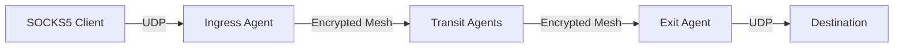

<div style={{textAlign: 'center', marginBottom: '2rem'}}>
  
</div>

# UDP Relay

The SOCKS5 listener also relays UDP datagrams, with the standard UDP ASSOCIATE command or with UDP STREAM, a Muti Metroo extension that carries the datagrams on the SOCKS connection itself. [Mutiauk](/mutiauk) uses UDP STREAM. With UDP ASSOCIATE, a client opens a TCP control connection to the ingress agent, receives a local UDP relay address, and sends datagrams there. The ingress agent forwards each datagram through the mesh to the exit agent that has a route for its destination, and the exit sends it from its own host.



Datagram payloads are end-to-end encrypted between the ingress and the exit. Destination addresses are visible to transit agents; see [End-to-End Encryption](/security/e2e-encryption#what-transit-agents-can-see).

## Requirements

- The ingress agent has the SOCKS5 listener enabled. See [SOCKS5 Configuration](/configuration/socks5).
- The exit agent has UDP relay enabled. It is enabled by default; see [UDP Configuration](/configuration/udp).
- The ingress agent has a CIDR route for each destination. Unlike TCP, UDP is never sent directly from the ingress host when no route matches.
- The route's exit is a different agent from the ingress. An agent does not relay UDP to its own exit routes, so a single agent that is both ingress and exit does not relay UDP.
- The ingress agent has at least one CIDR route. UDP ASSOCIATE and UDP STREAM are refused when it has none; datagrams to a destination without a route are dropped.

The relay socket listens on the same IP address as the SOCKS5 TCP listener, so a listener on `127.0.0.1:1080` only accepts datagrams from the local host. The relay is IPv4.

## Use the relay

The client must implement SOCKS5 UDP ASSOCIATE. Many SOCKS tools, including proxychains and curl, only proxy TCP. [Mutiauk](/mutiauk) relays UDP for all programs on a host through its TUN interface.

The following Python script, which needs only the standard library, sends a DNS query for `example.com` to `1.1.1.1` through the relay:

```python
import socket
import struct

PROXY = ("127.0.0.1", 1080)
DNS_SERVER = "1.1.1.1"
NAME = "example.com"

# 1. Open the TCP control connection and negotiate "no authentication".
ctrl = socket.create_connection(PROXY)
ctrl.sendall(b"\x05\x01\x00")
assert ctrl.recv(2) == b"\x05\x00"

# 2. UDP ASSOCIATE. The reply contains the relay address to send datagrams to.
ctrl.sendall(b"\x05\x03\x00\x01" + b"\x00" * 6)
reply = ctrl.recv(10)
assert reply[1] == 0, f"UDP ASSOCIATE failed, reply code {reply[1]}"
relay = (socket.inet_ntoa(reply[4:8]), struct.unpack(">H", reply[8:10])[0])

# 3. Build a DNS query for the A record of NAME.
qname = b"".join(bytes([len(p)]) + p.encode() for p in NAME.split(".")) + b"\x00"
query = struct.pack(">HHHHHH", 0x1234, 0x0100, 1, 0, 0, 0) + qname + struct.pack(">HH", 1, 1)

# 4. Wrap it in a SOCKS5 UDP header (RSV, FRAG=0, ATYP=IPv4, address, port).
header = b"\x00\x00\x00\x01" + socket.inet_aton(DNS_SERVER) + struct.pack(">H", 53)
udp = socket.socket(socket.AF_INET, socket.SOCK_DGRAM)
udp.settimeout(5)
udp.sendto(header + query, relay)

# 5. The reply carries the same 10-byte header before the DNS response.
data, _ = udp.recvfrom(4096)
answer = data[10:]
print(f"{len(answer)}-byte DNS response, answer count {struct.unpack('>H', answer[6:8])[0]}")

# The association lives as long as the TCP control connection.
ctrl.close()
```

```text
61-byte DNS response, answer count 2
```

## UDP over the SOCKS connection

UDP STREAM (SOCKS5 command `0x08`) is UDP ASSOCIATE without the separate relay socket. After the success reply, each datagram travels on the SOCKS connection in both directions as a 2-byte big-endian length followed by the same SOCKS5 UDP header and payload that UDP ASSOCIATE uses. Compared with UDP ASSOCIATE:

- It works over the [WebSocket listener](/configuration/socks5#websocket-listener), and with TLS the datagrams are encrypted between the client and the ingress agent. The UDP ASSOCIATE relay socket is plain UDP, and only reachable where the client can send UDP to the ingress host.
- No UDP port on the ingress host needs to be reachable from the client.
- Datagrams share the connection's TCP ordering, so a lost packet on that connection delays the datagrams behind it.

An agent that does not support it, or has UDP relay disabled, replies with "command not supported" (reply code 7). Mutiauk then falls back to UDP ASSOCIATE. The limits below apply to both commands, with the connection taking the place of the control connection.

## Limits

| Limit | Default | Notes |
| ----- | ------- | ----- |
| Datagram payload size | 1472 bytes | Set by `udp.max_datagram_size` on the exit. Larger datagrams are dropped. |
| SOCKS5 fragmentation | Not supported | Datagrams with a non-zero `FRAG` field are dropped. |
| Concurrent associations per exit | 1000 | `udp.max_associations` |
| Idle timeout | 5m | `udp.idle_timeout`; any datagram resets it |
| Association lifetime | TCP control connection | Closing the control connection ends the association |

## Troubleshooting

### UDP ASSOCIATE fails with reply code 1

The ingress agent has no CIDR routes at all. Check `muti-metroo route status` on the ingress agent, and that the exit agents are connected and advertise routes.

### Datagrams get no reply

- Run `muti-metroo route trace <destination-ip>` on the ingress agent and confirm a route exists, and that its exit is another agent.
- Confirm the exit agent has `udp.enabled: true` and has not reached `udp.max_associations`.
- Keep the payload at or below `udp.max_datagram_size`.
- Check that the application does not set the SOCKS5 `FRAG` field.

### Association closes unexpectedly

The association ends when the TCP control connection closes or after `udp.idle_timeout` without traffic. Keep the control connection open for the lifetime of the session.

## See Also

- [UDP Configuration](/configuration/udp): relay limits and timeouts
- [SOCKS Proxy](/features/socks5-proxy): the TCP side of the SOCKS listener
- [Exit Routing](/features/exit-routing): make destinations reachable through an exit
- [ICMP Relay](/features/icmp-relay): ping through the mesh
- [Mutiauk](/mutiauk): relay UDP for every program on a host
