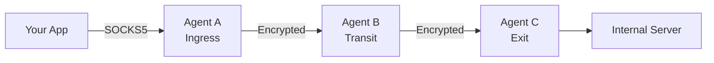
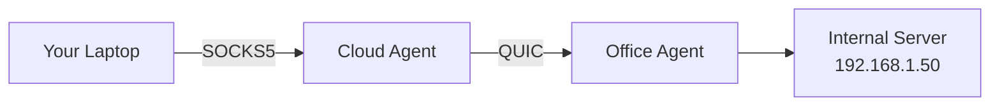
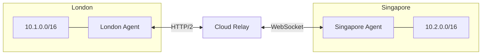
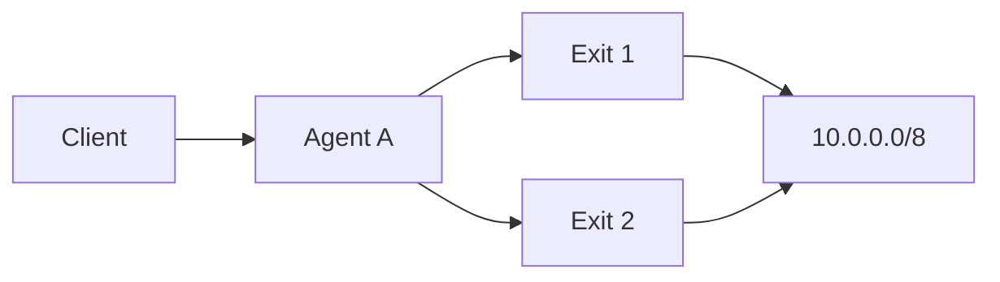

  

# Introduction

Muti Metroo is a mesh networking agent that runs entirely in userspace. Agents connect to each other over QUIC, HTTP/2, or WebSocket, propagate routes across the mesh, and carry traffic end-to-end encrypted from the agent where it enters the mesh to the agent where it leaves. It needs no root privileges, kernel modules, or TUN driver, and ships as a single binary.

  <a className="button button--primary button--lg" href="/getting-started/overview">Get Started</a>

## Features

| Feature                  | Description                                                                                                       |
| ------------------------ | ----------------------------------------------------------------------------------------------------------------- |
| **Multi-hop routing**    | Agents form chains, trees, or a full mesh. Routes propagate between agents automatically.                         |
| **End-to-end encryption** | X25519 key exchange and ChaCha20-Poly1305. Transit agents relay payloads without holding the session keys. See [limits](/security/e2e-encryption#limits-of-the-protection). |
| **Multiple transports**  | QUIC over UDP, HTTP/2 and WebSocket over TCP. WebSocket can also run behind a TLS-terminating reverse proxy and dial through an HTTP proxy. |
| **SOCKS proxy ingress**  | SOCKS4, SOCKS4a, and SOCKS5 with optional username/password authentication. SOCKS5 UDP ASSOCIATE is supported.     |
| **Exit routing**         | CIDR routes (DNS resolved at the ingress) and domain routes (DNS resolved at the exit).                           |
| **Port forwarding**      | Expose a service behind one agent as a listening port on another.                                                 |
| **Management**           | Remote shell, file transfer, and ICMP ping through the mesh, authorized by a signing key.                          |
| **HTTP API**             | Health checks, topology and dashboard data, and runtime changes to routes, peers, and listeners.                  |

See the [Configuration Overview](/configuration/overview) for every option.

## Companion tools

Two separate binaries extend the agent. Both are optional.

- [Mutiauk](/mutiauk) creates a TUN interface and forwards IP traffic into the agent's SOCKS5 proxy, so applications need no proxy settings. It requires root or Administrator.
- [Muti Metroo Manager](/muti-metroo-manager) is a web dashboard that connects to an agent's HTTP API to show the topology and run management actions.

The [Suite Overview](/suite-overview) explains how the three fit together.

## Use cases

### Reach internal resources

Reach servers behind NAT or a firewall through a chain of agents.

### Connect multiple sites

Link several sites through a relay. Each site's agent advertises its local networks, and every other site can reach them.

### Redundant exits

When several exit agents advertise the same network, the ingress uses the route with the lowest metric (the exit's configured metric plus one per hop). If a peer disconnects, the routes learned through it are withdrawn and the next-best route takes over. Agents reconnect to their peers with exponential backoff.

## How it works

1. You deploy agents on hosts you control and configure which agents dial which.
2. Once peers connect, each exit agent advertises its routes, and the advertisements flood through the mesh.
3. Applications connect to the SOCKS proxy on an ingress agent.
4. The ingress looks up the destination in its route table and opens an encrypted stream through the mesh to the exit that advertises it.
5. The exit agent opens the real connection to the destination.

The [Architecture](/concepts/architecture) page describes each step in detail.

## See Also

- [Getting Started](/getting-started/overview): run a demo mesh in Docker, or set up your first agent
- [Download](/download): binaries for Linux, macOS, and Windows
- [Architecture](/concepts/architecture): agent roles, routing, and encryption in depth
- [Muti Metroo vs SSH Jump Hosts](/comparisons/vs-ssh-jump): how the mesh compares to SSH-based tunneling
- [Deployment Scenarios](/deployment/scenarios): example topologies for real deployments
- [Troubleshooting](/troubleshooting/common-issues): fixes for common problems
