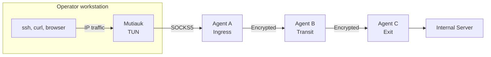
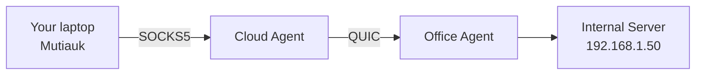
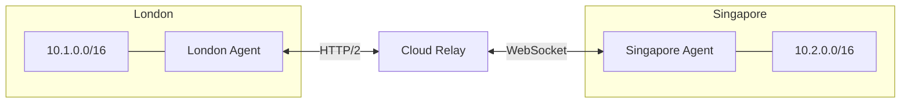
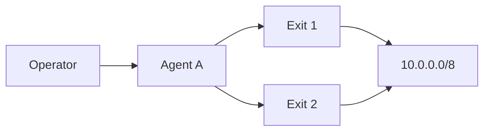

  

# Introduction

Muti Metroo is a suite of three tools for reaching networks through an encrypted multi-hop mesh:

- **Muti Metroo agents** run on the mesh nodes: relays, gateways, and hosts inside the networks you want to reach. Agents connect to each other over QUIC, HTTP/2, or WebSocket, propagate routes across the mesh, and carry traffic end-to-end encrypted from the agent where it enters the mesh to the agent where it leaves. The agent runs entirely in userspace, needs no root privileges, and ships as a single binary.
- **[Mutiauk](/mutiauk)** runs on the operator's workstation. It creates a TUN interface, receives the mesh's routes and hostnames from an agent, and forwards IP traffic into that agent's SOCKS5 listener, so ordinary tools such as `ssh`, `curl`, and browsers reach mesh networks without proxy settings.
- **[Muti Metroo Manager](/muti-metroo-manager)** is a web dashboard, usually also on the operator's workstation, that connects to an agent's HTTP API to show the topology and run management actions.

Applications that support SOCKS can also use an agent's SOCKS listener directly, without Mutiauk. That is the quickest way to test a mesh, and it works on machines where you cannot get root or Administrator rights.

  <a className="button button--primary button--lg" href="/getting-started/overview">Get Started</a>

## Features

| Feature                  | Description                                                                                                       |
| ------------------------ | ----------------------------------------------------------------------------------------------------------------- |
| **Multi-hop routing**    | Agents form chains, trees, or a full mesh. Routes propagate between agents automatically.                         |
| **End-to-end encryption** | X25519 key exchange and ChaCha20-Poly1305. Transit agents relay payloads without holding the session keys. See [limits](/security/e2e-encryption#limits-of-the-protection). |
| **Multiple transports**  | QUIC over UDP, HTTP/2 and WebSocket over TCP. WebSocket can also run behind a TLS-terminating reverse proxy or CDN. |
| **Transparent access**   | [Mutiauk](/mutiauk) carries TCP, UDP, and ICMP echo from the operator's workstation into the mesh, installs the mesh's routes, and resolves mesh hostnames. |
| **SOCKS proxy ingress**  | SOCKS4, SOCKS4a, and SOCKS5 with optional username/password authentication, over TCP or WebSocket. Mutiauk connects here, and so can SOCKS-aware applications. |
| **Exit routing**         | CIDR routes (DNS resolved at the ingress) and domain routes (DNS resolved at the exit).                           |
| **Port forwarding**      | Expose a service behind one agent as a listening port on another.                                                 |
| **Management**           | Remote shell, file transfer, and ICMP ping through the mesh, authorized by a signing key.                          |
| **Web dashboard and HTTP API** | [Muti Metroo Manager](/muti-metroo-manager) and the agent HTTP API show the topology and make runtime changes to routes, peers, and listeners. |

See the [Configuration Overview](/configuration/overview) for every agent option, and the [Suite Overview](/suite-overview) for how the three tools fit together.

## Use cases

### Reach internal resources

Reach servers behind NAT or a firewall through a chain of agents.

### Connect multiple sites

Link several sites through a relay. Each site's agent advertises its local networks, and every other site can reach them.

### Redundant exits

When several exit agents advertise the same network, the ingress uses the route with the lowest metric (the metric configured on the exit). If a peer disconnects, the routes learned through it are withdrawn and the next-best route takes over. Agents reconnect to their peers with exponential backoff.

## How it works

1. You deploy agents on hosts you control and configure which agents dial which.
2. Once peers connect, each exit agent advertises its routes, and the advertisements flood through the mesh.
3. On your workstation, Mutiauk connects to the SOCKS5 listener of an ingress agent, receives the mesh's routes, and installs them on its TUN interface. (SOCKS-aware applications can connect to the listener directly instead.)
4. Traffic for a mesh destination enters the TUN interface, and Mutiauk forwards each connection to the ingress agent over SOCKS5.
5. The ingress looks up the destination in its route table and opens an encrypted stream through the mesh to the exit that advertises it.
6. The exit agent opens the real connection to the destination.

The [Architecture](/concepts/architecture) page describes each step in detail.

## See Also

- [Getting Started](/getting-started/overview): run a demo mesh in Docker, or set up your first agent
- [Suite Overview](/suite-overview): which tool runs where, and how they connect
- [Download](/download): binaries for Linux, macOS, and Windows
- [Architecture](/concepts/architecture): agent roles, routing, and encryption in depth
- [Deployment Scenarios](/deployment/scenarios): example topologies for real deployments
- [Troubleshooting](/troubleshooting/common-issues): fixes for common problems
