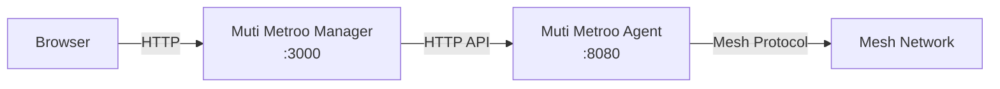

export const DownloadButton = ({ href, children, primary }) => (
  <a
    href={href}
    className={`download-button ${primary ? "download-button--primary" : ""}`}
    target="_blank"
    rel="noopener noreferrer"
  >
    {children}
  </a>
);

export const DownloadButtonGroup = ({ children }) => (
  <div className="download-button-group">{children}</div>
);

import Tabs from "@theme/Tabs";
import TabItem from "@theme/TabItem";

# Muti Metroo Manager - Web Dashboard

<div style={{ textAlign: "center", marginBottom: "2rem" }}>
  
</div>

**Muti Metroo Manager** is a lightweight web dashboard for managing and monitoring Muti Metroo mesh networks. It runs as a standalone binary that reverse-proxies a Muti Metroo agent's HTTP API and serves an embedded React SPA.


:::info Requires Running Agent
Muti Metroo Manager connects to a Muti Metroo agent's HTTP API. The agent must have `http.enabled: true` with `http.dashboard: true` and `http.remote_api: true` in its configuration.
:::

## Features

| Feature                       | Description                                                                                                                                                                                                                                                                                                                                            |
| ----------------------------- | ------------------------------------------------------------------------------------------------------------------------------------------------------------------------------------------------------------------------------------------------------------------------------------------------------------------------------------------------------ |
| **Topology Map**              | Interactive pan/zoom/drag visualization of all agents and their connections, with live RTT heat, traffic-flow indicators, boot pulses, and an event ticker                                                                                                                                                                                             |
| **Dashboard**                 | Real-time stats for peers, streams, routes, and system info                                                                                                                                                                                                                                                                                            |
| **Route Management**          | View and manage CIDR and domain exit routes; trace how the agent would route a destination                                                                                                                                                                                                                                                             |
| **DNS**                       | Manage mesh-host hostname registrations (`*.mesh -> IPv4/IPv6`) and TLD suffixes via `/hosts/manage` and `/hosts/suffixes/manage`                                                                                                                                                                                                                      |
| **Port Forwards**             | Listener and endpoint subtabs with unpaired-route visibility                                                                                                                                                                                                                                                                                           |
| **Management Commands**       | Browser-based terminal for running commands, with Reconnect on exit or error                                                                                                                                                                                                                                                                           |
| **File Transfer**             | Upload and download files to/from remote agents                                                                                                                                                                                                                                                                                                        |
| **Mesh Test**                 | Test connectivity between all agents in the mesh                                                                                                                                                                                                                                                                                                       |
| **Ping**                      | Browser-driven ICMP echo from any agent to any IP, with sequence and RTT tracking                                                                                                                                                                                                                                                                      |
| **Sleep/Wake**                | Trigger mesh-wide sleep and wake commands                                                                                                                                                                                                                                                                                                              |
| **Downloads**                 | In-UI download links for Muti Metroo and Mutiauk release binaries (plus the user, operator, and slides PDFs) with SHA256 checksums; ships as an optional bundle alongside the binary, with a per-section "Create config" button that opens the matching wizard. The Muti Metroo Manager binary itself is downloaded out-of-band -- it does not appear in this tab. |
| **Settings Overrides**        | Operator-configurable agent API URL and default SOCKS5 address are persisted in Muti Metroo Manager's local SQLite store; the bearer token used for proxied API calls lives in browser session storage and is not persisted across tab close.                                                                                                                    |
| **Per-Agent Notes & Icons**   | Persistent operator notes and a platform/role icon per agent                                                                                                                                                                                                                                                                                           |
| **Search & Deep-Linking**     | `/` to search by name, hostname, ID, or notes; `#/agents/<id>` URL hash links                                                                                                                                                                                                                                                                          |
| **Health and Metrics**        | `/healthz` for liveness/readiness; optional Prometheus `/metrics` listener pinned to a private interface                                                                                                                                                                                                                                               |
| **Structured Logs and Audit** | Text or JSON output, per-request IDs propagated via `X-Request-ID`, dedicated audit lines on every state change                                                                                                                                                                                                                                        |
| **Layered Config**            | Defaults + TOML + env + flags with `muti-metroo-manager config show` reporting the source of every value                                                                                                                                                                                                                                                         |
| **Single-Instance Lock**      | An exclusive lock on the data directory prevents two managers from racing on the same SQLite store                                                                                                                                                                                                                                                     |

## Download

<Tabs groupId="manager-os">
  <TabItem value="macos" label="macOS" default>

### Apple Silicon (M-series)

<DownloadButtonGroup>
  <DownloadButton href="__METROO_MANAGER_RELEASE__/muti-metroo-manager-darwin-arm64" primary>
    Download for macOS (Apple Silicon)
  </DownloadButton>
</DownloadButtonGroup>

### Intel

<DownloadButtonGroup>
  <DownloadButton href="__METROO_MANAGER_RELEASE__/muti-metroo-manager-darwin-amd64">
    Download for macOS (Intel)
  </DownloadButton>
</DownloadButtonGroup>

  </TabItem>
  <TabItem value="linux" label="Linux">

### x86_64 (amd64)

<DownloadButtonGroup>
  <DownloadButton href="__METROO_MANAGER_RELEASE__/muti-metroo-manager-linux-amd64" primary>
    Download for Linux (amd64)
  </DownloadButton>
</DownloadButtonGroup>

### ARM64 (aarch64)

<DownloadButtonGroup>
  <DownloadButton href="__METROO_MANAGER_RELEASE__/muti-metroo-manager-linux-arm64">
    Download for Linux (arm64)
  </DownloadButton>
</DownloadButtonGroup>

  </TabItem>
  <TabItem value="windows" label="Windows">

### x86_64 (amd64)

<DownloadButtonGroup>
  <DownloadButton
    href="__METROO_MANAGER_RELEASE__/muti-metroo-manager-windows-amd64.exe"
    primary
  >
    Download for Windows (amd64)
  </DownloadButton>
</DownloadButtonGroup>

### ARM64

<DownloadButtonGroup>
  <DownloadButton href="__METROO_MANAGER_RELEASE__/muti-metroo-manager-windows-arm64.exe">
    Download for Windows (arm64)
  </DownloadButton>
</DownloadButtonGroup>

  </TabItem>
</Tabs>

## Quick Start

```bash
# Download (example: macOS Apple Silicon)
curl -L -o muti-metroo-manager __METROO_MANAGER_RELEASE__/muti-metroo-manager-darwin-arm64
chmod +x muti-metroo-manager

# Launch (connects to local agent on port 8080)
./muti-metroo-manager

# Open in browser
open http://localhost:3000
```

The dashboard opens automatically at `http://localhost:3000` and connects to the Muti Metroo agent's HTTP API at `http://127.0.0.1:8080`.

## Command Surface

```bash
muti-metroo-manager [run] [flags]            start the HTTP server (default subcommand)
muti-metroo-manager check [flags]            validate config, probe agent, exit 0 / 1
muti-metroo-manager config show [flags]      print the resolved config with provenance
muti-metroo-manager config init [path]       emit a commented TOML config template
muti-metroo-manager version | -V             print version and build info
```

`check` is the subcommand systemd's `ExecStartPre=` should run -- it validates the config, the data dir, and upstream agent reachability without binding the listener, so a broken deploy fails before the long-lived process starts. `config show` reports each value alongside its source (default / TOML / env / flag), which makes "why is the agent URL wrong?" investigations a single command. `config init <path>` writes a commented TOML template that already lists every supported key with sane defaults.

## CLI Flags

The same flag set applies to `run` (default), `check`, and `config show`.

| Flag                | Default                      | Description                                                                          |
| ------------------- | ---------------------------- | ------------------------------------------------------------------------------------ |
| `-config`           |                              | TOML config file. Values overridden by env vars, env vars overridden by flags.       |
| `-addr`             | `:3000`                      | Address for the web UI to listen on.                                                 |
| `-agent`            | `http://127.0.0.1:8080`      | Muti Metroo agent HTTP API URL.                                                            |
| `-agent-token`      |                              | Bearer token. Visible via `/proc`; prefer `-agent-token-file` or the env var.        |
| `-agent-token-file` |                              | File containing the bearer token (single line, trimmed).                             |
| `-data-dir`         | OS-specific (see below)      | Directory for `muti-metroo-manager.db` and the instance lock.                                  |
| `-downloads-bundle` | auto-detect alongside binary | Path to `muti-metroo-downloads-bundle.zip`. An explicit path that does not exist is fatal. |
| `-no-downloads`     |                              | Disable the Downloads tab regardless of bundle presence.                             |
| `-log-format`       | `text`                       | Log encoding: `text` (operator-readable) or `json` (SIEM).                           |
| `-log-level`        | `info`                       | Minimum severity: `debug`, `info`, `warn`, `error`.                                  |
| `-metrics-addr`     |                              | `host:port` for the `/metrics` listener; empty disables. Pin to a private interface. |
| `-no-sounds`        |                              | Force the UI sound effects off regardless of per-user setting.                       |
| `-version`, `-V`    |                              | Print version and exit.                                                              |

**Data directory defaults:** `~/Library/Application Support/Muti-Metroo-Manager` on macOS, `/var/lib/muti-metroo-manager` for root on Linux, `$XDG_CONFIG_HOME/muti-metroo-manager` for unprivileged Linux users, `%LOCALAPPDATA%\muti-metroo-manager` on Windows. The directory holds the SQLite settings database and an exclusive lock file so only one instance runs per data dir.

**Token environment variables:** the canonical name is `METROO_MANAGER_AGENT_TOKEN`. The legacy `MUTI_METROO_TOKEN` is still accepted but logs a deprecation warning at startup. `-agent-token` and `-agent-token-file` both override the env var; the file form is preferred for systemd / Kubernetes secrets.

### Examples

```bash
# Connect to a remote agent
./muti-metroo-manager -agent http://192.168.1.10:8080

# Use a custom port for the web UI
./muti-metroo-manager -addr :9090

# Token from a file (preferred over -agent-token in production)
./muti-metroo-manager -agent http://192.168.1.10:8080 -agent-token-file /etc/muti-metroo-manager/token

# TOML-driven deploy (validate first, then start)
./muti-metroo-manager check -config /etc/muti-metroo-manager/config.toml \
  && ./muti-metroo-manager run -config /etc/muti-metroo-manager/config.toml

# Render a starter config
./muti-metroo-manager config init /etc/muti-metroo-manager/config.toml

# Bind to all interfaces (accessible from other machines)
./muti-metroo-manager -addr 0.0.0.0:3000 -agent http://10.0.0.5:8080

# Mount a downloads bundle from a custom path
./muti-metroo-manager -downloads-bundle /opt/muti-metroo/muti-metroo-downloads-bundle.zip

# Explicitly disable the Downloads tab
./muti-metroo-manager -no-downloads

# Production: structured logs to stderr, /metrics on a private IP
./muti-metroo-manager -config /etc/muti-metroo-manager/config.toml \
  -log-format json -log-level info \
  -metrics-addr 127.0.0.1:9101
```

## Agent Configuration Requirements

The Muti Metroo agent must have its HTTP API enabled with dashboard and remote API endpoints active:

```yaml
http:
  enabled: true
  address: ":8080"
  dashboard: true # Required for /api/* endpoints
  remote_api: true # Required for /agents/* endpoints
```

If the agent uses bearer token authentication, pass the token via `-agent-token-file`, `-agent-token`, or the `METROO_MANAGER_AGENT_TOKEN` environment variable:

```yaml
# Agent config with token protection
http:
  enabled: true
  address: ":8080"
  token_hash: "$2a$10$..." # Generated with: muti-metroo hash
  dashboard: true
  remote_api: true
```

```bash
# Token from a file (preferred for systemd / Kubernetes secrets)
./muti-metroo-manager -agent http://192.168.1.10:8080 \
  -agent-token-file /etc/muti-metroo-manager/token

# Or as a flag (visible via /proc; avoid in production)
./muti-metroo-manager -agent http://192.168.1.10:8080 -agent-token yourtoken

# Or via environment variable
export METROO_MANAGER_AGENT_TOKEN=yourtoken
./muti-metroo-manager -agent http://192.168.1.10:8080
```

## Architecture

Muti Metroo Manager acts as a reverse proxy between the browser and a Muti Metroo agent:



- **Browser**: Loads the React SPA from the Manager and makes API calls
- **Manager**: Serves the embedded SPA and proxies API requests to the agent
- **Agent**: Handles mesh operations and returns status/management data

The Manager binary embeds the entire React frontend at build time, so no separate web server or Node.js runtime is needed.

## Operations

### Health and Metrics

Two HTTP endpoints are designed for monitoring infrastructure:

- **`/healthz`** is on the main listener and reports the manager's own state plus a cached one-shot probe of the upstream agent (config validity, agent reachability, and -- if a token is set -- a successful `/healthz` round-trip to the agent). Suitable for Kubernetes liveness/readiness, ALB health checks, or systemd `WatchdogSec=`.
- **`/metrics`** is on a separate optional listener (`-metrics-addr 127.0.0.1:9101`). Output is Prometheus text format with `metroo_manager_requests_total{method,path,status}`, `metroo_manager_request_duration_seconds_bucket{...}`, and `metroo_manager_agent_reachable`. The listener is disabled by default; pin it to a private interface when you turn it on.

The `muti-metroo-manager check` subcommand runs the same upstream probe synchronously and exits 0 / 1, so a systemd unit can chain `ExecStartPre=/usr/local/bin/muti-metroo-manager check -config /etc/muti-metroo-manager/config.toml` before starting the real service.

### Structured Logs and Audit Trail

`-log-format text` (default) is operator-readable; `-log-format json` writes one JSON object per line for ingestion into a SIEM or log aggregator. Every request gets a request ID -- propagated via `X-Request-ID` if the client supplies one, otherwise generated -- which appears in every log line emitted while handling that request. State-changing operations (route mutations, sleep/wake, settings overrides, file uploads/downloads) emit a dedicated `audit=true` log line so a 24/7 compliance audit can reconstruct who did what.

### Single-Instance Lock

On startup, Muti Metroo Manager takes an exclusive lock on a file inside `-data-dir` (`flock` on Linux/macOS, `LockFileEx` on Windows). A second instance pointed at the same data directory exits with a clear "another instance is running" error rather than silently corrupting the SQLite store or fighting over the listener. Each instance therefore needs its own `-data-dir`.

### Layered Configuration

Resolution order, lowest precedence first: built-in defaults, `-config <path>` TOML file, environment variables, command-line flags. `muti-metroo-manager config show` prints the resolved value of every setting alongside a `source=` annotation, so an operator chasing "why is the agent URL different from what I set in TOML?" can see in one command whether an env var or flag is overriding it. `muti-metroo-manager config init <path>` writes a complete commented template ready to edit.

## Feature Details

### Topology Map

The topology map provides a visual overview of all agents in the mesh and their peer connections. Agents are displayed with their display names, agent IDs, and connection status. Click on any agent to view detailed information.

The map is interactive: mouse wheel zooms toward the cursor (0.25x-5x), click-and-drag on empty space pans, and click-and-drag on a station repositions it. Pan, zoom, and station positions persist in `localStorage`, so a refresh keeps the operator view. A **Reset view** button appears when any of those are non-default. A fullscreen toggle is available on the map. The agent search collapses to an icon by default; the `/` hotkey expands it and focuses the input regardless of which tab is active.

Live cues annotate the topology in real time:

- **RTT heat** on each connection -- color shifts from cool (low latency) to warm (degraded) so a struggling link is visible at a glance.
- **Traffic flow** animation on connections currently carrying streams, indicating direction.
- **Boot sweep** on agents that just came online; a brief pulse marks the addition.
- **Live ticker** on the bottom edge cycling through recent topology events.
- **Ambient sound effects** for boot / disconnect / mesh-test results. The user toggle and the `-no-sounds` server flag both override the per-user setting; in noise-sensitive deployments (clinical, broadcast, control rooms) start the manager with `-no-sounds` and the sound system stays muted regardless of operator setting.
- **Faint matrix-rain backdrop** behind the metro map. Decorative only; performance-bounded.


### Dashboard

The dashboard shows real-time statistics for the connected agent, including:

- Connected peers and their connection status
- Active streams and buffer usage
- Route table (CIDR and domain routes)
- System information (OS, architecture, uptime)
- Forward route endpoints and listeners

### Route Management

The Routes tab has two sub-tabs:

- **Active routes** lists every CIDR and domain route advertised across the mesh, with origin agent, hop count, metric, and an editable comment per route. Comments on dynamic routes are mutated through `POST /routes/manage` (`set_comment` action) and propagate over the wire so they appear on every agent that learns the route. The edit dialog also sets an optional **Source IP** and egress **Interface** for the route, each a combobox seeded from the origin agent's interface addresses (`GET /api/interfaces`); a mismatch advisory appears when the chosen source IP lives on a different NIC than the pinned interface. Both bindings are local to the origin agent and survive restart.
- **Test routing** posts a destination to the agent's `POST /route/trace` and renders three labelled views — **SOCKS** (the IP the SOCKS5 dial would pick), **TUN** (Layer 3 view, with default routes hidden client-side), and **Domain** (the domain-route table match) — plus a collapsible all-candidates dump showing every CIDR considered and why each loser lost.


### DNS

The DNS tab is split into two sub-tabs: **Hosts** and **TLDs**. Hosts is a CRUD UI for the agent's mesh-host registry: hostname &rarr; IPv4 / IPv6 mappings backed by `POST /hosts/manage`. Add a name, give it one or both IP families and an optional comment, and the entry is journalled to `agent.data_dir` so it survives restarts. Names ending in any of the configured TLD suffixes (default `.mesh`) are accepted; the active suffix set is reported back by the agent so the form can validate client-side. Bare TLDs without a label are also valid hostnames. Config-seeded entries appear in the list but cannot be removed - edit the agent's `mesh_hosts:` block and restart instead. The TLDs sub-tab manages the suffix set itself at runtime via `POST /hosts/suffixes/manage`. See [Hosts Configuration](/configuration/hosts) for the YAML schema and [Hosts Management API](/api/hosts-management) for the underlying endpoints.


### Port Forwards

The port forwards view pairs backend routes with topology data so a listener advertised without a matching endpoint (or vice versa) is still visible. In the agent panel, listeners and endpoints live in separate subtabs with a ready-to-paste `curl` example keyed off the first parseable listener port (including an SNI `--resolve` variant for TLS backends).


### Connectivity

The agent panel's **Connectivity** tab has two sub-tabs. **Peers** shows the agent's direct peer connections. **Listeners** manages the transport sockets the agent binds to accept inbound peers without editing its config: pick a transport (`quic` / `h2` / `ws`), enter a bind address (e.g. `:4433`), optionally set the HTTP path (ws/h2), a `plaintext` flag (ws, for reverse-proxy deployments), and an advertise `host:port` to publish a public dial target to the mesh. Config listeners are read-only; runtime-added ones carry a dynamic badge and can be removed (with a confirmation dialog). When the connected agent has no management signing key the sub-tab is read-only.

### Management Commands

Run commands on any reachable agent in the mesh from a browser-based terminal. Both streaming mode (for simple commands) and interactive mode (for programs like `htop` or `vim`) are supported. When a session ends or errors out, a **Reconnect** button reopens it. The target agent must have management commands enabled in its configuration.


### File Transfer

Upload and download files to/from any reachable agent through the browser. Supports individual files and directory transfers. The target agent must have file transfer enabled in its configuration.

The file browser toolbar is laid out as four equal-weight text buttons -- **Up**, **Path**, **Upload**, **Refresh** -- with drag-and-drop carrying the primary upload affordance via a drop overlay. The breadcrumb's leading `/` segment is clickable: it opens an editable path input so an operator can jump directly to a known directory. The input expands a leading `~` to the agent user's home directory on Unix targets and shows a platform-appropriate placeholder (`~ or /path` on Unix, `~ or C:\path` on Windows).


### Mesh Test

Run connectivity tests between all agents in the mesh. The test sends probe messages between every pair of agents and reports success/failure with latency measurements. The footer shows a persistent "Mesh: N/M reachable" summary that turns red when any remote agent is unreachable.


### Ping

Send ICMP echo requests from any agent to any reachable IP address. Configure the request count and interval, watch sequence numbers and round-trip times update in real time, and see the source/destination address pair the exit agent used. The target agent must have `icmp.enabled: true`; the browser tunnels each session over a dedicated WebSocket subprotocol.

### Sleep/Wake Control

Trigger mesh-wide sleep or wake commands from the dashboard. When sleep is activated, agents enter a low-power polling mode and disconnect from peers. Wake restores normal operation.

### Downloads

A top-level **Downloads** tab serves the current Muti Metroo and Mutiauk release binaries -- including the Windows DLL -- plus the user, operator, and slides PDFs, grouped by architecture (`amd64` / `arm64`) with SHA256 checksums and capture timestamps. Useful when handing an operator a single URL instead of separate release-page links. The Muti Metroo Manager binary itself is not delivered through this tab; operators download it directly from the release page or from the URL where the dashboard is hosted.

The contents come from `muti-metroo-downloads-bundle.zip`, an optional file that the Muti Metroo Manager release ships alongside the binary. When the binary boots without `-downloads-bundle`, it looks for the zip in the same directory as the executable; if found, the Downloads tab appears and the startup log notes `downloads bundle: ... (N files)`. When no bundle is present (or `-downloads-bundle off` is passed), the tab is hidden and the rest of the dashboard works normally. Files are served with friendly download names (`muti-metroo`, `muti-metroo.exe`, `muti-metroo.dll`, `mutiauk`, `user-manual.pdf`) via `Content-Disposition`.

Each binary section in the Downloads tab has a **Create config** button next to its arch tabs - clicking it opens the matching wizard (Agent or Entry) without leaving the tab. The button is shown only on sections that ship a wizard.

### Config Wizards

The dashboard includes two interactive configuration wizards reachable from the agent kebab menu and from the Downloads tab:

- **Muti Metroo Agent wizard** (`ConfigWizard`) - guides through identity, listeners, peers, ingress/exit, HTTP API, and management keys. The peers step pre-populates from `advertised_listeners` reported on the topology poll, so an operator can pick a known agent rather than typing its address by hand. Each listener step also offers an "Advertise this listener" toggle that emits the corresponding `listeners[].advertise: {address, path, transport}` block in the YAML preview.
- **Mutiauk wizard** (`EntryConfigWizard`) - five steps: **TUN interface**, **SOCKS5 proxy**, **Routes**, **Admin interface**, and **Review & download**. Autoroutes is a single toggle on the Routes step (on by default); there is no separate DNS-resolver step or autoroutes bearer-token field.

Both wizards perform inline **management-keypair validation**: when an operator pastes a private key, the wizard derives the public half and surfaces a mismatch on the same step. X25519 keys are 32-byte (64-hex) scalars; Ed25519 signing keys are 64-byte (128-hex) seed-with-public-tail values per Go's `crypto/ed25519` layout. Mismatches stop the wizard before download, so an operator never ends up with a config that fails to decrypt topology or sign privileged ops at runtime.

The review step shows a YAML preview plus verified copy-paste deployment commands for the most common scenarios:

- Foreground run (no privileges)
- System service install (`systemd` on Linux, `launchd` on macOS, Windows Service on Windows)
- Linux non-root install via cron (`muti-metroo service install --user ...`)
- Windows DLL flow (`muti-metroo.exe service install --user --dll ... -c ...` or `rundll32.exe muti-metroo.dll,Run ...`)

The commands are generated from the wizard's own paths and pinned to whatever the [`muti-metroo service`](/cli/service) command documents - see that page for per-platform details.

### Settings

A persistent settings dialog lets operators override the agent API URL, the default SOCKS5 address surfaced in setup hints, and the bearer token used for proxied API calls. Values are stored in Muti Metroo Manager's local SQLite store (`muti-metroo-manager.db`) and survive restarts; the [Mutiauk](/mutiauk) wizard seeds itself from the same values.

### Per-Agent Notes and Icons

Each agent has a free-text notes field (saved on blur or Ctrl/Cmd-S) and a selectable icon (Linux/macOS/Windows, router, switch, database, valve, pump, ...). Both persist in the Muti Metroo Manager SQLite store and survive restarts. Notes are surfaced on station hover; icons render on the map.


### Keyboard Shortcuts and Deep Links

| Shortcut | Action                                                        |
| -------- | ------------------------------------------------------------- |
| `/`      | Focus the search box (switches to the topology tab if needed) |
| `Esc`    | Close the active agent panel                                  |

URL hashes like `#/agents/<id>` (short or full ID) open an agent panel directly. Destructive actions -- removing routes, peers, or port forwards -- go through a confirmation dialog.

## Related

- [Suite Overview](/suite-overview) - How Muti Metroo, Mutiauk, and Muti Metroo Manager work together
- [Muti Metroo Download](/download) - Main Muti Metroo agent binary
- [HTTP API Reference](/api/overview) - API endpoints that Muti Metroo Manager uses
- [Mutiauk TUN Interface](/mutiauk) - Transparent traffic routing companion tool
- [Dashboard API](/api/dashboard) - JSON endpoints for topology and stats
