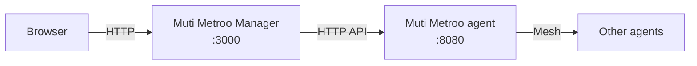

export const DownloadButton = ({ href, children, primary }) => (
  <a
    href={href}
    className={`download-button ${primary ? "download-button--primary" : ""}`}
    target="_blank"
    rel="noopener noreferrer"
  >
    {children}
  </a>
);

export const DownloadButtonGroup = ({ children }) => (
  <div className="download-button-group">{children}</div>
);

import Tabs from "@theme/Tabs";
import TabItem from "@theme/TabItem";

# Muti Metroo Manager

<div style={{ textAlign: "center", marginBottom: "2rem" }}>
  
</div>

Muti Metroo Manager is a single binary that serves a browser UI for a Muti Metroo mesh. It connects to the HTTP API of one agent and reverse-proxies the browser's requests to it, so everything that agent can see or reach through the mesh is available in the UI: the topology, routes, port forwards, mesh hostnames, remote shells, file transfer, ping, and sleep mode.




The React frontend is embedded in the binary; no web server or Node.js runtime is needed. The Manager keeps its own small SQLite database for UI state (settings, agent notes and icons, network names, station positions).

:::warning The Manager has no login of its own
Anyone who can open the Manager's address can use it with the permissions of the token it was started with. The default listen address `:3000` binds every interface. Bind it to `127.0.0.1:3000`, or put it behind a reverse proxy that authenticates users, on any host reachable from a network you do not trust.
:::

## Download

<Tabs groupId="manager-os">
  <TabItem value="macos" label="macOS" default>

### Apple Silicon (M-series)

<DownloadButtonGroup>
  <DownloadButton href="https://github.com/postalsys/Muti-Metroo-Manager/releases/latest/download/metroo-manager-darwin-arm64" primary>
    Download for macOS (Apple Silicon)
  </DownloadButton>
</DownloadButtonGroup>

### Intel

<DownloadButtonGroup>
  <DownloadButton href="https://github.com/postalsys/Muti-Metroo-Manager/releases/latest/download/metroo-manager-darwin-amd64">
    Download for macOS (Intel)
  </DownloadButton>
</DownloadButtonGroup>

  </TabItem>
  <TabItem value="linux" label="Linux">

### x86_64 (amd64)

<DownloadButtonGroup>
  <DownloadButton href="https://github.com/postalsys/Muti-Metroo-Manager/releases/latest/download/metroo-manager-linux-amd64" primary>
    Download for Linux (amd64)
  </DownloadButton>
</DownloadButtonGroup>

### ARM64 (aarch64)

<DownloadButtonGroup>
  <DownloadButton href="https://github.com/postalsys/Muti-Metroo-Manager/releases/latest/download/metroo-manager-linux-arm64">
    Download for Linux (arm64)
  </DownloadButton>
</DownloadButtonGroup>

  </TabItem>
  <TabItem value="windows" label="Windows">

### x86_64 (amd64)

<DownloadButtonGroup>
  <DownloadButton
    href="https://github.com/postalsys/Muti-Metroo-Manager/releases/latest/download/metroo-manager-windows-amd64.exe"
    primary
  >
    Download for Windows (amd64)
  </DownloadButton>
</DownloadButtonGroup>

### ARM64

<DownloadButtonGroup>
  <DownloadButton href="https://github.com/postalsys/Muti-Metroo-Manager/releases/latest/download/metroo-manager-windows-arm64.exe">
    Download for Windows (arm64)
  </DownloadButton>
</DownloadButtonGroup>

  </TabItem>
</Tabs>

Each release also carries `checksums.txt` with SHA-256 sums of the binaries.

## Quick start

1. Make sure the agent has its HTTP API enabled (see [Agent requirements](#agent-requirements)).
2. Download and start the Manager on a host that can reach the agent's API:

   ```bash
   curl -L -o muti-metroo-manager https://github.com/postalsys/Muti-Metroo-Manager/releases/latest/download/metroo-manager-linux-amd64
   chmod +x muti-metroo-manager
   ./muti-metroo-manager -addr 127.0.0.1:3000 -agent http://127.0.0.1:8080
   ```

3. Open `http://localhost:3000` in a browser.

The startup log lists the listen address, the agent URL and whether the agent answered, whether a token is set, and the data directory. If the agent is unreachable, the Manager still starts and keeps probing it.

## Agent requirements

The Manager uses the agent's dashboard (`/api/*`) and remote (`/agents/*`) endpoints. Both are on by default when the HTTP API is enabled:

```yaml
http:
  enabled: true
  address: "127.0.0.1:8080"
  dashboard: true
  remote_api: true
```

Some operations need more than read access. They are greyed out or read-only in the UI when not available:

| Operation                                                           | Requirement                                                                                     |
| ------------------------------------------------------------------- | ----------------------------------------------------------------------------------------------- |
| Add, edit, or remove routes, peers, listeners, forwards, hostnames; rename agents | The connected agent holds `management.signing_private_key` ([Management keys](/configuration/management)) |
| Shell                                                               | The same signing key, plus shell enabled on the target agent ([Shell](/configuration/shell))    |
| Files                                                               | The same signing key, plus file transfer enabled on the target agent ([File Transfer](/configuration/file-transfer)) |
| Ping                                                                | ICMP enabled on the target agent ([ICMP](/configuration/icmp)); not offered for Windows agents  |
| Suspend and resume the mesh                                         | Sleep mode enabled on the connected agent ([Sleep](/configuration/sleep))                       |

### Bearer token

If the agent has `http.token_hash` set, the Manager needs the matching token. Give it to the Manager in one of these ways (highest precedence first):

1. `-agent-token-file <path>`: a file with the token on one line. Preferred for systemd and Kubernetes secrets.
2. `-agent-token <token>`: visible to other users through the process list; avoid in production.
3. The `METROO_MANAGER_AGENT_TOKEN` environment variable. The older `MUTI_METROO_TOKEN` still works but logs a deprecation warning.

```bash
./muti-metroo-manager -agent http://192.168.1.10:8080 \
  -agent-token-file /etc/muti-metroo-manager/token
```

When the Manager has no token and the agent answers `401`, the browser shows an **Authentication required** dialog instead. The token entered there is kept in the browser's session storage, or in local storage for 8 hours when **Remember on this device for 8 hours** is ticked. **Sign out** in the actions menu clears it. A token configured on the Manager always replaces a token sent by the browser.

## Using the web UI

### Layout

- **Header**: the connected agent's name and short ID, the main tabs, the actions menu (the vertical dots button), and a light/dark theme toggle. The theme follows the operating system preference until you change it and is remembered per browser.
- **Main tabs**: **Topology**, **Routes**, **Port Forwarding**, **DNS**, and **Downloads** (only when a [downloads bundle](#downloads) is present).
- **Actions menu**: **Mesh connectivity test**, **Generate Muti Metroo agent config...**, **Generate Mutiauk config...**, **Settings...**, **Suspend mesh** or **Resume mesh** (when sleep mode is enabled), and **Sign out** (when the browser holds a token).
- **Footer**: the most recent topology event, the [mesh health](#mesh-test) summary, and the Manager version.


Destructive actions (removing routes, peers, listeners, forwards, hostnames, suffixes, and files) ask for confirmation.

### Topology

The **Topology** tab draws every agent as a station and every peer connection as a line between them. Click a station to open its [agent panel](#agent-panel). Hover a station or a connection for details, including the agent's notes.

- **Zoom** with the mouse wheel, toward the cursor, from 0.25x to 5x. A short scroll still scrolls the page; zooming starts after a longer wheel movement.
- **Pan** by dragging empty space.
- **Move a station** by dragging it. Stations snap to a grid; hold Alt (Option on macOS) to place freely. Station positions are saved in the Manager database, so everyone using the same Manager sees the same layout. Pan and zoom are saved per browser.
- **Reset view** (top left) appears when the view or any station has been moved, and restores the default layout.
- **Fullscreen** toggle (bottom left).

Connection lines are colored by round-trip time (under 50 ms, under 200 ms, slower) and marked when a peer is unresponsive. Lines that carry traffic are animated from the dialing side to the listening side. Joins, departures, link changes, route changes, and mesh test changes appear as events in the footer. Optional sound effects accompany peer joins and departures, mesh test results, and station clicks; turn them off in [Settings](#settings) or for all users with `-no-sounds`. Animations and sounds are off when the operating system requests reduced motion.

#### Search

Press `/` (from any tab) or click the search icon to search agents. Search matches the agent ID, IP addresses, role, display name, hostname, exit routes, domain routes, forward keys, SOCKS5 address, and notes, and shows which field matched. Use the arrow keys and Enter to open a result.


#### Networks

Agents can be grouped into named boxes on the map. Set the **Networks** field on an agent's Info tab to a comma-separated list (for example `prod,edge-1`); agents that share a network are drawn inside the same box. Click a box label to rename it. Boxes can be nested and moved.


### Agent panel

Clicking a station opens a side panel for that agent. The pencil button next to the name renames the agent (sets its display name). The panel has these tabs:

#### Info

Agent ID, hostname, platform, version, uptime, PID, IP addresses, which capabilities are enabled (shell, file transfer, signing key), SOCKS5 address, and advertised routes. Below them are three fields stored in the Manager database:

- **Notes**: free text, saved when the field loses focus, on Ctrl+S or Cmd+S, and when the panel closes.
- **Map icon**: an icon drawn on the station. **Choose...** opens a picker with operating system, network, compute, storage, industrial, and other device icons.
- **Networks**: see [Networks](#networks).


#### Routes

The agent's dynamic CIDR routes. Add a route (CIDR, metric, comment), remove one, or **Edit** one to change its comment, **Source IP**, and **Interface**. The Source IP and Interface fields suggest the agent's own addresses and network interfaces; a warning appears when the chosen source address belongs to a different interface. The meaning of each field is described in [route](/cli/route).


#### Forwards

Two sub-tabs: **Listeners (ingress)** for forward listeners (key and address) and **Endpoints (exit)** for forward endpoints (key and target). A usage hint shows a ready-to-run `curl` command for the first listener, including a `--resolve` variant for TLS services that need the right SNI name. Endpoints registered by [Mutiauk expose](/mutiauk#expose-publishing-local-services) are marked as such.


#### Connectivity

Two sub-tabs:

- **Peers**: the agent's peer connections. Add a peer by address, transport, path (for `h2` and `ws`), and optional keepalive; the Manager probes the address first and offers **Add anyway** if the probe fails. Runtime peers can be removed.
- **Listeners**: transport listeners. Add one by transport (`quic`, `h2`, `ws`), bind address (for example `:4433`), path (`h2` and `ws`), optional advertise address (`host:port`, published to the mesh as a dial target), and the `plaintext` option for `ws` behind a TLS-terminating proxy. Listeners from the agent's config file are marked `static` and cannot be removed here.

Without a management signing key on the connected agent, both sub-tabs are read-only. See [peer](/cli/peer) and [listener](/cli/listener) for what each field does.


#### Shell

An interactive terminal on the agent. Pick a shell from the list to start a session. **Reconnect** appears when the session ends or fails, and **Copy CLI** copies the equivalent `muti-metroo shell` command.


#### Files

A file browser limited to the agent's allowed paths. The toolbar has **Up**, **Path**, **Upload**, and **Refresh**. **Path** (or clicking the leading `/` in the breadcrumb on Unix agents) opens a field to type a path; `~` expands to the agent user's home directory. Drop files or folders onto the list to upload them; folders upload recursively. Each entry has a menu to view (text, hex, image, or PDF), download (folders as `.tar.gz`), change permissions, or delete.


#### Ping

Sends ICMP echo requests from the agent to an IP address: 10, 25, or 50 requests, or continuously, one per second. The table shows each sequence number, round-trip time, and result, with minimum, average, and maximum RTT, loss, and the source and destination addresses the exit used.


### Routes

The **Routes** tab has two sub-tabs:

- **Active routes**: every CIDR and domain route known in the mesh, with exit node, protocol, hop count, and comment. Click a row to open the exit agent's Routes tab.
- **Test routing**: enter a destination to see how the connected agent would route it. The result shows the **SOCKS** match, the **TUN** match as Mutiauk would see it (default routes ignored), and the **SOCKS domain pattern** match, plus a collapsible list of all candidate routes and why each lost. This uses the same lookup as [route trace](/api/route-trace).


### Port Forwarding

The **Port Forwarding** tab lists every forward key in the mesh with its listeners and endpoints. A key that has a listener but no endpoint (or the reverse) is still listed, marked `- no endpoint -` or `- no listener -`.


### DNS

The **DNS** tab manages the connected agent's [mesh hostnames](/features/mesh-hostnames):

- **Hosts**: add a hostname with IPv4, IPv6, or both, and an optional comment, or remove one. The name must end in one of the configured suffixes. Entries from the agent's config file cannot be removed here; the agent rejects the request.
- **TLDs**: add or remove hostname suffixes. A suffix that still has hosts cannot be removed.


### Downloads

The **Downloads** tab offers Muti Metroo and Mutiauk binaries and the documentation PDFs to whoever uses the Manager. Sections are **Documentation**, **Muti Metroo Agent**, **Muti Metroo Agent DLL**, and **Mutiauk**; each binary section has an `amd64`/`arm64` switch and lists the files per operating system with their SHA-256 checksums. Files download under plain names (`muti-metroo`, `muti-metroo.exe`, `muti-metroo.dll`, `mutiauk`, `user-manual.pdf`). The Agent and Mutiauk sections have a **Create config** button that opens the matching [config wizard](#config-wizards).

The tab is shown only when the Manager finds a downloads bundle, `muti-metroo-downloads-bundle.zip`. It looks for the file next to its own binary, or at the path given with `-downloads-bundle`. The bundle is not a release asset; build it from the Manager source tree with `bundle-downloads.sh`, which collects the binaries and manuals from local Muti Metroo and Mutiauk release builds. `-no-downloads` hides the tab even when a bundle is present.


### Mesh test

The Manager runs a mesh connectivity test every 60 seconds and shows the result in the footer as `Mesh: N/M reachable`, highlighted when an agent is unreachable. The browser tab title and icon also indicate degraded agents. **Mesh connectivity test** in the actions menu runs a test immediately and opens a results dialog with one row per agent and its latency. See [mesh-test](/cli/mesh-test) for how the test works.


### Sleep and wake

When sleep mode is enabled on the connected agent, the actions menu shows **Suspend mesh** (with a confirmation) or **Resume mesh**. While the mesh sleeps, a banner says so. Suspending disconnects peers and tunnels across the mesh; see [Sleep Mode](/features/sleep-mode).


### Config wizards

Two wizards build configuration files in the browser:

- **Generate Muti Metroo agent config**: steps for basics, network listeners, TLS, peers, SOCKS5, exit routes, monitoring, shell, file transfer, and management keys, then **Review & download**. The network step can advertise a listener as a public dial target. The peers step lists dial targets that other agents advertise, each with a **Use** button. The management key step checks that pasted private and public keys belong together. The review step shows the YAML and commands to run the agent in the foreground, install it as a service, install it as a user without root on Linux, or run the Windows DLL.
- **Generate Mutiauk config**: **TUN interface**, **SOCKS5 proxy**, **Routes** (autoroutes on by default), **Admin interface**, and **Review & download**. The review step shows the YAML and the commands to start Mutiauk or install it as a service on Linux, macOS, and Windows.

Open them from the actions menu, from **Create config** on the Downloads tab, or from the empty topology view.


### Settings

**Settings...** in the actions menu opens a dialog with:

- **Muti Metroo agent API address**: the agent API address the UI shows, for example in copied commands.
- **SOCKS5 proxy address**: the SOCKS5 address the UI shows for the connected agent.
- **Sound effects**: on or off. Greyed out when the Manager runs with `-no-sounds`.

Both addresses are labels only; the agent the Manager talks to is set with `-agent`. Settings are stored in the Manager database and apply to every browser.


### Keyboard shortcuts and links

| Key            | Action                                                                  |
| -------------- | ----------------------------------------------------------------------- |
| `/`            | Open agent search (switches to the Topology tab)                        |
| `Esc`          | Close the agent panel, cancel a rename, or clear the search             |
| Ctrl+S, Cmd+S  | Save the agent's notes                                                  |
| Alt (dragging) | Move a station without snapping to the grid                             |

Each tab has its own URL path (`/topology`, `/routes/active`, `/routes/test`, `/forwards`, `/dns/hosts`, `/dns/tlds`, `/downloads`). Add `?agent=<id>` with a short or full agent ID to open that agent's panel, for example `http://localhost:3000/topology?agent=abc12345`. Older `#/agents/<id>` links are redirected.

## Command-line reference

```text
muti-metroo-manager [run] [flags]          start the HTTP server (default)
muti-metroo-manager check [flags]          validate config + probe agent, exit 0/1
muti-metroo-manager config show [flags]    print resolved config with provenance
muti-metroo-manager config init [path]     emit a commented TOML config template
muti-metroo-manager version | -V           print version and build info
```

- `check` validates the configuration, the data directory, and the downloads bundle path, and calls the agent's `/healthz`. It exits 0 when all pass and 1 otherwise, without starting the listener.
- `config show` prints every setting with its source (`default`, `file`, `env`, `flag`, or `token-file`).
- `config init` writes a commented TOML file with every key; `-force` overwrites an existing file.

### Flags

These flags apply to `run`, `check`, and `config show`. Flags use a single dash.

| Flag                | Default                  | Description                                                                                         |
| ------------------- | ------------------------ | --------------------------------------------------------------------------------------------------- |
| `-config`           |                          | TOML config file                                                                                    |
| `-addr`             | `:3000`                  | Listen address for the UI. The default binds every interface.                                      |
| `-agent`            | `http://127.0.0.1:8080`  | Agent HTTP API URL (`scheme://host:port[/prefix]`)                                                  |
| `-agent-token`      |                          | Bearer token for the agent                                                                          |
| `-agent-token-file` |                          | File containing the bearer token                                                                    |
| `-data-dir`         | see [Data directory](#data-directory) | Directory for the database and the instance lock                                       |
| `-downloads-bundle` | next to the binary       | Path to `muti-metroo-downloads-bundle.zip`                                                          |
| `-no-downloads`     | `false`                  | Hide the Downloads tab                                                                              |
| `-log-level`        | `info`                   | `debug`, `info`, `warn`, or `error`                                                                 |
| `-log-format`       | `text`                   | `text` or `json`                                                                                    |
| `-metrics-addr`     |                          | Listen address for the [metrics](#metrics) endpoint; empty disables it                              |
| `-no-sounds`        | `false`                  | Turn UI sound effects off for all users                                                             |

### Config file

Settings are resolved in this order, later ones winning: built-in defaults, the TOML file given with `-config`, environment variables, flags. Each flag has a TOML key with underscores instead of dashes:

```toml
addr = "127.0.0.1:3000"
agent = "http://127.0.0.1:8080"
agent_token_file = "/etc/muti-metroo-manager/token"
data_dir = "/var/lib/muti-metroo-manager"
downloads_bundle = ""
no_downloads = false
log_level = "info"
log_format = "json"
metrics_addr = ""
no_sounds = false
```

The token itself cannot be set in the TOML file; use `agent_token_file`.

### Environment variables

| Variable                     | Description                                     |
| ---------------------------- | ----------------------------------------------- |
| `METROO_MANAGER_AGENT_TOKEN` | Bearer token for the agent                      |
| `MUTI_METROO_TOKEN`          | Deprecated name for the same; logs a warning    |

### Data directory

The data directory holds `muti-metroo-manager.db` (the SQLite database) and `muti-metroo-manager.lock`. Back up the database with your config. Defaults:

| Platform            | Default                                              |
| ------------------- | ---------------------------------------------------- |
| macOS               | `~/Library/Application Support/Muti-Metroo-Manager`  |
| Linux, as root      | `/var/lib/muti-metroo-manager`                       |
| Linux, other users  | `$XDG_CONFIG_HOME/muti-metroo-manager` (`~/.config/muti-metroo-manager`) |
| Windows             | `%AppData%\muti-metroo-manager`                      |

Only one Manager can use a data directory at a time. A second instance pointed at the same directory exits with `another muti-metroo-manager instance is already running`. Give each instance its own `-data-dir`.

## Operations

### Health check

`GET /healthz` on the main listener returns the Manager's status and the result of its last probe of the agent. It always answers `200`; check `agent_reachable` in the body.

```bash
curl http://localhost:3000/healthz
```

```json
{"status":"ok","version":"0.2.39","agent_reachable":true,"agent_status":200,"agent_latency_ms":2,"agent_checked_ago_s":4}
```

### Metrics

With `-metrics-addr` set, a separate listener serves Prometheus text format at `/metrics`: `metroo_manager_requests_total` and `metroo_manager_request_duration_seconds` (by method, route, and status) and `metroo_manager_agent_reachable`. Bind it to a private address.

```bash
./muti-metroo-manager -addr 127.0.0.1:3000 -metrics-addr 127.0.0.1:9101
curl http://127.0.0.1:9101/metrics
```

### Logs

Logs go to standard error, as text or (with `-log-format json`) one JSON object per line. Every request is logged with method, path, status, latency, client address, and a request ID. The ID is taken from the client's `X-Request-ID` header (which is also passed on to the agent) or generated, and is returned in the response. Changes to the Manager's own state (settings, agent notes and icons, network names, station positions) also produce a log line with `audit=true`. Operations performed on the agent appear in the request log.

### Running as a service

The Manager repository has a systemd unit (`contrib/systemd/muti-metroo-manager.service`) and a launchd plist (`contrib/launchd/`). The systemd unit runs as a dedicated user, validates with `check` before each start, and reads `/etc/muti-metroo-manager/config.toml`:

```bash
sudo useradd --system --no-create-home muti-metroo-manager
sudo install -m 755 muti-metroo-manager /usr/local/bin/muti-metroo-manager
sudo install -d -m 750 -o muti-metroo-manager -g muti-metroo-manager \
  /var/lib/muti-metroo-manager /etc/muti-metroo-manager
sudo /usr/local/bin/muti-metroo-manager config init /etc/muti-metroo-manager/config.toml
sudo cp muti-metroo-manager.service /etc/systemd/system/
sudo systemctl daemon-reload
sudo systemctl enable --now muti-metroo-manager
```

Edit `config.toml` before starting, at least `addr`, `agent`, and `agent_token_file`.

## See Also

- [Suite Overview](/suite-overview): how Muti Metroo, Mutiauk, and Muti Metroo Manager fit together
- [HTTP Configuration](/configuration/http): enable the agent API and set its bearer token
- [Management Keys](/configuration/management): the signing key that unlocks changes from the UI
- [Dashboard API](/api/dashboard): the endpoints behind the topology and route views
- [Mutiauk TUN Interface](/mutiauk): the TUN tool that the Mutiauk wizard configures
