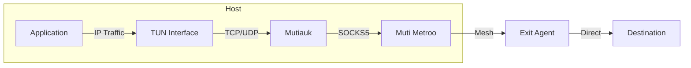

export const DownloadButton = ({ href, children, primary }) => (
  <a
    href={href}
    className={`download-button ${primary ? "download-button--primary" : ""}`}
    target="_blank"
    rel="noopener noreferrer"
  >
    {children}
  </a>
);

export const DownloadButtonGroup = ({ children }) => (
  <div className="download-button-group">{children}</div>
);

# Mutiauk - TUN Interface for Muti Metroo

<div style={{ textAlign: "center", marginBottom: "2rem" }}>
  
</div>

**Mutiauk** is a companion tool that provides transparent Layer 3 traffic interception using a TUN interface, forwarding traffic through Muti Metroo's SOCKS5 proxy.

:::info Elevated privileges required
Mutiauk runs on Linux, macOS, and Windows. Unlike Muti Metroo agents which run unprivileged, Mutiauk requires elevated privileges to create and manage the TUN interface: root (CAP_NET_ADMIN) on Linux and macOS, or Administrator on Windows. On Windows it bundles the signed Wintun driver, so the single `.exe` is self-contained.
:::

## Overview

While Muti Metroo's SOCKS5 proxy requires applications to be SOCKS-aware, Mutiauk provides transparent proxying by:

1. Creating a TUN network interface
2. Intercepting L3 (IP) traffic destined for configured routes
3. Forwarding TCP and UDP connections through Muti Metroo's SOCKS5 proxy
4. Returning responses back through the TUN interface

This enables any application to use the mesh network without modification.



## Features

| Feature                  | Description                                                                                                 |
| ------------------------ | ----------------------------------------------------------------------------------------------------------- |
| **Transparent Proxying** | No application changes required                                                                             |
| **TCP Support**          | Full TCP connection forwarding                                                                              |
| **UDP Support**          | UDP datagram forwarding via SOCKS5 UDP ASSOCIATE                                                            |
| **ICMP Support**         | Ping forwarding via Muti Metroo ICMP relay (requires an ICMP-capable exit)                                        |
| **WebSocket Transport**  | Connect via WebSocket when TCP/SOCKS5 is blocked                                                            |
| **Route-Based**          | Only intercept traffic for configured destinations                                                          |
| **Autoroutes**           | Automatically fetch routes from Muti Metroo API                                                                   |
| **Mesh DNS Resolver**    | In-process resolver for mesh hostnames; pluggable host integration (`resolvectl`, NetworkManager `dnsmasq`) |
| **Expose**               | Publish local folders or TCP targets to the mesh over a single outbound SOCKS5 stream                       |
| **Route Persistence**    | Save routes to config with `--persist` flag                                                                 |
| **CLI-Daemon IPC**       | Unix socket API for real-time daemon communication                                                          |
| **Userspace**            | No kernel modules required (uses TUN)                                                                       |

## Download

<DownloadButtonGroup>
  <DownloadButton
    href="__MUTIAUK_RELEASE__/mutiauk-linux-amd64"
    primary
  >
    Download for Linux (amd64)
  </DownloadButton>
</DownloadButtonGroup>

<DownloadButtonGroup>
  <DownloadButton href="__MUTIAUK_RELEASE__/mutiauk-linux-arm64">
    Download for Linux (arm64)
  </DownloadButton>
</DownloadButtonGroup>

## Quick Start

```bash
# Download and install
curl -L -o mutiauk __MUTIAUK_RELEASE__/mutiauk-linux-amd64
chmod +x mutiauk
sudo mv mutiauk /usr/local/bin/

# Run the interactive setup wizard (recommended)
sudo mutiauk setup
```

The setup wizard will guide you through configuring:

- TUN interface settings (name, MTU, IP address)
- SOCKS5 proxy connection
- Routes to forward through the proxy
- Optional systemd service installation

:::note Root Required
Mutiauk requires root privileges to create and manage the TUN interface.
:::

#### Non-interactive setup

`mutiauk setup` is interactive and requires a TTY. For unattended deploys (cloud-init, Ansible, configuration-management tooling) use `mutiauk config generate`, which assembles a config file non-interactively. It accepts `--from <answers.yaml>`, `--output`/`-o`, `--force`, `--json`, and per-field overrides (`--tun-name`, `--tun-address`, `--tun-address6`, `--socks5-server`, `--socks5-username`, `--autoroutes-enabled`). Per-field flags override values from the answers file, which in turn overrides the built-in defaults.

The SOCKS5 password comes from the `MUTI_METROO_SOCKS5_PASSWORD` env var; it is never read from the answers file or the command line.

```bash
# Render a config with answers and emit a JSON report on stdout.
sudo MUTI_METROO_SOCKS5_PASSWORD=$(cat /etc/mutiauk/socks-pass) \
  mutiauk config generate \
    --from /etc/mutiauk/answers.yaml \
    --autoroutes-enabled \
    -o /etc/mutiauk/config.yaml --force --json
```

Install the daemon as a service separately with `mutiauk service install`. Config files written by `config generate` (and by `cfg.Save`) are mode `0600` since they carry `socks5.password`. `mutiauk config check` warns when a hand-rolled file is group- or world-readable.

### Manual Configuration

If you prefer manual configuration instead of the wizard:

```bash
# Create config directory and file
sudo mkdir -p /etc/mutiauk
sudo tee /etc/mutiauk/config.yaml > /dev/null << 'EOF'
tun:
  name: tun0
  mtu: 1400
  address: 10.200.200.1/24

socks5:
  server: 127.0.0.1:1080

routes:
  - destination: 10.0.0.0/8
    enabled: true
  - destination: 192.168.0.0/16
    enabled: true
EOF

# Start the daemon
sudo mutiauk daemon start
```

## Configuration

Mutiauk uses a YAML configuration file (default: `/etc/mutiauk/config.yaml`).

### Configuration File Structure

```yaml
daemon:
  pid_file: /var/run/mutiauk.pid
  socket_path: /var/run/mutiauk.sock
  status_probe_target: example.com:80 # host:port the `status` TCP probe dials (set to an in-mesh address for air-gapped deployments)

tun:
  name: tun0
  mtu: 1400
  address: 10.200.200.1/24
  address6: fd00:200::1/64 # Optional IPv6

socks5:
  server: 127.0.0.1:1080 # TCP address, or wss:// URL for WebSocket
  username: "" # Optional auth
  password: ""
  timeout: 30s
  keepalive: 60s
  transport: tcp # "tcp" (default) or "websocket"
  ws_path: /socks5 # WebSocket path (only for WebSocket transport)

routes:
  - destination: 10.0.0.0/8
    comment: "Internal network"
    enabled: true # defaults to true when omitted; legacy configs see a per-route WARN at startup
  - destination: 192.168.0.0/16
    comment: "Private network"
    enabled: true

admin:
  # Local admin HTTP interface (browser dashboard + JSON API).
  # Enabled by default; loopback-only and unauthenticated.
  enabled: true
  listen: 127.0.0.1:48088 # must be a loopback address

nat:
  table_size: 65536
  tcp_timeout: 1h
  udp_timeout: 5m
  gc_interval: 1m

logging:
  level: info # debug, info, warn, error
  format: json # json or console
  output: stdout # stdout, stderr, or file path
  max_size: 100 # Max file size in MB (for file output)
  max_backups: 3 # Max backup files (for file output)
  max_age: 30 # Max age in days (for file output)
```

### Automatic Routes (Autoroutes)

Mutiauk can automatically fetch CIDR routes from Muti Metroo's API and apply them to the local routing table. This enables dynamic route discovery without manual configuration.

:::note CIDR Routes Only
Autoroutes only fetches **CIDR routes** (IP-based), not domain routes. Domain-based routing requires the destination hostname, which is only available to SOCKS5 clients. Mutiauk operates at Layer 3 (IP) and only sees IP addresses after DNS resolution has already occurred on the host.
:::

```yaml
autoroutes:
  # Receive routes/hosts/DNS suffixes over the SOCKS5 endpoint (socks5.server).
  # No separate URL or token; the only knob is enabled.
  enabled: true
```

Route and mesh-host state arrives over the same SOCKS5 endpoint Mutiauk already uses for traffic (`socks5.server`), so a typical deploy needs only that one endpoint -- the agent pushes a fresh snapshot whenever routes, mesh hosts, or suffixes change. Because this data rides the SOCKS5 connection, it inherits the SOCKS5 authentication (none or username/password); there is no separate URL or bearer token. If the agent does not support route-watch, autoroutes simply does not start.

When enabled, Mutiauk:

1. Receives the route-watch snapshot from the Muti Metroo agent (pushed over SOCKS5)
2. Extracts CIDR routes advertised by all connected agents
3. Filters out unsafe routes (default routes, loopback, link-local, multicast)
4. Applies valid routes to the TUN interface

**Filtered Routes (not added automatically):**

| Route                         | Reason                                     |
| ----------------------------- | ------------------------------------------ |
| `0.0.0.0/0`, `::/0`           | Default routes - would capture all traffic |
| `127.0.0.0/8`, `::1/128`      | Loopback - localhost traffic               |
| `169.254.0.0/16`, `fe80::/10` | Link-local - breaks DHCP/ARP               |
| `224.0.0.0/4`, `ff00::/8`     | Multicast - not SOCKS-routable             |
| Domain routes                 | Domain-based routing handled by Muti Metroo      |

:::tip Ephemeral Routes
Autoroutes are ephemeral - they are not saved to the config file and are re-fetched when Mutiauk restarts. Static routes in the `routes` section always take precedence over autoroutes.
:::

### DNS Resolver

When `autoroutes.enabled` is true, Mutiauk also runs an in-process DNS resolver bound to the TUN IPv4 address on port 53. The resolver answers A/AAAA queries for mesh hostnames using the registry received from the Muti Metroo agent on each route-watch update; the active suffix list (`mesh_hosts_suffixes`) is also received from the agent so the operator does not configure suffixes locally. Names outside the active suffixes return NXDOMAIN. Cleanup runs on graceful shutdown and can be re-run after a crash with `sudo mutiauk cleanup`.

There is no separate `dns:` block -- the resolver lifecycle is tied to `autoroutes.enabled`. The only DNS-related knob is how the host resolver is wired to forward mesh-suffix queries to the in-process resolver:

```yaml
# Top-level option (default: auto)
dns_integration: auto # auto | resolvectl | nm-dnsmasq | none
```

| Value            | Behavior                                                                                                                                                                                                                                                                                                      |
| ---------------- | ------------------------------------------------------------------------------------------------------------------------------------------------------------------------------------------------------------------------------------------------------------------------------------------------------------- |
| `auto` (default) | Select a platform-appropriate backend automatically. On Linux: prefer `resolvectl` (systemd-resolved), fall back to NetworkManager's `dnsmasq` plugin. On macOS: `/etc/resolver` entries. On Windows: the Name Resolution Policy Table (NRPT). If none is available, log a warning and skip host-side wiring. |
| `resolvectl`     | Require systemd-resolved. Per-link DNS config; suffix changes propagate live.                                                                                                                                                                                                                                 |
| `nm-dnsmasq`     | Require NetworkManager with `dns=dnsmasq`. Mutiauk writes `/etc/NetworkManager/dnsmasq.d/mutiauk.conf` and reloads NM whenever the TLD set changes.                                                                                                                                                   |
| `none`           | Run the resolver but leave host DNS alone; useful when wiring DNS yourself. The resolver is still reachable directly at the TUN address.                                                                                                                                                                      |

Use `sudo mutiauk dns status` (or `--json`) to inspect the active backend, the current TLD set, host-side resolver state, and live probes. The `OK` markers on `NXDOMAIN` probes are correct -- the probes use a sentinel name that is deliberately unregistered, so `NXDOMAIN` proves the resolver is reachable; `SERVFAIL` or timeout would indicate broken wiring.

### Mesh Hostnames

The Muti Metroo agent can publish a registry of symbolic names that resolve to in-mesh IPs (for example `target-11.mesh -> 10.8.0.11`). The same route-watch snapshot that powers autoroutes also carries this map under `mesh_hosts` and the active suffixes under `mesh_hosts_suffixes`. Mutiauk's local DNS resolver picks the entries up automatically and serves them when the operator queries `<name>.<suffix>`; the host integration (above) forwards only matching queries, so the operator's normal upstream DNS stays untouched.

The agent itself also consults the registry for SOCKS5 dial (TCP and UDP ASSOCIATE) and `POST /route/trace`, so registered names work even when no Mutiauk is running on the agent's host -- a SOCKS5 client can dial `gateway.mesh:443` directly through the agent without any local DNS forwarding.

No extra Mutiauk configuration is required beyond `autoroutes.enabled: true` (and a reachable `socks5.server`).

**Prerequisite:** the IP that a name resolves to must already be reachable through Mutiauk. That means a static route in the `routes` block or an autoroute fetched from the agent for the underlying CIDR. Mesh hostnames do not by themselves install any routing -- they only translate names to IPs.

:::note Bare single-label TLDs
`systemd-resolved` does not forward bare single-label queries (e.g. `dig mesh` for a bare host registered as `mesh`) by default. The resolver itself answers them correctly when queried directly at the TUN address. To forward them through the stub, set `ResolveUnicastSingleLabel=yes` in `/etc/systemd/resolved.conf` and restart resolved.
:::

#### Registering hostnames on the agent

Hostnames live on the Muti Metroo agent and are managed via the `muti-metroo host` CLI or the `POST /hosts/manage` HTTP endpoint. Static seed entries can also be put in the agent's `mesh_hosts:` config block.

CLI:

```bash
# Add IPv4 entry with an optional comment
muti-metroo host add target-11.mesh --ipv4 10.8.0.11 --comment "edge worker"

# Dual-stack entry
muti-metroo host add gateway.mesh --ipv4 10.0.0.1 --ipv6 fd00::1

# List
muti-metroo host list
muti-metroo host list --json

# Remove a runtime entry
muti-metroo host remove target-11.mesh
```

HTTP (replace `$MUTI_METROO_TOKEN` with the bearer token if the agent has `http.token_hash` set):

```bash
curl -X POST -H "Authorization: Bearer $MUTI_METROO_TOKEN" \
  -H "Content-Type: application/json" \
  -d '{"action":"add","name":"target-11.mesh","ipv4":"10.8.0.11"}' \
  http://localhost:8080/hosts/manage

curl -X POST -H "Authorization: Bearer $MUTI_METROO_TOKEN" \
  -H "Content-Type: application/json" \
  -d '{"action":"list"}' \
  http://localhost:8080/hosts/manage

curl -X POST -H "Authorization: Bearer $MUTI_METROO_TOKEN" \
  -H "Content-Type: application/json" \
  -d '{"action":"remove","name":"target-11.mesh"}' \
  http://localhost:8080/hosts/manage
```

Every response returns the merged `{"hosts": [...]}` list (config + dynamic), so the just-added entry is visible without a follow-up call.

Static seed via the agent's `config.yaml`:

```yaml
mesh_hosts_suffixes: ["mesh"] # optional, defaults to ["mesh"]
mesh_hosts:
  - name: gateway.mesh
    ipv4: 10.0.1.5
    comment: "edge gateway"
```

Config-seeded entries cannot be removed via `/hosts/manage` (the API returns 403); edit the config and restart instead. Runtime entries are persisted to the agent's dynamic-config journal so they survive restarts.

### Expose: Publishing Local Services

The `expose` block lets the operator publish local services to the mesh without standing up a full Muti Metroo agent. Mutiauk opens a single outbound expose stream to the upstream agent over the same SOCKS5 endpoint it uses for traffic (`socks5.server`, via the SOCKS5 `CmdExpose` extension) and registers each forward by routing key. When the agent receives a forward stream for that key, it pipes the connection back over that stream and Mutiauk handles it locally.

Two forward types are supported:

- **`folder`** -- strict static file server. Returns an empty 404 (Apache-style body, no `Server` header) for any path that does not exactly resolve to a regular file under `path`. No directory listings, no `index.html` fallback, no welcome page.
- **`tcp`** -- dial `target` and pipe bytes bidirectionally.

```yaml
expose:
  enabled: true
  max_streams_per_key: 256 # default 256; caps concurrent inbound streams per routing key
  max_buffered_bytes: 16777216 # default 16 MiB; per-stream receive buffer cap (overflow closes the stream)
  reconnect_min: 1s # default 1s; initial backoff when the expose stream drops
  reconnect_max: 30s # default 30s; maximum reconnect backoff
  keepalive_period: 25s # default 25s; expose-stream keepalive interval
  forwards:
    - key: op-docs
      type: folder
      path: /srv/docs
      comment: "operator runbook"
    - key: op-ssh
      type: tcp
      target: 127.0.0.1:22
```

The DoS caps are intentional: the wire protocol has no flow control, so a misbehaving (or malicious) peer that opens many streams or never reads back-pressure could otherwise exhaust file descriptors and memory on Mutiauk's host. The 256-streams / 16 MiB defaults suit a workstation; raise them only when you know the upstream agent is trusted and the host has the headroom.

Forwards declared in YAML are loaded at startup and reload on `SIGHUP`. `mutiauk expose add|remove` mutates them at runtime (lost when the daemon restarts; runtime entries cannot collide with config-defined keys). Multiple concurrent inbound connections per key are multiplexed over the same expose connection.

**Requirements:**

- `socks5.server` must be set -- the expose session runs over the SOCKS5 endpoint and authenticates with the SOCKS5 credentials (none, or `socks5.username`/`socks5.password`). Expose does **not** depend on `autoroutes` or any HTTP bearer token.
- Folder paths must be absolute and exist at startup.
- Routing keys must match `[a-zA-Z0-9._-]+`.

**Runtime control via the daemon's Unix socket:**

```bash
mutiauk expose status
mutiauk expose list [--json]                # forwards only, no connection summary
mutiauk expose add folder shared-docs /srv/share --comment "team share"
mutiauk expose add tcp local-ssh 127.0.0.1:22
mutiauk expose remove shared-docs
```

Registrations advertise on the mesh as forward routes labelled `expose:<key>`; other agents see them alongside ordinary forward endpoints. They are bound to the upstream connection and disappear when it drops. See [Port Forwarding](/features/port-forwarding) for the conceptual overview.

### Admin HTTP Interface

The daemon serves a local admin interface: a single-page browser dashboard plus JSON endpoints for inspecting the running setup and managing local exposing. It is **enabled by default** and bound to **loopback only** (`127.0.0.1` and, best-effort, `::1`), so it is never reachable from the network. There is no authentication: the loopback binding is the trust boundary.

```yaml
admin:
  enabled: true # default; set false to disable
  listen: 127.0.0.1:48088 # must be a loopback address (rejected otherwise)
```

Open `http://127.0.0.1:48088/` in a browser on the host. The dashboard shows:

- **Daemon** - run state, PID, uptime, TUN interface, config path, and route counts by source.
- **Muti Metroo agent connection** - SOCKS5 endpoint and status, the autoroutes route-watch state, and the expose control-stream connection.
- **Applied routes** - every active route with its source (`config`, `auto`, or `manual`).
- **Exposing** - the live folder and TCP forwards with per-key registration and active-stream counts, an "Add forward" form, and a remove button per forward.

The same data and mutations are available as JSON for scripting:

```bash
curl http://127.0.0.1:48088/api/status
curl http://127.0.0.1:48088/api/agent
curl http://127.0.0.1:48088/api/routes
curl http://127.0.0.1:48088/api/hosts          # mesh-host registry
curl http://127.0.0.1:48088/api/route-events    # recent route-change events
curl http://127.0.0.1:48088/api/expose
# add a folder forward
curl -X POST http://127.0.0.1:48088/api/expose \
  -H 'Content-Type: application/json' \
  -d '{"key":"shared-docs","type":"folder","path":"/srv/share","comment":"team share"}'
# stop exposing
curl -X DELETE http://127.0.0.1:48088/api/expose/shared-docs
```

The interface shares state with the daemon's control plane, so forwards added or removed here behave identically to `mutiauk expose add|remove` (runtime-only; lost on restart). Changing `listen` requires a daemon restart; all displayed data is read live, so config reloads are reflected automatically.

### Route Persistence

By default, routes added via CLI are runtime-only and will be lost when the daemon restarts. Use the `--persist` flag to save routes to the configuration file:

```bash
# Add route and save to config file
mutiauk route add 10.50.0.0/16 --persist
# Output:
# Added route: 10.50.0.0/16
# Saved to config: /etc/mutiauk/config.yaml

# Remove route and update config file
mutiauk route remove 10.50.0.0/16 --persist
```

:::note CLI-Daemon Communication
When the daemon is running, CLI commands communicate via a Unix socket (configured in `daemon.socket_path`). This enables the CLI to query daemon state, verify configuration, and make changes that take effect immediately. If the daemon is not running, CLI commands fall back to direct kernel manipulation for route changes.
:::

### CLI Commands

```bash
# Daemon management
mutiauk daemon start                        # Start the daemon (foreground; use service install to background)
mutiauk daemon stop                         # Stop the daemon (default --wait, --timeout 30s)
mutiauk daemon stop --wait=false            # Fire-and-forget SIGTERM; returns immediately
mutiauk daemon stop --timeout 5s --force    # Escalate to SIGKILL after 5s if not exited
mutiauk daemon reload                       # Reload configuration (SIGHUP)
mutiauk daemon status                       # Lightweight pid/uptime/config_path; suitable for k8s readiness

# Route management
mutiauk route list                          # List active routes (shows SOURCE: config/auto/manual)
mutiauk route add <cidr>                    # Add a route (runtime only)
mutiauk route add <cidr> --persist          # Add route and save to config
mutiauk route remove <cidr>                 # Remove a route
mutiauk route remove <cidr> --persist       # Remove route and update config
mutiauk route plan                          # Show pending route changes
mutiauk route apply                         # Apply routes from config file
mutiauk route check                         # Check for route conflicts
mutiauk route trace <ip|domain>             # Analyze routing for a destination

# Mesh-host inspector (read-only; reads daemon's local DNS cache)
mutiauk host list                           # Tabular: NAME, IPV4, IPV6, COMMENT
mutiauk host list --json                    # JSON output

# DNS resolver inspection (backend, active TLDs, host-side state, probes)
sudo mutiauk dns status
sudo mutiauk dns status --json

# Expose: publish local services to the mesh (over the SOCKS5 endpoint; set expose.enabled)
mutiauk expose status
mutiauk expose list [--json]                # forwards only, no connection summary
mutiauk expose add folder shared-docs /srv/share --comment "team share"
mutiauk expose add tcp local-ssh 127.0.0.1:22
mutiauk expose remove shared-docs

# System status (queries running daemon via Unix socket)
mutiauk status                              # Per-component table + connectivity tests
mutiauk status --json                       # JSON output (for fleet tooling)
mutiauk status --skip-tests                 # Skip connectivity tests (faster)
mutiauk status --exit-code                  # Non-zero if any component is unhealthy
mutiauk status -q | --quiet                 # Suppress output (implies --exit-code)
mutiauk status --check socks5 --check tcp   # Repeatable; scopes --exit-code to specific
                                                # components: tun, socks5, tcp, udp, expose, daemon

# Config inspection / generation
mutiauk config check                        # Validate config; warns if mode is not 0600 (--strict, --json)
mutiauk config generate --from answers.yaml -o /etc/mutiauk/config.yaml
                                                # Assemble a config non-interactively (per-field flags, --force, --json)

# Cleanup after an unclean shutdown
sudo mutiauk cleanup                        # Remove stale TUN, PID file, socket; revert host DNS
sudo mutiauk cleanup --dry-run              # Print what would change, touch nothing
sudo mutiauk cleanup --purge                # Also remove the persisted route state file

# Setup wizard
sudo mutiauk setup                          # Interactive (TTY) wizard
sudo mutiauk setup --from answers.yaml --json --install-service   # Non-interactive

# Service management (Linux systemd)
sudo mutiauk service install -c /etc/mutiauk/config.yaml
sudo mutiauk service uninstall
mutiauk service status                      # Tabular
mutiauk service status --json               # {installed, active, enabled, sub_state} for fleet tooling

# Other
mutiauk version                             # Show version information
```

### Route Tracing

The `mutiauk route trace` command analyzes routing for a destination IP or domain, showing which interface handles the traffic and the mesh path if routed through Mutiauk.

```bash
# Trace route for an IP address
$ mutiauk route trace 10.10.5.100
Destination:  10.10.5.100
Match:        10.10.0.0/16
Interface:    tun0 (Mutiauk)
Mesh Path:    Agent-A (Host) -> Agent-B (Docker) -> Agent-C (Ubuntu)
Origin:       Agent-C (Ubuntu) [76e822ad]
Hop Count:    2

# Trace route for a domain name
$ mutiauk route trace internal.corp.local
Destination:  internal.corp.local
Resolved:     192.168.50.10
Match:        192.168.0.0/16
Interface:    tun0 (Mutiauk)
Mesh Path:    Agent-A -> Agent-D
Origin:       Agent-D [3a26f525]
Hop Count:    1

# Non-Mutiauk route
$ mutiauk route trace 8.8.8.8
Destination:  8.8.8.8
Match:        0.0.0.0/0 via 192.168.1.1
Interface:    eth0
Note:         Not routed through Mutiauk

# JSON output for scripting
$ mutiauk route trace 10.10.5.100 --json
{
  "destination": "10.10.5.100",
  "resolved_ip": "10.10.5.100",
  "matched_route": "10.10.0.0/16",
  "interface": "tun0",
  "is_mutiauk": true,
  "mesh_path": ["Agent-A (Host)", "Agent-B (Docker)", "Agent-C (Ubuntu)"],
  "origin": "Agent-C (Ubuntu)",
  "origin_id": "76e822ad",
  "hop_count": 2
}
```

This command is useful for debugging routing issues and understanding how traffic flows through the mesh network.

#### Resolution Sources

When the trace argument is a hostname, the `Resolved:` line is suffixed with the source the daemon used:

- **`(via mesh DNS)`** - resolved from the daemon's mesh-host registry (the same map that populates the in-process resolver). Implies the name ends with one of the active mesh suffixes (the `mesh_hosts_suffixes` set fetched from the agent).
- **`(via system DNS)`** - resolved through the host's normal resolver. Used for any name outside the mesh suffix.
- **`(literal IP)`** - the argument was already an IPv4 or IPv6 address; no DNS lookup happened.

The JSON output reports the same information in the `resolution` field (`"mesh"`, `"system"`, or `"ip"`).

#### Mesh Path Status

When the resolved IP would otherwise route through Mutiauk, the trace also reports a `mesh_path_status`:

| Status        | Meaning                                                                                         |
| ------------- | ----------------------------------------------------------------------------------------------- |
| `ok`          | Path found through the mesh; `mesh_path` and `origin` are populated.                            |
| `unreachable` | The SOCKS5 snapshot fetch failed; the IP may still be in the mesh but the trace cannot confirm. |
| `not_in_mesh` | No advertised route covers this IP; traffic would fall back to the kernel-selected interface.   |

Use these statuses in scripts to distinguish "bypass intended" from "mesh outage" from "configuration gap".

## Setup Wizard

The setup wizard (`mutiauk setup`) provides an interactive guided configuration experience. It walks you through each configuration step with sensible defaults and input validation.

### Wizard Steps

1. **Configuration File Location**
   - Default: `/etc/mutiauk/config.yaml`
   - Creates parent directories if needed
   - Warns before overwriting existing files

2. **TUN Interface Configuration**
   - Interface name (default: `tun0`)
   - MTU size (default: `1400`)
   - IPv4 address in CIDR notation (default: `10.200.200.1/24`)
   - Optional IPv6 address

3. **SOCKS5 Proxy Configuration**
   - Server address and port (e.g., `127.0.0.1:1080`)
   - Optional username/password authentication

4. **Route Configuration**
   - Option to add common private network routes (10.0.0.0/8, 172.16.0.0/12, 192.168.0.0/16)
   - Add custom routes with optional comments

5. **Service Installation** (Linux only)
   - Optionally install as a systemd service
   - Automatically starts and enables the service

6. **Post-Setup Connectivity Check**
   - Wizard prompts `Run a connectivity check now? [Y/n]`
   - Runs the same probes as `mutiauk status` (daemon, TUN, SOCKS5 reachability) against the freshly written config and prints the result
   - Failures are informational only - they do not roll back the setup or fail the wizard exit code

### Example Session

```
======================================================================
                       Mutiauk Setup Wizard
======================================================================
                   TUN-based SOCKS5 Proxy Agent

This wizard will help you configure Mutiauk.
Press Enter to accept default values shown in [brackets].

----------------------------------------------------------------------
Configuration File
----------------------------------------------------------------------
Where should the configuration file be saved?

Config file path [/etc/mutiauk/config.yaml]:
[OK] Created directory /etc/mutiauk

----------------------------------------------------------------------
TUN Interface
----------------------------------------------------------------------
Configure the virtual network interface.

Interface name [tun0]:
MTU [1400]:
IPv4 address (CIDR) [10.200.200.1/24]:
Configure IPv6 address? [y/N]:

----------------------------------------------------------------------
SOCKS5 Proxy
----------------------------------------------------------------------
Configure the upstream SOCKS5 proxy server.

SOCKS5 server address [127.0.0.1:1080]:
Does the SOCKS5 server require authentication? [y/N]:

----------------------------------------------------------------------
Routes
----------------------------------------------------------------------
Configure which traffic to route through the SOCKS5 proxy.

Use common private network routes? [Y/n]:
[OK] Added standard private network routes

----------------------------------------------------------------------
Configuration Summary
----------------------------------------------------------------------
  Config file:     /etc/mutiauk/config.yaml
  TUN interface:   tun0
  TUN address:     10.200.200.1/24
  MTU:             1400
  SOCKS5 server:   127.0.0.1:1080
  Routes:          3 configured
                   - 10.0.0.0/8 (Private class A)
                   - 172.16.0.0/12 (Private class B)
                   - 192.168.0.0/16 (Private class C)

----------------------------------------------------------------------
Service Installation
----------------------------------------------------------------------
Install Mutiauk as a systemd service? [Y/n]:
[OK] Service installed and started!
```

### Global CLI Options

| Option          | Default                        | Description                |
| --------------- | ------------------------------ | -------------------------- |
| `-c, --config`  | `/etc/mutiauk/config.yaml` | Path to configuration file |
| `-v, --verbose` | `false`                        | Enable verbose logging     |

## Use Cases

### Transparent Corporate Access

Route traffic to corporate networks without configuring each application:

```yaml
# /etc/mutiauk/config.yaml
tun:
  name: tun0
  address: 10.200.200.1/24

socks5:
  server: 127.0.0.1:1080

routes:
  - destination: 10.0.0.0/8
    comment: "Corporate network"
    enabled: true
```

```bash
sudo mutiauk daemon start
```

### Development Environment

Test applications against remote environments transparently:

```yaml
# /etc/mutiauk/config.yaml
routes:
  - destination: 192.168.100.0/24
    comment: "Staging environment"
    enabled: true
```

### Container/VM Traffic

Route traffic from containers or VMs through the mesh by configuring their default gateway to the TUN interface.

### WebSocket Transport (Firewall Bypass)

When raw TCP/SOCKS5 traffic is blocked but HTTPS is permitted, use WebSocket transport to tunnel through:

```yaml
# /etc/mutiauk/config.yaml
socks5:
  # Option 1: Use wss:// URL (auto-detects WebSocket)
  server: wss://relay.example.com:8443/socks5

  # Option 2: Explicit transport setting
  server: relay.example.com:8443
  transport: websocket
  ws_path: /socks5

  # Authentication (if server requires it)
  username: "user1"
  password: "yourpassword"
```

This tunnels the SOCKS5 protocol over WebSocket, appearing as standard HTTPS traffic to network filters. The Muti Metroo server must have WebSocket SOCKS5 enabled:

```yaml
# Muti Metroo config
socks5:
  enabled: true
  auth:
    enabled: true
    users:
      - username: "user1"
        password_hash: "$2a$10$..."
  websocket:
    enabled: true
    address: "0.0.0.0:8443"
    path: "/socks5"
```

#### Authentication

When `socks5.auth.enabled` is true on the Muti Metroo server:

1. **HTTP Basic Auth** is required for the WebSocket upgrade request
2. **SOCKS5 Username/Password** authentication is required after connection

Mutiauk handles both automatically using the same credentials:

- The `username` and `password` from your config are sent as HTTP Basic Auth headers during the WebSocket handshake
- The same credentials are then used for SOCKS5 authentication after the connection is established

This dual-authentication provides defense in depth - the WebSocket endpoint is protected before any SOCKS5 traffic is accepted.

### Transparent Application Routing

Once a route matches, any application on the host uses the tunnel automatically - no per-application proxy configuration:

```yaml
# /etc/mutiauk/config.yaml
tun:
  name: tun0
  address: 10.200.200.1/24

socks5:
  server: 127.0.0.1:1080

routes:
  - destination: 192.168.50.0/24
    comment: "Remote office network"
    enabled: true
```

```bash
# Start Mutiauk
sudo mutiauk daemon start

# Everything below flows through the mesh transparently
curl https://192.168.50.10/
ssh admin@192.168.50.20
psql postgresql://192.168.50.30:5432/inventory
```

## Architecture

Mutiauk operates as a userspace network stack:

1. **TUN Interface**: Receives raw IP packets from the kernel
2. **L3 Processing**: Parses IP headers to determine protocol and destination
3. **L4 Proxy**:
   - TCP: Establishes SOCKS5 CONNECT for each connection
   - UDP: Uses SOCKS5 UDP ASSOCIATE for datagram forwarding
4. **Response Handling**: Wraps responses back into IP packets for the TUN interface

## Limitations

- **Cross-platform**: Runs on Linux (`/dev/net/tun`), macOS (utun), and Windows (bundled Wintun driver)
- **Requires elevated privileges**: TUN interface creation needs root (Linux/macOS) or Administrator (Windows)

:::tip ICMP Support
Mutiauk supports ICMP echo (ping) forwarding through the Muti Metroo mesh. ICMP echo requests are intercepted and forwarded using a custom SOCKS5 extension.

**ICMP requires an ICMP-capable exit.** The agent that actually serves the route to your ping target must have ICMP relay enabled - see [ICMP Configuration](/configuration/icmp). If the target is reached through an exit without working ICMP relay, pings fail even though TCP and UDP to the same target work. When a target could match several routes, make sure the most-specific route points at an ICMP-capable exit (a `/32` host route to that exit overrides a broader default exit). This applies on every platform (Linux, macOS, Windows) - the forwarder itself is identical.

When an echo cannot be forwarded (for example the exit agent has no unprivileged ICMP socket, or ICMP is disabled there), Mutiauk replies to the local sender with an ICMP **Destination Unreachable** so `ping` fails fast with a clear message instead of timing out. This only fires on forwarding-setup failures; a destination that is reachable but does not answer still times out normally. Disable it with:

```yaml
icmp:
  unreachable_replies: false # default: true
```

:::

## Troubleshooting

### TUN Creation Failed

```
Error: failed to create TUN interface: operation not permitted
```

- Run with `sudo` or as root
- Check if TUN module is loaded: `lsmod | grep tun`
- Load TUN module: `sudo modprobe tun`

The `lsmod` / `modprobe` steps are Linux-specific; on macOS and Windows the usual cause is missing privilege -- run elevated (as root on macOS, as Administrator on Windows).

### No Connectivity

- Verify Muti Metroo SOCKS5 is running: `curl -x socks5://127.0.0.1:1080 https://example.com`
- Check routes are correctly specified
- Verify TUN interface is up: `ip addr show tun0`

### DNS Not Working

- Use a DNS server reachable through the mesh
- Or configure system DNS to use a server in the routed network

## Related

- [Suite Overview](/suite-overview) - How Muti Metroo, Mutiauk, and Muti Metroo Manager work together
- [Muti Metroo Manager](/muti-metroo-manager) - Web dashboard for mesh monitoring and management
- [Mutiauk source](https://github.com/postalsys/Mutiauk) - Source code and releases
- [Muti Metroo Download](/download) - Main Muti Metroo binary
- [SOCKS5 Configuration](/configuration/socks5) - Configure SOCKS5 ingress
- [UDP Relay](/features/udp-relay) - UDP support through SOCKS5
