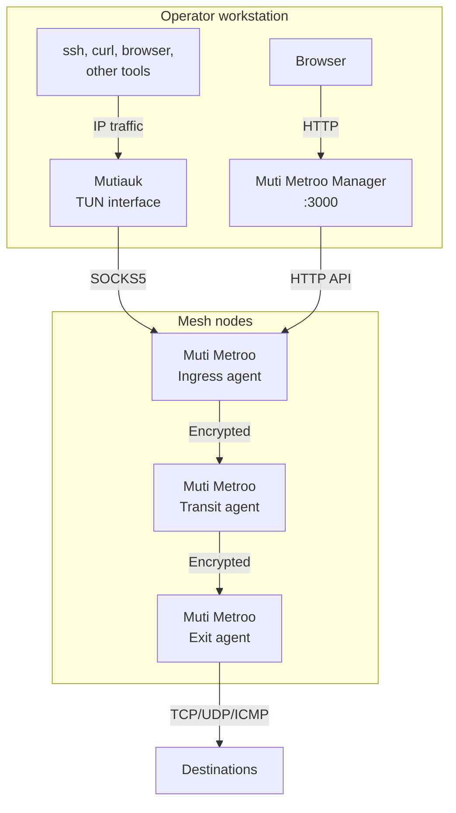

# Suite Overview

Muti Metroo is a suite of three tools that work together. The agents form the mesh, and the operator reaches it through Mutiauk and manages it with Muti Metroo Manager.

| Component | Runs on | Purpose | Platforms | Privileges |
| --- | --- | --- | --- | --- |
| [Muti Metroo](/getting-started/overview) | Mesh nodes: relays, gateways, transit hops, exits | Mesh agent: encrypted tunnels, multi-hop routing, SOCKS proxy ingress, exit routing | Linux, macOS, Windows | Unprivileged |
| [Mutiauk](/mutiauk) | The operator's workstation | TUN interface that installs the mesh's routes and forwards IP traffic into an ingress agent's SOCKS5 listener | Linux, macOS, Windows | Root or Administrator |
| [Muti Metroo Manager](/muti-metroo-manager) | The operator's workstation | Web dashboard for an agent's HTTP API: topology, routes, management actions | Linux, macOS, Windows | Unprivileged |

## How the components connect



- **Agents** run on the hosts that make up the mesh. At least one agent is an ingress (its SOCKS5 listener is enabled) and at least one is an exit (it advertises the networks it can reach). The ingress is usually a mesh node that the workstation can reach, such as a public relay.
- **Mutiauk** connects to the ingress agent's SOCKS5 listener. With [autoroutes](/mutiauk#autoroutes) on, the agent pushes the mesh's CIDR routes, mesh hostnames, and hostname suffixes to Mutiauk, which installs the routes on its TUN interface and answers DNS queries for mesh hostnames. Every application on the workstation then reaches mesh destinations through the ordinary routing table.
- **Muti Metroo Manager** proxies an agent's HTTP API to show the topology and run management actions. It can also [generate Mutiauk configs](/muti-metroo-manager#config-wizards).

### Using the SOCKS listener directly

Applications that support SOCKS (curl, browsers, `ssh` through `nc`, proxychains) can connect to the ingress agent's SOCKS listener without Mutiauk. Use this to test a mesh, to send a single application through it, or on a machine where you cannot get root or Administrator rights. The SOCKS listener is also needed for [domain routes](/features/exit-routing#route-types): Mutiauk sees IP packets after the workstation has resolved the name, so it can only use CIDR routes. See [SOCKS Proxy](/features/socks5-proxy).

## Connecting the workstation to a remote ingress

When Mutiauk runs on a different host from the ingress agent, its connection to the SOCKS5 listener crosses the network:

- Bind the listener to a reachable address and turn on [SOCKS5 authentication](/configuration/socks5#authentication). The credentials go in Mutiauk's `socks5.username` and `socks5.password`.
- Plain SOCKS5 over TCP is not encrypted, so the credentials and the traffic (TCP, and UDP, which Mutiauk carries on the same connection) between the workstation and the ingress agent travel in clear text. The mesh's end-to-end encryption starts at the ingress agent. Over an untrusted network, use the agent's [WebSocket listener](/configuration/socks5#websocket-listener) with TLS and a `wss://` URL in Mutiauk; Mutiauk checks the server certificate against the workstation's system trust store, so the listener needs a certificate that the workstation trusts (for example, from a TLS-terminating reverse proxy with a public certificate).
- Mutiauk never installs a route that covers the address of its own SOCKS5 server, so the connection to the ingress agent is not sent into the tunnel.

[Deployment Scenarios](/deployment/scenarios) has complete configurations for this setup.

## Example deployment

### Step 1: Deploy the agents

Deploy at least an ingress agent, where the workstation connects, and an exit agent, where traffic leaves the mesh. On each host:

```bash
muti-metroo init -d ./data
muti-metroo run -c ./config.yaml
```

[Your First Mesh](/getting-started/first-mesh) shows the configuration for both agents.

### Step 2: Connect the workstation with Mutiauk

On the operator's workstation, run the Mutiauk setup wizard. Give it the address of the ingress agent's SOCKS5 listener (and its credentials, if authentication is on), and keep autoroutes enabled so Mutiauk receives the mesh's routes from the agent. Then start the daemon:

```bash
sudo mutiauk setup
sudo mutiauk daemon start
```

`mutiauk daemon start` runs in the foreground. To run it in the background, install it as a service with `mutiauk service install`. Applications on the workstation now reach mesh destinations without proxy settings:

```bash
sudo mutiauk route list
ssh admin@192.168.1.20
```

See [Mutiauk](/mutiauk) for configuration details.

### Step 3: Add Muti Metroo Manager

On a machine that can reach an agent's HTTP API, start Manager and point it at that agent:

```bash
muti-metroo-manager -addr 127.0.0.1:3000 -agent http://192.168.1.10:8080
```

Then open `http://localhost:3000` in a browser. If the agent's API requires a bearer token, give it to Manager with `-agent-token-file`. Manager has no login of its own, so keep it on a loopback address or behind an authenticating reverse proxy. See [Muti Metroo Manager](/muti-metroo-manager) for all options.

## Downloads

| Component | Download |
| --- | --- |
| Muti Metroo | [Download page](/download) |
| Mutiauk | [Mutiauk download section](/mutiauk#download) |
| Muti Metroo Manager | [Manager download section](/muti-metroo-manager#download) |

## See Also

- [Getting Started](/getting-started/overview): set up your first Muti Metroo agents
- [SOCKS Proxy](/features/socks5-proxy): use the agent's SOCKS listener directly from SOCKS-aware applications
- [Mutiauk](/mutiauk): Mutiauk installation, configuration, and autoroutes
- [Muti Metroo Manager](/muti-metroo-manager): Manager installation, configuration, and features
- [HTTP API Overview](/api/overview): the agent API that Manager and scripts use
