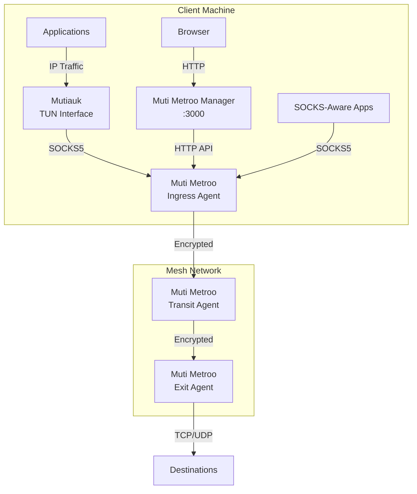

# Suite Overview

Muti Metroo is one of three tools that are designed to work together. Each is a standalone binary, and only the agent is required.

| Component | Purpose | Platforms | Privileges |
| --- | --- | --- | --- |
| [Muti Metroo](/getting-started/overview) | Mesh agent: encrypted tunnels, SOCKS proxy ingress, multi-hop routing | Linux, macOS, Windows | Unprivileged |
| [Mutiauk](/mutiauk) | TUN interface that forwards IP traffic into the agent's SOCKS5 proxy | Linux, macOS, Windows | Root or Administrator |
| [Muti Metroo Manager](/muti-metroo-manager) | Web dashboard for an agent's HTTP API: topology, routes, management actions | Linux, macOS, Windows | Unprivileged |

## How the components connect



- **Applications that support SOCKS** connect to the ingress agent's SOCKS proxy directly.
- **Other applications** send ordinary IP traffic. Mutiauk captures it on a TUN interface and forwards it through the agent's SOCKS5 proxy.
- **Operators** open Muti Metroo Manager in a browser. Manager proxies the agent's HTTP API to show the topology and run management actions.

## Which components you need

| Scenario | Components | Reason |
| --- | --- | --- |
| Route traffic from specific applications (browser, curl, SSH) | Muti Metroo | Configure each application to use the SOCKS proxy. |
| Route traffic from applications without proxy support | Muti Metroo and Mutiauk | Mutiauk captures IP traffic, so no per-application settings are needed. |
| Monitor and manage the mesh from a browser | Muti Metroo and Muti Metroo Manager | Manager provides the web dashboard. |
| Transparent routing and browser management | All three | Combines the two cases above. |

## Example deployment

### Step 1: Deploy the agents

Deploy at least an ingress agent, where clients connect, and an exit agent, where traffic leaves the mesh. On each host:

```bash
muti-metroo init -d ./data
muti-metroo run -c ./config.yaml
```

[Your First Mesh](/getting-started/first-mesh) shows the configuration for both agents.

### Step 2: Add Mutiauk on client machines

On a client that runs an ingress agent, run the Mutiauk setup wizard and point it at the agent's SOCKS5 proxy, `127.0.0.1:1080`. With autoroutes enabled, Mutiauk receives the mesh's CIDR routes from the agent. Then start the daemon:

```bash
sudo mutiauk setup
sudo mutiauk daemon start
```

`mutiauk daemon start` runs in the foreground. To run it in the background, install it as a service with `mutiauk service install`. Applications on the machine now reach mesh destinations without proxy settings. See [Mutiauk](/mutiauk) for configuration details.

### Step 3: Add Muti Metroo Manager

On a machine that can reach an agent's HTTP API, start Manager and point it at that agent:

```bash
muti-metroo-manager -addr 127.0.0.1:3000 -agent http://192.168.1.10:8080
```

Then open `http://localhost:3000` in a browser. If the agent's API requires a bearer token, give it to Manager with `-agent-token-file`. Manager has no login of its own, so keep it on a loopback address or behind an authenticating reverse proxy. See [Muti Metroo Manager](/muti-metroo-manager) for all options.

## Downloads

| Component | Download |
| --- | --- |
| Muti Metroo | [Download page](/download) |
| Mutiauk | [Mutiauk download section](/mutiauk#download) |
| Muti Metroo Manager | [Manager download section](/muti-metroo-manager#download) |

## See Also

- [Getting Started](/getting-started/overview): set up your first Muti Metroo agents
- [Mutiauk](/mutiauk): Mutiauk installation, configuration, and autoroutes
- [Muti Metroo Manager](/muti-metroo-manager): Manager installation, configuration, and features
- [HTTP API Overview](/api/overview): the agent API that Manager and scripts use
