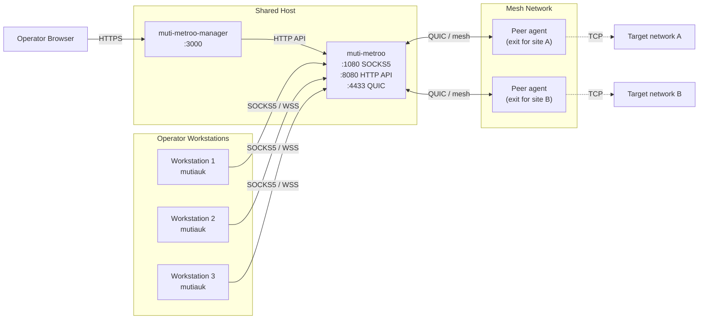

# Deployment Overview

The deployment this manual assumes is small and symmetric: every operator gets the same view of the mesh, and every operator's workstation behaves the same way. There is a single shared host that everyone trusts, and a small population of workstations that connect to it.

## The Three Binaries

| Binary        | Where It Runs                         | Job                                                                                                                                            |
| ------------- | ------------------------------------- | ---------------------------------------------------------------------------------------------------------------------------------------------- |
| `muti-metroo`       | Shared host (and any other mesh node) | The mesh agent. SOCKS5 ingress, route advertisement, encrypted tunnels, exit handling.                                                         |
| `muti-metroo-manager`   | Shared host                           | Browser dashboard. Reverse-proxies the local agent's HTTP API and serves a downloads bundle so operators can fetch their tools from one place. |
| `mutiauk` | Each operator workstation (Linux)     | Local TUN interface. Captures IP traffic destined for routed CIDRs and pipes it to the shared agent's SOCKS5 port.                             |

Each binary is independent. You can run `muti-metroo` on its own (everything works through SOCKS5), add Muti Metroo Manager later for browser management, and let each operator add Mutiauk on their own machine when they want transparent routing.

## Topology

A few things worth noticing in that diagram:

- Operators interact with the shared host in two ways: their **browser** talks to Muti Metroo Manager, and their **workstation traffic** talks to the agent's SOCKS5 (directly via tools, or transparently via Mutiauk).
- The shared host's agent is the **only** node operators talk to. The mesh itself -- transit hops, exit nodes, routing decisions -- is invisible to them.
- Operator workstations never become mesh peers. They are clients that consume the mesh, not nodes that participate in it.

## What Goes on the Shared Host

- The Muti Metroo agent: SOCKS5 listener for clients, peer connections to upstream relays / exit nodes, HTTP API on `:8080`, QUIC listener on `:4433`.
- A management signing keypair configured on the agent. The **private key** is what the agent uses to sign privileged requests it issues on behalf of operators (route changes, management commands, file transfer, sleep/wake). The matching **public key** also goes on every other agent in the mesh so they accept those signed requests.
- A bearer token (`http.token_hash`) protecting the HTTP API. This is what operators paste into Muti Metroo Manager to log in.
- Muti Metroo Manager bound to `:3000` (often fronted by a reverse proxy that does TLS).
- Optionally, the `muti-metroo-downloads-bundle.zip` file dropped next to `muti-metroo-manager` so the **Downloads** tab appears for operators.

Setup details are in Chapter 3.

## What Goes on Each Operator Workstation

- A Debian-based Linux machine.
- The `mutiauk` binary at `/usr/local/bin/mutiauk` (downloaded from the Muti Metroo Manager Downloads tab; see Chapter 5).
- A YAML config at `/etc/mutiauk/config.yaml` pointing at the shared host's SOCKS5 endpoint and enabling autoroutes. The SOCKS5 password (if the agent requires auth) lives in this file too; autoroutes carries no token of its own.
- The systemd service `mutiauk.service` so it starts on boot.

Setup details are in Chapter 5.

## What Operators Do Not Need

- **Direct mesh peering.** Operators do not run `muti-metroo` on their workstation. The shared host is the only mesh participant on their side.
- **The full agent CLI.** Most day-to-day work happens in the browser (Muti Metroo Manager) and via `mutiauk` on the workstation.
- **The management signing private key.** The shared host's agent already has it in its config; signing happens on the agent. Operators only ever handle the bearer token.

If your deployment grows beyond this shape -- multiple agents per operator, dedicated transit nodes, mesh-to-mesh bridges -- the user manual is the right reference. The remaining chapters of this manual stay inside the assumed topology.
