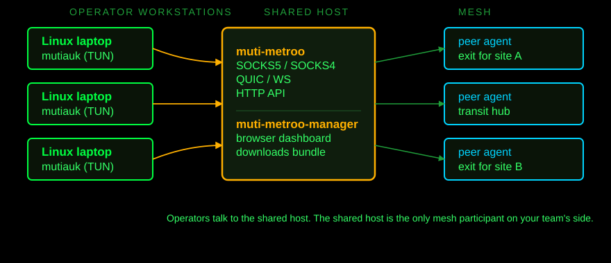

<!-- _class: title -->

# MUTI_METROO

## Operator Briefing

A 5-minute orientation for new operators

---

# Why Muti Metroo

Three things you get on day one that you do not get from a VPN, an SSH bastion, or a pile of port-forwards:

- **One URL for the whole team.** No per-user provisioning. No per-host VPN profile. The dashboard is the access surface.
- **Routes propagate automatically.** Senior op adds a CIDR once. Every workstation picks it up within a poll. No "send me your hosts file" coordination.
- **Your existing tools just work.** `ping`, `ssh`, `curl`, `proxychains` - no custom client, no library binding.

The rest of this deck is how those three feel in practice.

---

# One URL for the team

What it replaces:

| Old way                         | Muti Metroo                             |
| ------------------------------- | --------------------------------- |
| OpenVPN profile per operator    | One bearer token in a YAML        |
| SSH bastion + jump-host configs | Open dashboard, click target      |
| Hand-rolled WireGuard mesh      | One shared host runs the agent    |
| `~/.ssh/config` for the project | `target.mesh` resolves everywhere |

Onboard a new operator in four steps. Off-board them by revoking one token.

---

# Routes appear automatically

Senior operator adds `10.20.0.0/16 -> exit-dc-a` in the dashboard.

Within one poll (default ~30s), every workstation sees:

```bash
$ mutiauk route list
DESTINATION       SOURCE   INTERFACE  COMMENT
10.20.0.0/16      auto     tun0       project Q2
```

Operators do nothing. No reload, no restart, no "did you get the new config?" message in chat.

End of project: remove the route in the dashboard. Same propagation, in reverse.

---

# Every tool just works

The TUN on each workstation captures traffic for routed CIDRs _before_ it hits the kernel routing table. So:

```bash
ping 10.20.120.11
ssh op@10.20.120.11
curl https://internal.corp/
nc -zv 10.20.120.11 22
proxychains4 ssh op@10.20.120.12
```

All work. No `--proxy` flag, no `socksify`, no library shims.

Caveat: tools that build raw packets (SYN scanners, `traceroute`) bypass the TUN. Use TCP-connect equivalents.

---

# The three binaries

| Binary          | Where            | Job                                           |
| --------------- | ---------------- | --------------------------------------------- |
| **muti-metroo**       | Shared host      | Agent. SOCKS, routing, encrypted tunnels.     |
| **muti-metroo-manager**   | Shared host      | Dashboard. One URL for the team.              |
| **mutiauk** | Each workstation | Local TUN. Captures traffic for routed CIDRs. |

Each is one self-contained Go binary. No external services to install, no per-host daemons on each workstation. (Muti Metroo Manager carries a small embedded SQLite for operator notes; nothing to administer.)

---

# Deployment shape



---

# Install on your workstation

```bash
# 1. Get the binary - Muti Metroo Manager -> Downloads
sudo mv mutiauk /usr/local/bin/

# 2. Get the config - Muti Metroo Manager kebab menu ->
#    "Generate Mutiauk Config..." -> Download mutiauk.yaml
sudo install -d -m 0755 /etc/mutiauk
sudo install -m 0600 config.yaml /etc/mutiauk/config.yaml

# 3. Start the service
sudo mutiauk service install -c /etc/mutiauk/config.yaml

# 4. Confirm
sudo mutiauk status
```

The bearer token in the YAML is the **only secret on your workstation**.

---

# What you get for free

Once Entry is running:

- **Autoroutes** arrive from the dashboard. Nothing to type.
- **Mesh-host names** (`target-11.mesh`) resolve from any tool.
- **ICMP** flows through the TUN. Plain `ping` works for any routed IP.
- **TCP and UDP** ride the same TUN. SOCKS5 UDP-ASSOCIATE is set up for you.

You never paste a private key into the browser. The shared host's agent does the signing.

---

<!-- _class: divider -->

# Workflows

---

# Route a CIDR to a site

| Want                           | Where                | Watch out for                                                  |
| ------------------------------ | -------------------- | -------------------------------------------------------------- |
| New CIDR reachable to the team | Web -> Routes -> Add | One CIDR can map to one origin. Use /32s if two sites collide. |

```bash
# After adding 10.20.0.0/16 -> exit-dc-a in the dashboard:
mutiauk route list                # confirm autoroute arrived
mutiauk route trace 10.20.120.11  # see which exit was picked
ssh op@10.20.120.11                   # done
```

Add a comment on the route - it propagates with the route, every operator sees the same label.

---

<!-- _class: screenshot -->

# Routes tab


---

# Two sites, same CIDR

Both sites use `192.168.0.0/24`. You cannot route the whole `/24` two ways. Route specific hosts:

| Host               | Origin        |
| ------------------ | ------------- |
| `192.168.50.10/32` | `exit-site-A` |
| `192.168.50.21/32` | `exit-site-A` |
| `192.168.50.7/32`  | `exit-site-B` |

Longest-prefix-match picks the right exit per host:

```bash
mutiauk route trace 192.168.50.10   # -> exit-site-A
mutiauk route trace 192.168.50.7    # -> exit-site-B
```

---

# SOCKS proxy direct

| Want                                             | Where                        | Watch out for                                          |
| ------------------------------------------------ | ---------------------------- | ------------------------------------------------------ |
| One tool through the mesh, not the whole machine | `socks5h://shared-host:1080` | Listener auto-detects SOCKS4/4a/5; SOCKS4 has no auth. |

```bash
curl -x socks5h://shared-host:1080 https://internal/
ssh -o ProxyCommand='ncat --proxy shared-host:1080 \
                          --proxy-type socks5 %h %p' op@target
proxychains4 ssh op@target
```

Use this when you do _not_ want to install Entry, or when only one process needs the mesh.

---

# Ping just works

| Want                        | Where                       | Watch out for                                                 |
| --------------------------- | --------------------------- | ------------------------------------------------------------- |
| Plain `ping` to a routed IP | Run it. Entry catches ICMP. | Raw-socket tools (SYN scanners, `traceroute`) bypass the TUN. |

```bash
ping -c 3 10.20.120.11
```

ICMP echo and echo-reply propagate. TTL-exceeded does not, so `traceroute` shows nothing past the gateway.

For service checks, use TCP-connect tools (`ssh`, `curl`, `nc -zv`).

---

# Mesh-host DNS

| Want                   | Where                      | Watch out for                                                     |
| ---------------------- | -------------------------- | ----------------------------------------------------------------- |
| Stable name for a host | Web -> DNS -> Hosts -> Add | Multi-label only. `target.mesh` works; bare `target` is rejected. |

```bash
ping -c 1 target-11.mesh
ssh op@target-11.mesh
curl http://target-11.mesh/
```

Suffixes (`.mesh`, `.lan`, `.corp.local`) are managed in the **TLDs** sub-tab. Add a suffix once, it works everywhere Entry is running.

---

# Expose: publish from your laptop

| Want                                                                        | Where                                             | Watch out for                                                  |
| --------------------------------------------------------------------------- | ------------------------------------------------- | -------------------------------------------------------------- |
| Make a folder / port on **your workstation** reachable from inside the mesh | `mutiauk expose ...` + Web -> Port Forwarding | Runtime entries vanish on daemon restart - persist via config. |

```bash
# On your laptop:
mutiauk expose add folder tools /home/op/tools
mutiauk expose add tcp listener 127.0.0.1:9999

# Then in Web -> Port Forwarding, add a listener for that key on a
# mesh agent the target can reach. From the target box:
curl -O http://that-agent:8090/diagnostics.sh
ssh -p 2200 op@that-agent
```

The target sees an ordinary local mesh agent, not your laptop.

---

# Management commands

| Want                      | Where                                       | Watch out for                                                        |
| ------------------------- | ------------------------------------------- | -------------------------------------------------------------------- |
| Run commands on any agent | Web -> Topology -> click agent -> **Shell** | Needs `shell.enabled: true` on target. Whitelist controls what runs. |

- xterm.js, full PTY. `vim`, `htop`, `top` work.
- Streaming and interactive modes.
- Linux, macOS, Windows ConPTY.

The shared host signs every management command request. Operators do not handle keys.

---

<!-- _class: screenshot -->

# Shell sub-tab


---

# File transfer

| Want                         | Where                                       | Watch out for                                                         |
| ---------------------------- | ------------------------------------------- | --------------------------------------------------------------------- |
| Move files to/from any agent | Web -> Topology -> click agent -> **Files** | Needs `file_transfer.enabled: true` and an `allowed_paths` whitelist. |

- Browse, drag-and-drop upload, download, delete.
- Edit the breadcrumb's leading `/` to jump to a path.
- Directory transfers tar/gzip with permissions preserved.

CLI equivalents: `muti-metroo upload <id> ./local /remote` and `muti-metroo download <id> /remote ./local`.

---

# Mesh test, sleep, wake

| Want                                     | Where                                            | Watch out for                                                                                                   |
| ---------------------------------------- | ------------------------------------------------ | --------------------------------------------------------------------------------------------------------------- |
| Confirm every agent talks to every agent | Kebab menu -> **Mesh Connectivity Test**         | Footer counter goes red the moment any agent stops responding.                                                  |
| Park the mesh overnight                  | Kebab menu -> **Suspend Mesh** / **Resume Mesh** | The label flips with sleep state. Both are signed by the shared host; agents come back without reconfiguration. |

Mesh Connectivity Test is your "is it me or is it the mesh?" answer. Run it before debugging anything else.

---

# Topology niceties

- **Drag** stations to reposition; mouse wheel zooms. Layout persists per browser.
- **Search** with `/`: filter by name, ID, role, IP, route, forward, or note.
- **Notes + icon** per agent (Linux, macOS, Windows, router, switch, database). Stored in Muti Metroo Manager's local SQLite.
- **Route comments** propagate over the wire - annotate once, every agent shows the same label.

`/topology?agent=<short-id>` deep-links straight into an agent panel (add `&panel=shell`, `&panel=files`, etc. to land on a sub-tab). The legacy `#/agents/<id>` form still loads but is rewritten on the way in.

---

<!-- _class: screenshot -->

# Topology tab


---

<!-- _class: divider -->

# When it breaks

---

# Top failure modes

| Symptom                               | First thing to run                                        |
| ------------------------------------- | --------------------------------------------------------- |
| `ping` to a routed IP times out       | `mutiauk route trace <ip>`                            |
| Mesh-host name does not resolve       | `sudo mutiauk dns status`                             |
| Specific agent looks dead in Topology | Kebab -> **Mesh test**                                    |
| Nothing reaches the shared host       | `curl http://shared-host:8080/health`                     |
| Routes not arriving on a workstation  | `sudo mutiauk daemon reload` (or restart the service) |

Almost every operator-facing failure falls in this table. Start here before reading logs.

---

# Debug commands

```bash
mutiauk route trace 10.20.120.11
# matched route, interface, mesh path,
# mesh_path_status: ok / unreachable / not_in_mesh / not_configured

sudo mutiauk dns status
# backend (resolvectl / nm-dnsmasq / none),
# active suffixes, host count, live probes

curl http://localhost:8080/healthz | jq
# peer count, stream count, route count on the local agent
```

When in doubt, the dashboard's kebab menu -> **Mesh Connectivity Test** tells you whether the problem is local to your workstation or mesh-wide.

---

# Cookbook

```bash
# Reset Mutiauk without rebooting
sudo systemctl stop mutiauk
sudo mutiauk cleanup
sudo systemctl start mutiauk

# Check a service through the mesh (TCP connect)
nc -zv 10.20.120.11 22

# Trigger immediate route advertisement on the shared host
# (gated by remote_api + http.token_hash; pass the bearer token)
curl -X POST -H "Authorization: Bearer $MUTI_METROO_TOKEN" \
     http://localhost:8080/routes/advertise

# Reload Entry config without restarting
sudo mutiauk daemon reload

# Run one tool through the SOCKS proxy
proxychains4 -q curl -s 'http://internal/...'
```

---

<!-- _class: title -->

# Good to go

paste token -> wizard -> install service

deeper questions land in the operator manual
