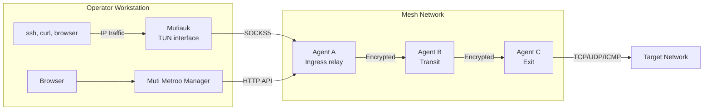
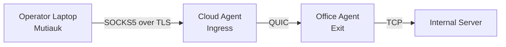
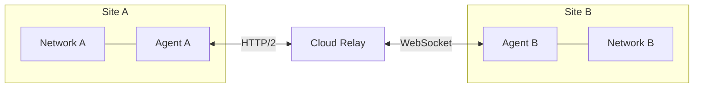

# Introduction

## What is Muti Metroo?

Muti Metroo is a suite of three tools for building and using a userspace mesh network that carries TCP, UDP, and ICMP echo traffic across network segments, firewalls, and different transport protocols:

- **Muti Metroo agent** (`muti-metroo`): runs on the mesh nodes (relays, gateways, transit hops, and exits inside target networks). Agents connect to each other over QUIC, HTTP/2, or WebSocket, advertise routes, and relay end-to-end encrypted streams. An agent with the SOCKS5 listener enabled is an **ingress** agent: the point where traffic enters the mesh. The agent runs in userspace on Linux, macOS, and Windows and needs no root privileges.
- **Mutiauk** (`mutiauk`): runs on the operator's workstation. It creates a TUN interface and forwards IP traffic for mesh routes into the SOCKS5 listener of an ingress agent. With autoroutes enabled it receives the mesh's CIDR routes, mesh hostnames, and DNS suffixes from that agent, so ordinary tools such as `ssh`, `curl`, browsers, `nmap`, and database clients reach mesh networks without proxy settings. Mutiauk is the usual operator entry point into the mesh. It runs on Linux, macOS, and Windows and needs root or Administrator privileges.
- **Muti Metroo Manager** (`muti-metroo-manager`): a web dashboard, usually run on the operator's workstation, that connects to an agent's HTTP API to show the mesh topology and run management actions (routes, management commands, file transfer, mesh tests, sleep and wake). It also generates agent and Mutiauk configurations.

The ingress agent is usually a mesh node too, for example a relay on a public server, not the operator's laptop. The operator's workstation runs Mutiauk and Muti Metroo Manager and reaches the mesh through that ingress.

## Key Features

| Feature                   | Description                                                                             |
| ------------------------- | --------------------------------------------------------------------------------------- |
| **Multi-Hop Mesh**        | Traffic routes through the mesh to reach any exit                                       |
| **TUN Interface**         | Mutiauk forwards IP traffic for mesh routes from the operator workstation (Linux, macOS, Windows) |
| **Autoroutes and Mesh DNS** | Mutiauk receives CIDR routes, mesh hostnames, and DNS suffixes from the ingress agent |
| **SOCKS Proxy**           | SOCKS4, SOCKS4a, and SOCKS5; TCP CONNECT, UDP ASSOCIATE, and UDP STREAM with optional authentication |
| **Flexible Routing**      | CIDR and domain-based exit routes                                                       |
| **Multiple Transports**   | QUIC/TLS 1.3, HTTP/2, and WebSocket for network traversal                               |
| **Port Forwarding**       | Expose local services through reverse tunnels                                           |
| **Remote Execution**      | Execute commands on remote agents                                                       |
| **File Transfer**         | Upload/download files across the mesh                                                   |
| **Web Dashboard**         | Muti Metroo Manager for topology, status, and management actions                        |
| **No Root on Agents**     | Agents run in userspace; only Mutiauk on the workstation needs root or Administrator    |
| **End-to-End Encryption** | X25519 + ChaCha20-Poly1305 between ingress and exit; transit nodes cannot decrypt       |

## How It Works

1. **Agents** run on mesh nodes and connect to form a mesh network. Each agent can act as ingress, transit, exit, or any combination.
2. **Routes** are advertised through the mesh using flood-based propagation.
3. **Mutiauk** on the operator workstation captures traffic for mesh routes on its TUN interface and opens SOCKS5 connections to an ingress agent. SOCKS-aware applications can also connect to the ingress agent's SOCKS5 listener directly.
4. **Traffic** flows through the mesh following the best route to the exit agent, encrypted end to end between ingress and exit.
5. **Exit agents** open real TCP connections, relay UDP datagrams, or send ICMP echo requests to destinations.

## Getting Traffic into the Mesh

There are two ways for an operator to send traffic into the mesh. Both end at the SOCKS5 listener of an ingress agent.

| Path                          | Typical use                                                                                   | Privileges on the workstation |
| ----------------------------- | --------------------------------------------------------------------------------------------- | ----------------------------- |
| **Mutiauk (TUN interface)**   | Main operator path. Every application reaches mesh CIDR routes and mesh hostnames unchanged.   | root or Administrator         |
| **Direct SOCKS5 clients**     | Quick tests, a single application, hosts without root or Administrator, and domain-based exit routes | none                     |

Mutiauk works at the IP layer and only sees destination addresses, so it uses CIDR routes. Domain-based exit routes need the destination hostname, which only a SOCKS client sends (for example `curl -x socks5h://...`). Chapter 9 covers the SOCKS5 listener and direct clients; Chapter 10 covers Mutiauk.

When Mutiauk connects to an ingress agent on another host, enable SOCKS5 authentication on the agent and prefer the SOCKS5 WebSocket listener over TLS (a `wss://` URL in Mutiauk's `socks5.server`). Plain SOCKS5 over TCP is not encrypted between the workstation and the ingress agent, including the SOCKS5 credentials. Mesh encryption starts at the ingress agent.

## Use Cases

### Corporate Network Access

Reach internal resources through a multi-hop path without traditional VPN infrastructure. The operator's laptop runs Mutiauk and connects to a cloud agent that serves as the ingress.

### Multi-Site Connectivity

Connect multiple locations through a mesh of agents, giving access to resources across sites.

### Resilient Remote Access

Maintain connectivity through redundant paths with automatic failover and reconnection.

## Document Structure

This manual is organized into the following parts:

- **Part I: Getting Started** - Quick start, installation, and setup wizard
- **Part II: Core Configuration** - Certificates, configuration, roles, and transports
- **Part III: Traffic Ingress** - The SOCKS5 ingress listener and Mutiauk on the operator workstation
- **Part IV: Routing & Features** - Exit routing, management commands, file transfer, and more
- **Part V: Monitoring & Management** - HTTP API, Muti Metroo Manager, and service installation
- **Part VI: Security** - Privacy configuration, management keys, and sleep mode
- **Part VII: Reference** - Troubleshooting and quick reference
