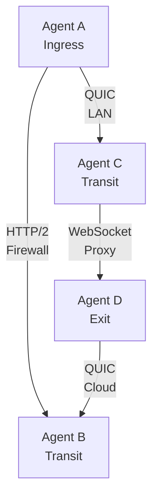

# Transport Protocols

Muti Metroo supports three transport protocols, each with different characteristics. You can mix transports within the same mesh.

## Overview

| Transport     | Protocol | Port     | Firewall Friendliness | Performance |
| ------------- | -------- | -------- | --------------------- | ----------- |
| **QUIC**      | UDP      | 4433     | Medium                | Best        |
| **HTTP/2**    | TCP      | 443/8443 | Good                  | Good        |
| **WebSocket** | TCP/HTTP | 443/80   | Excellent             | Fair        |

## QUIC Transport

QUIC (Quick UDP Internet Connections) is the recommended transport for most deployments.

### Characteristics

- **Protocol**: UDP with built-in TLS 1.3
- **Multiplexing**: Native stream multiplexing
- **Performance**: Lowest latency, best throughput
- **Connection**: Fast 0-RTT reconnection

### When to Use

- Direct server-to-server connections
- Low-latency requirements
- High-throughput scenarios
- When UDP is not blocked

### Configuration

**Listener:**

```yaml
listeners:
  - transport: quic
    address: "0.0.0.0:4433"
```

**Peer connection:**

```yaml
peers:
  - id: "peer-id..."
    transport: quic
    address: "192.168.1.10:4433"
```

### Firewall Considerations

- Requires UDP port to be open
- May be blocked by corporate firewalls
- NAT traversal generally works well
- Some ISPs throttle or block UDP

## HTTP/2 Transport

HTTP/2 provides a TCP-based alternative with good firewall compatibility.

### Characteristics

- **Protocol**: TCP with TLS 1.3
- **Multiplexing**: HTTP/2 stream multiplexing
- **Performance**: Good, but TCP head-of-line blocking
- **Compatibility**: Works through most firewalls

### When to Use

- Corporate environments blocking UDP
- When QUIC is not available
- Standard HTTPS infrastructure
- Load balancer compatibility needed

### Configuration

**Listener:**

```yaml
listeners:
  - transport: h2
    address: "0.0.0.0:8443"
    path: "/mesh"
```

**Peer connection:**

```yaml
peers:
  - id: "peer-id..."
    transport: h2
    address: "192.168.1.10:8443"
    path: "/mesh"
```

## WebSocket Transport

WebSocket provides maximum compatibility, especially through HTTP proxies.

### Characteristics

- **Protocol**: HTTP upgrade to WebSocket
- **Multiplexing**: Application-level over single connection
- **Performance**: Highest overhead, most latency
- **Compatibility**: Maximum - works through HTTP proxies

### When to Use

- Restrictive corporate proxies
- When HTTP/2 is blocked or problematic
- Through CDNs or WAFs

### Configuration

**Listener:**

```yaml
listeners:
  - transport: ws
    address: "0.0.0.0:443"
    path: "/mesh"
```

**Peer connection:**

```yaml
peers:
  - id: "peer-id..."
    transport: ws
    address: "wss://relay.example.com:443/mesh"
```

**Through HTTP proxy:**

```yaml
peers:
  - id: "peer-id..."
    transport: ws
    address: "wss://relay.example.com:443/mesh"
    proxy: "http://proxy.corp.local:8080"
    proxy_auth:
      username: "${PROXY_USER}"
      password: "${PROXY_PASS}"
```

### Plain WebSocket Mode (Reverse Proxy)

When behind a reverse proxy that handles TLS termination:

```yaml
listeners:
  - transport: ws
    address: "127.0.0.1:8080"
    path: "/mesh"
    plaintext: true
```

**Security**: Only use behind trusted reverse proxies. Bind to localhost to prevent direct external access.

### Advertising a Listener to the Mesh

Add an optional `advertise:` block to publish a listener's public dial target across the mesh. Other agents -- including agents that have never directly peered with this one -- can then see and reach the listener through their topology view.

```yaml
listeners:
  - transport: h2
    address: "0.0.0.0:3000"
    path: "/mesh"
    advertise:
      address: "kreata.ee:3000"
      # path defaults to listener.path; transport defaults to listener.transport
```

`advertise` is opt-in. Without it, the listener is not propagated -- bind-only or NAT-shielded listeners must not be auto-advertised. `advertise.address` may not be a loopback or unspecified address (`0.0.0.0`, `127.0.0.1`, `::`, `::1`). Override `advertise.path` or `advertise.transport` only when a reverse proxy maps the public path or transport differently from the local listener.

### Dynamic Transport Listeners

A running agent can open or close a listener without editing `config.yaml` and restarting:

```bash
# Open a new QUIC listener
muti-metroo listener add quic :4434

# Open a plaintext WebSocket listener behind a reverse proxy, advertised to the mesh
muti-metroo listener add ws 127.0.0.1:3002 --path /ws/ --plaintext --advertise-address ws.example.com:443

# Stop accepting on a dynamic listener (existing connections are unaffected)
muti-metroo listener remove :4434

# List static (config) and dynamic listeners
muti-metroo listener list
```

Dynamic listeners reuse the agent's global TLS certificate and mTLS setting; `--plaintext` (ws only) starts without TLS for reverse-proxy deployments. When `agent.data_dir` is configured, they are journalled and restored across restart and sleep/wake; otherwise they are ephemeral. Listeners declared in `config.yaml` take precedence and cannot be removed at runtime.

## TLS ClientHello Profiles

Outbound HTTP/2 and WebSocket peer connections can present a browser-compatible TLS ClientHello, which improves compatibility with strict proxies and servers that expect specific TLS client behavior. The feature is disabled by default -- enable it under `tls.fingerprint.preset`. QUIC peer connections use Go's internal TLS 1.3 stack and ignore the preset (a warning is logged). Note: some WAFs treat a browser-like ClientHello combined with non-browser HTTP request shapes as a bot signal and will reject the dial, so test before enabling on peers behind strict middleboxes.

Available presets: `disabled` (default), `go`, `chrome`, `firefox`, `safari`, `edge`, `ios`, `android`, `random`. `disabled` and `go` both use Go's standard library ClientHello; the named browsers / `random` engage uTLS. Configure under `tls.fingerprint.preset` and apply only to peer dials, not listeners. See Chapter 20 (Privacy & Security Configuration) for the full preset table, transport-support matrix, and combined-with-protocol-identifiers usage notes.

## Transport Comparison

### Latency (per hop)

| Transport | LAN    | WAN      |
| --------- | ------ | -------- |
| QUIC      | 1-2ms  | 50-100ms |
| HTTP/2    | 2-5ms  | 60-150ms |
| WebSocket | 3-10ms | 80-200ms |

### Throughput

| Transport | Single Stream | Multi-Stream |
| --------- | ------------- | ------------ |
| QUIC      | Excellent     | Excellent    |
| HTTP/2    | Good          | Good         |
| WebSocket | Fair          | Fair         |

## Mixed Transport Deployments

You can mix transports in a single mesh:



### Configuration Example

Agent with multiple transports:

```yaml
listeners:
  - transport: quic
    address: "0.0.0.0:4433"

  - transport: h2
    address: "0.0.0.0:8443"
    path: "/mesh"

peers:
  - id: "agent-b-id..."
    transport: h2
    address: "corporate-relay.example.com:443"
    path: "/mesh" # h2 path is a separate field, not part of address

  - id: "agent-c-id..."
    transport: quic
    address: "192.168.1.50:4433"
```

For `h2` peers, the request URL is built as `https://<address><path>`. A
bare host:port address with `path` omitted defaults the path to `/mesh`.
Embedding the path in `address` (e.g. `host:443/mesh`) without separating it
produces a duplicated path (`/mesh/mesh`) and the dial will fail. WebSocket
peers may use a full URL form (`wss://host:443/mesh`) instead of separate
`address` + `path`.

## Transport Selection Guide

| Scenario                   | Recommended    | Reason                 |
| -------------------------- | -------------- | ---------------------- |
| Data center to data center | QUIC           | Best performance       |
| Office to cloud            | HTTP/2 or QUIC | Depends on firewall    |
| Home user to cloud         | QUIC           | Most ISPs allow UDP    |
| Corporate laptop to cloud  | WebSocket      | Works through proxies  |
| Through CDN/WAF            | WebSocket      | HTTP-based, compatible |
| Large file transfers       | QUIC           | Best throughput        |

## Troubleshooting

### QUIC Connection Fails

```bash
# Check if UDP is reachable
nc -u -v target.example.com 4433

# Check firewall rules
sudo iptables -L -n | grep 4433
```

### HTTP/2 Connection Fails

```bash
# Test HTTP/2 connectivity
curl -v --http2 https://target.example.com:8443/mesh

# Check TLS
openssl s_client -connect target.example.com:8443
```

### WebSocket Connection Fails

```bash
# Test through proxy
curl -v --proxy http://proxy:8080 https://target.example.com/mesh
```
