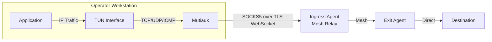
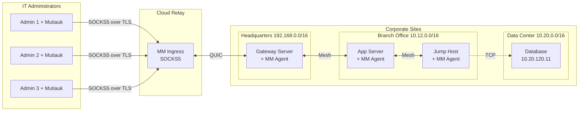

# TUN Interface (Mutiauk)

Mutiauk is the operator-side component of the Muti Metroo suite and the usual way an operator reaches mesh networks. It runs on the operator's workstation, creates a TUN interface, and forwards IP traffic for mesh routes into the SOCKS5 listener of an ingress agent (Chapter 9). The ingress agent is usually a mesh node, for example a relay on a public server.

With `autoroutes.enabled: true`, Mutiauk receives the mesh's CIDR routes, mesh hostnames, and DNS suffixes from the ingress agent over the same SOCKS5 endpoint, installs the routes on the TUN interface, and answers DNS queries for mesh hostnames. Ordinary tools (`ssh`, `curl`, browsers, `nmap`, database clients) then reach mesh networks with no proxy settings.

**Platform**: Linux (`/dev/net/tun`), macOS (utun), and Windows (bundled Wintun driver). Requires elevated privileges: root / CAP_NET_ADMIN on Linux and macOS, Administrator on Windows. Only Mutiauk needs these privileges; the agents it connects to run without root.

> **When to use a SOCKS client instead**: Mutiauk works at the IP layer and only sees destination IP addresses, so it uses CIDR routes only. Domain-based exit routes need a SOCKS client that sends the hostname. Direct SOCKS clients (Chapter 9) also suit quick tests, a single application, and machines where root or Administrator is not available.

## Overview

Mutiauk:

1. Creates a TUN network interface
2. Intercepts L3 (IP) traffic destined for configured or received routes
3. Forwards TCP and UDP connections, and ICMP echo, through the ingress agent's SOCKS5 listener
4. Returns responses through the TUN interface



## Features

| Feature                  | Description                                                                                                 |
| ------------------------ | ----------------------------------------------------------------------------------------------------------- |
| **Transparent Proxying** | No application changes required                                                                             |
| **TCP Support**          | Full TCP connection forwarding                                                                              |
| **UDP Support**          | UDP datagrams framed on the SOCKS5 connection (UDP STREAM), or SOCKS5 UDP ASSOCIATE with agents that do not support it |
| **ICMP Support**         | Ping forwarding via ICMP relay                                                                              |
| **Route-Based**          | Only intercept configured destinations                                                                      |
| **Autoroutes**           | Receive CIDR routes, mesh hostnames, and DNS suffixes from the ingress agent over the SOCKS5 endpoint      |
| **Mesh DNS Resolver**    | In-process resolver for mesh hostnames; host integration via `resolvectl` or NetworkManager `dnsmasq` (Linux), `/etc/resolver` (macOS), or NRPT (Windows) |
| **Expose**               | Publish local folders or TCP targets to the mesh over a single outbound SOCKS5 stream                       |
| **Route Persistence**    | Save routes to config with `--persist`                                                                      |

## Get the Binary

Download Mutiauk from the Mutiauk releases page (`https://github.com/Muti-Metroo/Mutiauk/releases/latest`). Release builds are published for Linux, macOS, and Windows on amd64 and arm64:

| Platform                | Filename                    |
| ----------------------- | --------------------------- |
| Linux (amd64)           | `mutiauk-linux-amd64`       |
| Linux (arm64)           | `mutiauk-linux-arm64`       |
| macOS (Apple Silicon)   | `mutiauk-darwin-arm64`      |
| macOS (Intel)           | `mutiauk-darwin-amd64`      |
| Windows (amd64)         | `mutiauk-windows-amd64.exe` |
| Windows (arm64)         | `mutiauk-windows-arm64.exe` |

Each release also carries `checksums.txt` with SHA-256 sums of the binaries.

On Linux and macOS, install the binary in your `PATH` (example: Linux amd64):

```bash
curl -L -o mutiauk https://github.com/Muti-Metroo/Mutiauk/releases/latest/download/mutiauk-linux-amd64
chmod +x mutiauk
sudo mv mutiauk /usr/local/bin/
```

Replace `mutiauk-linux-amd64` with `mutiauk-darwin-arm64` (Apple Silicon) or `mutiauk-darwin-amd64` (Intel) on macOS. The macOS binaries are not signed; a file downloaded with a web browser is quarantined, so remove the attribute:

```bash
sudo xattr -d com.apple.quarantine /usr/local/bin/mutiauk
```

On Windows, save `mutiauk-windows-amd64.exe` (or the arm64 build) as `mutiauk.exe` in a directory in `PATH`. The Wintun driver is embedded in the executable, so no separate driver install is needed. Run Mutiauk commands from an elevated prompt; the configuration lives at `%ProgramData%\Mutiauk\config.yaml`.

Building from source is optional. With Go and `make`:

```bash
git clone https://github.com/Muti-Metroo/Mutiauk.git
cd Mutiauk
make build-all             # every platform, in bin/
```

The macOS and Windows targets pin `GOTOOLCHAIN=go1.25.5`; the gVisor dependency does not compile with Go 1.26.

## Quick Start

Run the interactive setup wizard:

```bash
sudo mutiauk setup
```

The wizard configures:

- TUN interface settings (name, MTU, IP address)
- SOCKS5 server (`host:port` or a `ws://` / `wss://` URL) and credentials
- Autoroutes, or a static route list
- Optional service installation

The SOCKS5 prompt reads `SOCKS5 server (host:port, or wss://host:port/path) [127.0.0.1:1080]:`. Enter a `host:port` for plain SOCKS5 over TCP, or a `ws://` / `wss://` URL to connect over the agent's SOCKS5 WebSocket listener (see "Connecting to a Remote Ingress Agent" below). The default `127.0.0.1:1080` fits only an agent on the same host. For a plain `host:port` that is not a loopback address, the wizard notes that the connection is unencrypted. Point the wizard at an existing config to edit it: the current values become the defaults, `transport`, `ws_path`, `timeout`, and `keepalive` are kept, and sections the wizard does not ask about are left as they are. The configuration summary at the end includes a `Transport:` line, for example `plain SOCKS5 over TCP (unencrypted)`.

`mutiauk setup` is interactive and requires a TTY. For unattended deploys, use `mutiauk config generate` instead, which writes a config file non-interactively. It accepts `--from <answers.yaml>`, `--output`/`-o`, `--force`, `--json`, and per-field overrides (`--tun-name`, `--tun-address`, `--tun-address6`, `--socks5-server`, `--socks5-username`, `--autoroutes-enabled`). Per-field flags override the answers file, which overrides the built-in defaults. The SOCKS5 password comes from the `MUTIAUK_SOCKS5_PASSWORD` environment variable so it never appears in the answers file or process listing. Install the service as a separate `mutiauk service install` step.

```bash
sudo MUTIAUK_SOCKS5_PASSWORD="$(cat /etc/mutiauk/socks5-password)" \
  mutiauk config generate --from /etc/mutiauk/answers.yaml \
    --socks5-server wss://relay.example.com:8443/socks5 \
    --socks5-username operator \
    --autoroutes-enabled \
    -o /etc/mutiauk/config.yaml --force --json
```

## Configuration

Default config file: `/etc/mutiauk/config.yaml` on Linux and macOS, `%ProgramData%\Mutiauk\config.yaml` on Windows.

```yaml
daemon:
  pid_file: /var/run/mutiauk.pid
  socket_path: /var/run/mutiauk.sock
  status_probe_target:
    example.com:80 # host:port the `status` command's SOCKS5-tunneled TCP probe dials;
    # set to an in-mesh address for air-gapped deployments

tun:
  name: tun0
  mtu: 1400
  address: 10.200.200.1/24
  address6: fd00:200::1/64 # Optional IPv6

socks5:
  server: wss://relay.example.com:8443/socks5 # host:port (plain TCP) or ws:// / wss:// URL
  username: "operator" # SOCKS5 auth (also HTTP Basic Auth for WebSocket)
  password: "" # or set MUTIAUK_SOCKS5_PASSWORD
  timeout: 30s
  keepalive: 60s
  transport: tcp # "tcp" (default) or "websocket"; a ws:// or wss:// server implies websocket
  ws_path: /socks5 # WebSocket path when server is host:port and transport is websocket

autoroutes:
  enabled: true # receive routes, mesh hosts, and DNS suffixes from the agent

routes: # static routes, in addition to autoroutes
  - destination: 10.0.0.0/8
    comment: "Internal network"
    enabled: true # defaults to true when omitted; legacy configs see a per-route WARN at startup
  - destination: 192.168.0.0/16
    comment: "Private network"
    enabled: true

nat:
  table_size: 65536
  tcp_timeout: 1h
  udp_timeout: 5m
  gc_interval: 1m

logging:
  level: info # debug, info, warn, error
  format: json # json or console
  output: stdout # stdout, stderr, or file path
```

### Autoroutes

Receive the mesh's CIDR routes from the ingress agent. Autoroutes is off by default; enable it for the usual operator setup.

**Note:** Autoroutes only installs **CIDR routes** (IP-based), not domain routes. Domain-based routing requires the destination hostname, which is only available to SOCKS5 clients. Mutiauk operates at Layer 3 (IP) and only sees IP addresses after DNS resolution.

```yaml
autoroutes:
  enabled: true
  # stale_timeout: 10m # optional; default off
```

Route and mesh-host state arrives over the same SOCKS5 endpoint Mutiauk already uses for traffic (`socks5.server`): the agent pushes a fresh snapshot whenever routes, mesh hosts, or DNS suffixes change. Because this data rides the SOCKS5 connection, it inherits the SOCKS5 authentication (none, or username/password) and the transport (TCP, or WebSocket with TLS). There is no separate URL or bearer token, and no agent-side setting beyond the SOCKS5 listener. If the agent does not support route-watch, autoroutes does not start.

`stale_timeout` (default off) removes the auto-installed routes and mesh DNS state when no snapshot has arrived for that long. With the default, routes are kept through agent restarts and short outages.

When enabled, Mutiauk:

1. Receives the route-watch snapshot pushed over the SOCKS5 endpoint
2. Extracts CIDR routes advertised by all connected agents
3. Filters out unsafe routes (default, loopback, link-local)
4. Applies valid routes to the TUN interface

### DNS Resolver

When `autoroutes.enabled` is true, Mutiauk also runs an in-process DNS resolver bound to the TUN IPv4 address on port 53. The resolver answers A/AAAA queries for mesh hostnames using the registry that arrives from the agent over the SOCKS5 route-watch stream, together with the active suffix list (`mesh_hosts_suffixes`), so the operator never configures suffixes locally. Names outside the active suffixes return NXDOMAIN. See Chapter 11 for the agent-side workflow that publishes hostnames.

There is no separate `dns:` block. The only DNS-related knob is how the host resolver is wired to forward mesh-suffix queries to the in-process resolver:

```yaml
# Top-level option (default: auto)
dns_integration: auto # auto | resolvectl | nm-dnsmasq | etc-resolver | nrpt | none
```

| Value            | Behavior                                                                                                                                                               |
| ---------------- | ---------------------------------------------------------------------------------------------------------------------------------------------------------------------- |
| `auto` (default) | Linux: prefer `resolvectl` (systemd-resolved), fall back to NetworkManager's `dnsmasq` plugin, otherwise log a warning and skip host-side wiring. macOS: `etc-resolver`. Windows: `nrpt`. |
| `resolvectl`     | Require systemd-resolved. Per-link DNS config; suffix changes propagate live.                                                                                          |
| `nm-dnsmasq`     | Require NetworkManager configured with `dns=dnsmasq`. Mutiauk writes `/etc/NetworkManager/dnsmasq.d/mutiauk.conf` and reloads NM whenever the TLD set changes. |
| `etc-resolver`   | macOS. Writes one `/etc/resolver/<suffix>` file per active suffix, pointing the system resolver at the Mutiauk resolver.                                               |
| `nrpt`           | Windows. Writes one Name Resolution Policy Table rule per active suffix, forwarding that namespace to the Mutiauk resolver.                                            |
| `none`           | Run the resolver but leave host DNS alone; useful when wiring DNS yourself. The resolver is still reachable directly at the TUN address.                               |

Use `sudo mutiauk dns status` (or `--json`) to inspect the active backend, the current TLD set, host-side resolver state, and live probes. The host integration is reverted on graceful shutdown and via `mutiauk cleanup`.

> **Bare single-label TLDs** are not forwarded by `systemd-resolved` by default. Query the resolver directly at the TUN address, or set `ResolveUnicastSingleLabel=yes` in `/etc/systemd/resolved.conf` and restart resolved.

### Admin HTTP Interface

The daemon serves a local admin interface: a single-page browser dashboard plus JSON endpoints for inspecting the running setup and managing local exposing. It is **enabled by default** and bound to **loopback only** (`127.0.0.1`, and best-effort `::1`), so it is never reachable from the network. There is no authentication: the loopback binding is the trust boundary.

```yaml
admin:
  enabled: true # default; set false to disable
  listen: 127.0.0.1:48088 # must be a loopback address (rejected otherwise)
```

Open `http://127.0.0.1:48088/` on the host to see daemon run state (PID, uptime, TUN interface, route counts by source), the Muti Metroo agent connection (SOCKS5 endpoint, autoroutes route-watch state, expose control stream), the applied routes, and the live expose forwards with add/remove controls. The same data and mutations are available as JSON:

```bash
curl http://127.0.0.1:48088/api/status
curl http://127.0.0.1:48088/api/agent
curl http://127.0.0.1:48088/api/routes
curl http://127.0.0.1:48088/api/hosts          # mesh-host registry
curl http://127.0.0.1:48088/api/route-events    # recent route-change events
curl http://127.0.0.1:48088/api/expose
curl -X POST http://127.0.0.1:48088/api/expose \
  -H 'Content-Type: application/json' \
  -d '{"key":"shared-docs","type":"folder","path":"/srv/share"}'
curl -X DELETE http://127.0.0.1:48088/api/expose/shared-docs
```

Forwards added or removed here behave identically to `mutiauk expose add|remove` (runtime-only; lost on restart). Changing `listen` requires a daemon restart.

### Expose: Publishing Local Services

The `expose` block lets the operator publish local services to the mesh without standing up a full Muti Metroo agent. Mutiauk opens a single outbound expose stream to the upstream agent over the same SOCKS5 endpoint it uses for traffic (`socks5.server`, via the SOCKS5 `CmdExpose` extension) and registers each forward by routing key. When the agent receives a forward stream for that key, it pipes the connection back over that stream and Mutiauk handles it locally. Multiple concurrent inbound connections per key are multiplexed over the same expose stream.

Two forward types are supported:

- **`folder`**: strict static file server. Returns an empty 404 for any path that does not exactly resolve to a regular file under `path`. No directory listings, no `index.html` fallback, no welcome page.
- **`tcp`**: dial `target` and pipe bytes bidirectionally.

```yaml
expose:
  enabled: true
  max_streams_per_key: 256 # default 256; caps concurrent inbound streams per routing key
  max_buffered_bytes: 16777216 # default 16 MiB; per-stream receive buffer cap (overflow closes the stream)
  reconnect_min: 1s # default 1s; initial backoff when the expose stream drops
  reconnect_max: 30s # default 30s; maximum reconnect backoff
  keepalive_period: 25s # default 25s; expose-stream keepalive interval
  forwards:
    - key: op-docs
      type: folder
      path: /srv/docs
      comment: "operator runbook"
    - key: op-ssh
      type: tcp
      target: 127.0.0.1:22
```

The two caps protect the workstation from a misbehaving (or malicious) upstream peer: the multiplexed expose protocol has no flow control, so without these limits a peer that opens many streams or never reads back-pressure could exhaust file descriptors and memory. The defaults suit a workstation; raise them only when you know the upstream agent is trusted and the host has the headroom.

Forwards declared in YAML are loaded at startup and reload on `SIGHUP`. `mutiauk expose add|remove` mutates them at runtime (lost when the daemon restarts; runtime entries cannot collide with config-defined keys).

**Requirements:**

- `socks5.server` must be set. The expose session runs over the SOCKS5 endpoint and authenticates with the SOCKS5 credentials (none, or `socks5.username`/`socks5.password`). Expose does **not** depend on `autoroutes` or any HTTP bearer token.
- Folder paths must be absolute and exist at startup.
- Routing keys must match `[a-zA-Z0-9._-]+`.

Registrations advertise on the mesh as forward routes labelled `expose:<key>`; other agents see them alongside ordinary forward endpoints.

### Connecting to a Remote Ingress Agent

In the usual setup the ingress agent runs on another host, often across the internet. Plain SOCKS5 over TCP is not encrypted between the workstation and the ingress agent, and the SOCKS5 username and password travel in clear text. Mesh encryption starts at the ingress agent. For a remote ingress:

1. Enable SOCKS5 authentication on the agent.
2. Connect over the agent's SOCKS5 WebSocket listener with TLS (`wss://`), or reach the ingress over a network you already trust (for example a VPN or an SSH tunnel to a listener bound to `127.0.0.1`).

```yaml
socks5:
  # Option 1: Use a wss:// URL (selects WebSocket with TLS)
  server: wss://relay.example.com:8443/socks5

  # Option 2: Explicit transport setting (host:port with websocket uses TLS)
  # server: relay.example.com:8443
  # transport: websocket
  # ws_path: /socks5

  # Authentication (if the agent requires it)
  username: "user1"
  password: "yourpassword"
```

The agent must have the SOCKS5 WebSocket listener enabled:

```yaml
# Muti Metroo agent config
tls:
  cert: "./certs/relay.crt" # ECDSA certificate the workstation trusts
  key: "./certs/relay.key"

socks5:
  enabled: true
  address: "127.0.0.1:1080"
  auth:
    enabled: true
    users:
      - username: "user1"
        password_hash: "$2a$12$..."
  websocket:
    enabled: true
    address: "0.0.0.0:8443"
    path: "/socks5"
```

**Certificate verification:** Mutiauk verifies the agent's TLS certificate against the workstation's system trust store and has no option to skip verification or pin a custom CA. The agent's WebSocket listener serves the global `tls.cert`; without one, the agent generates a self-signed certificate that Mutiauk rejects. Use a certificate from a public CA, a certificate from your own CA installed in the workstation's trust store, or `plaintext: true` on the agent behind a reverse proxy that terminates TLS with a trusted certificate (Chapter 9).

**Authentication:** When `socks5.auth.enabled` is true on the agent, Mutiauk:

1. Sends HTTP Basic Auth credentials during the WebSocket handshake
2. Performs SOCKS5 username/password authentication after connection

Both use the same `username` and `password` from your config.

## CLI Commands

### Daemon Management

```bash
sudo mutiauk daemon start                       # Start the daemon (foreground)
sudo mutiauk daemon stop                        # Stop (default --wait, --timeout 30s)
sudo mutiauk daemon stop --wait=false           # Fire-and-forget SIGTERM
sudo mutiauk daemon stop --timeout 5s --force   # Escalate to SIGKILL after 5s
sudo mutiauk daemon reload                      # SIGHUP - reload configuration
mutiauk daemon status                           # Lightweight pid/uptime; suitable for k8s readiness
```

### Route Management

```bash
mutiauk route list                   # List active routes (SOURCE: config/auto/manual)
mutiauk route add <cidr>             # Add route (runtime only)
mutiauk route add <cidr> --persist   # Add and save to config
mutiauk route remove <cidr>          # Remove route
mutiauk route trace <ip|hostname>    # Analyze routing for destination
```

The `route trace` argument can be an IP literal, a mesh hostname (resolved via the daemon's local cache), or any other domain (resolved via the host's system resolver). The trace output reports which source was used.

### Mesh-Host Inspector

```bash
mutiauk host list           # Tabular: NAME, IPV4, IPV6, COMMENT
mutiauk host list --json    # JSON output
```

Reads the daemon's local DNS cache, which is populated from the snapshots the agent pushes over the SOCKS5 route-watch stream. Use this command to confirm the daemon has picked up entries that were just registered with `muti-metroo host add` on the agent side (Chapter 11).

### DNS Status

Inspect the active backend, current TLD set, host-side resolver state, and live probes:

```bash
sudo mutiauk dns status
sudo mutiauk dns status --json
```

The `OK` markers on `NXDOMAIN` probes are correct: the probes use a sentinel name that is deliberately unregistered. `NXDOMAIN` proves the resolver is reachable; `SERVFAIL` or timeout would indicate broken wiring.

### Expose

Manage runtime expose forwards (config-defined entries are read-only):

```bash
mutiauk expose status                                     # active forwards + connection summary
mutiauk expose list [--json]                              # forwards only (no connection summary)
mutiauk expose add folder shared-docs /srv/share \
    --comment "team share"                                    # publish a folder
mutiauk expose add tcp local-ssh 127.0.0.1:22             # publish a TCP target
mutiauk expose remove shared-docs                         # unregister
```

Runtime entries are lost on daemon restart; persist them by editing the `expose:` block in the config and reloading.

### Status

```bash
mutiauk status                              # Per-component table + connectivity probes
mutiauk status --json                       # Machine-readable
mutiauk status --skip-tests                 # Skip live probes (faster, less informative)
mutiauk status --exit-code                  # Non-zero exit if any component is unhealthy
mutiauk status -q                           # Quiet (output suppressed; implies --exit-code)
mutiauk status --check socks5 --check tcp   # Repeatable; scopes --exit-code to specific
                                            # components: tun, socks5, tcp, udp, expose, daemon
```

`--check` lets monitoring scripts page on a specific failure mode without false-positives from unrelated components. For example, an alert on `--check socks5` only fires when the SOCKS5 hop is unreachable; routine TUN noise is ignored.

### Cleanup

After an unclean shutdown, `cleanup` resets the host to a clean state:

```bash
sudo mutiauk cleanup           # Remove TUN, stale PID file, stale socket; revert host DNS
sudo mutiauk cleanup --dry-run # Preview what would change without touching anything
sudo mutiauk cleanup --purge   # Also remove the persisted route state file
```

The `--purge` flag removes the route state file at `/var/lib/mutiauk/routes.json` (the same file the daemon writes when persisting runtime route changes). Use it for a clean reset; omit it to preserve manual routes across the cleanup. The command also reverts any `resolvectl` configuration applied by the DNS resolver. Refuses to run while the daemon is active; stop it first.

### Service Management

```bash
sudo mutiauk service install -c /etc/mutiauk/config.yaml
sudo mutiauk service uninstall
mutiauk service status
```

### Route Tracing

Analyze routing for a destination:

```bash
$ mutiauk route trace 10.10.5.100
Destination:  10.10.5.100
Match:        10.10.0.0/16
Interface:    tun0 (Mutiauk)
Mesh Path:    Agent-A -> Agent-B -> Agent-C
Origin:       Agent-C [76e822ad]
Hop Count:    2

$ mutiauk route trace 8.8.8.8
Destination:  8.8.8.8
Match:        0.0.0.0/0 via 192.168.1.1
Interface:    eth0
Note:         Not routed through Mutiauk
```

When the argument is a hostname, the `Resolved:` line is suffixed with `(via mesh DNS)` for names from the local mesh-host cache, `(via system DNS)` for names resolved through the host's normal resolver, or `(literal IP)` for IP literals. The JSON output reports the same in `resolution`, plus a `mesh_path_status` of `ok`, `unreachable`, `not_in_mesh`, or `not_configured` so scripts can distinguish "bypass intended" from "mesh outage" from "configuration gap".

### Setup Wizard Connectivity Check

After the wizard writes the config (and optionally installs the service), it asks `Run a connectivity check now? [Y/n]`. Answering yes runs the same probes as `mutiauk status` against the freshly written config and prints daemon, TUN, SOCKS5, and connectivity results. Failures are informational - they do not roll back the setup or fail the wizard exit code.

## Use Cases

### Multi-Site Corporate Connectivity

This example demonstrates how IT administrators use Mutiauk to transparently access multiple office locations through a cloud relay.

**Scenario:**

- IT administrators run Mutiauk on their workstations
- A cloud relay server runs the Muti Metroo ingress agent
- Corporate network with three office sites:
  - **Headquarters** (192.168.0.0/16) - main office with cloud connectivity
  - **Branch Office** (10.12.0.0/16) - regional office connected via headquarters
  - **Data Center** (10.20.0.0/16) - infrastructure services accessed via branch office



**Connection Flow to Database (10.20.120.11):**

1. Administrator runs `psql -h 10.20.120.11` on their workstation
2. Traffic to 10.20.0.0/16 is captured by Mutiauk TUN interface
3. Mutiauk forwards the connection to the cloud ingress agent over SOCKS5 (WebSocket with TLS)
4. Ingress agent routes through mesh: Gateway -> AppServer -> JumpHost
5. JumpHost agent (exit for 10.20.0.0/16) opens TCP connection to database

**Administrator Workstation Configuration:**

```yaml
# /etc/mutiauk/config.yaml
socks5:
  server: wss://relay.example.com:8443/socks5
  username: "admin1"
  password: "..." # or set MUTIAUK_SOCKS5_PASSWORD

autoroutes:
  enabled: true # receives 192.168.0.0/16, 10.12.0.0/16, 10.20.0.0/16 from the mesh
```

With autoroutes, the workstation needs no route list; the exit agents advertise their networks and the ingress agent pushes them to Mutiauk. Static `routes:` entries can be added for networks that should always be routed through the TUN interface.

**Mesh Agent Configurations:**

```yaml
# Cloud Relay (relay.example.com) - ingress for the administrators
tls:
  cert: "./certs/relay.crt" # ECDSA certificate the workstations trust
  key: "./certs/relay.key"
listeners:
  - transport: quic
    address: "0.0.0.0:4433"
socks5:
  enabled: true
  address: "127.0.0.1:1080"
  auth:
    enabled: true
    users:
      - username: "admin1"
        password_hash: "$2a$12$..."
  websocket:
    enabled: true
    address: "0.0.0.0:8443"
    path: "/socks5"

# Gateway Server (192.168.1.10) - Headquarters, dials out to the relay
listeners:
  - transport: quic
    address: "0.0.0.0:4433"
peers:
  - id: "auto"
    transport: quic
    address: "relay.example.com:4433"
exit:
  enabled: true
  routes:
    - "192.168.0.0/16"

# App Server - Bridges headquarters and branch office
listeners:
  - transport: quic
    address: "0.0.0.0:4433"
peers:
  - id: "auto"
    transport: quic
    address: "192.168.1.10:4433"
exit:
  enabled: true
  routes:
    - "10.12.0.0/16"

# Jump Host - Bridges branch office and data center
peers:
  - id: "auto"
    transport: quic
    address: "10.12.1.20:4433"
exit:
  enabled: true
  routes:
    - "10.20.0.0/16"
```

`id: "auto"` accepts any agent ID from the peer; set the expected 32-character agent ID instead to pin the peer.

### Transparent Corporate Access

Route all traffic to corporate networks without configuring each application:

```yaml
routes:
  - destination: 10.0.0.0/8
    comment: "Corporate network"
    enabled: true
```

```bash
# Any TCP/UDP/ICMP traffic now transparently uses the mesh
ssh user@10.10.5.100
curl http://10.10.5.100
ping 10.10.5.100
```

### Transparent Application Routing

Once a route matches, any application on the host uses the tunnel without per-application proxy configuration:

```bash
# Everything below flows through the mesh transparently
curl https://192.168.50.10/
ssh admin@192.168.50.20
psql postgresql://192.168.50.30:5432/inventory
```

### Using Ping

Mutiauk supports ICMP echo (ping) forwarding through the mesh network via a custom SOCKS5 extension.

```bash
# Standard ping works transparently
ping 10.10.5.100

# Ping with specific count
ping -c 4 192.168.50.1
```

**Requirements:**

- Exit agent must have ICMP enabled (default: enabled)
- Linux exit agents need `ping_group_range` configured:
  ```bash
  sudo sysctl -w net.ipv4.ping_group_range="0 65535"
  ```

**Limitations:**

- Only ICMP echo (ping) is supported
- Other ICMP types (port unreachable, TTL exceeded) are not forwarded
- Traceroute does not work (relies on TTL-exceeded messages)
- Raw-socket tools bypass the TUN interface

**Tip:** If ping fails, verify ICMP is enabled on the exit agent:

```yaml
# Exit agent config
icmp:
  enabled: true
```

**Fast failure:** When Mutiauk cannot forward an echo request (no ICMP-capable exit, or forwarding setup fails), it replies to the local sender with an ICMP Destination Unreachable so `ping` fails fast instead of waiting for a timeout. This is on by default; disable it with `icmp.unreachable_replies: false` in the Mutiauk config.

```yaml
# Mutiauk config
icmp:
  unreachable_replies: true # default; reply Destination Unreachable when an echo can't be forwarded
```

## Deployment Workflow

### 1. Enable SOCKS5 Ingress on a Mesh Agent

On the agent that will serve as ingress (usually a relay or another mesh node the workstation can reach), enable the SOCKS5 listener with authentication and the WebSocket listener with TLS:

```yaml
# muti-metroo config.yaml on the ingress agent
tls:
  cert: "./certs/relay.crt"
  key: "./certs/relay.key"

socks5:
  enabled: true
  address: "127.0.0.1:1080"
  auth:
    enabled: true
    users:
      - username: "operator"
        password_hash: "$2a$12$..." # muti-metroo hash
  websocket:
    enabled: true
    address: "0.0.0.0:8443"
    path: "/socks5"
```

```bash
muti-metroo run -c config.yaml
```

For a single-host test, the agent can run on the workstation with `socks5.address: "127.0.0.1:1080"`, and Mutiauk can use `server: 127.0.0.1:1080`.

### 2. Configure Mutiauk on the Workstation

```yaml
# /etc/mutiauk/config.yaml
tun:
  name: tun0
  address: 10.200.200.1/24

socks5:
  server: wss://relay.example.com:8443/socks5
  username: "operator"
  password: "..." # or set MUTIAUK_SOCKS5_PASSWORD

autoroutes:
  enabled: true
```

### 3. Start Mutiauk

```bash
sudo mutiauk daemon start
```

On Windows, run `mutiauk daemon start` from an elevated prompt. To start Mutiauk at boot, install it as a service with `mutiauk service install`.

### 4. Verify

```bash
# Component status and connectivity probes
sudo mutiauk status

# Routes received from the agent (SOURCE: auto)
sudo mutiauk route list

# Linux: check the TUN interface and kernel routes
ip addr show tun0
ip route | grep tun0

# Test connectivity
ping -c 3 10.10.5.100
nc -zv 10.10.5.100 22
curl http://10.10.5.100
```

## Limitations

- **Requires elevated privileges**: TUN interface creation needs root / CAP_NET_ADMIN on Linux and macOS, or Administrator on Windows

## Troubleshooting

### TUN Creation Failed

```
Error: failed to create TUN interface: operation not permitted
```

- Run with `sudo` or as root (Linux, macOS), or from an elevated prompt (Windows)
- Linux: check the TUN module with `lsmod | grep tun` and load it with `sudo modprobe tun`

### No Connectivity

- Check the SOCKS5 hop: `sudo mutiauk status --check socks5 --exit-code`
- For a `wss://` server, confirm the agent's certificate is trusted by the workstation, for example `curl -v https://relay.example.com:8443/socks5` should complete the TLS handshake without certificate errors
- Check that routes are present: `sudo mutiauk route list`, and `sudo mutiauk route trace <ip>` for a specific destination
- Linux: verify the TUN interface is up with `ip addr show tun0`

### Mesh Hostnames Do Not Resolve

- Confirm `autoroutes.enabled: true`; the mesh DNS resolver only runs with autoroutes
- Inspect the resolver and host integration: `sudo mutiauk dns status`
- List the hostnames the daemon has received: `sudo mutiauk host list`
- For other names, use a DNS server reachable through the mesh or in the routed network
