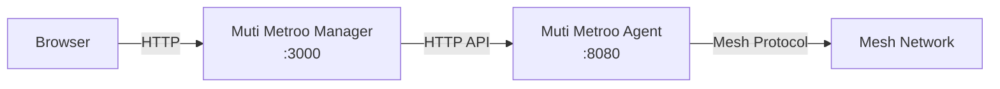

# Muti Metroo Manager

Muti Metroo Manager is a lightweight web dashboard for managing and monitoring Muti Metroo mesh networks. It runs as a standalone Go binary with an embedded React SPA that reverse-proxies a Muti Metroo agent's HTTP API.




## Get the Binary

Muti Metroo Manager is the binary that _hosts_ the **Downloads** tab for everyone else, so it has to be brought in out-of-band -- ask whoever set up the shared host (or your release-artifacts source) for the file matching your platform:

| Platform              | Filename                      |
| --------------------- | ----------------------------- |
| macOS (Apple Silicon) | `muti-metroo-manager-darwin-arm64`      |
| macOS (Intel)         | `muti-metroo-manager-darwin-amd64`      |
| Linux (amd64)         | `muti-metroo-manager-linux-amd64`       |
| Linux (arm64)         | `muti-metroo-manager-linux-arm64`       |
| Windows (amd64)       | `muti-metroo-manager-windows-amd64.exe` |
| Windows (arm64)       | `muti-metroo-manager-windows-arm64.exe` |

## Quick Start

Once you have the binary in your working directory (example: Linux amd64):

```bash
chmod +x muti-metroo-manager-linux-amd64

# Launch (connects to local agent on port 8080)
./muti-metroo-manager-linux-amd64

# Open http://localhost:3000 in your browser
```

## Command Surface

```bash
muti-metroo-manager [run] [flags]            start the HTTP server (default subcommand)
muti-metroo-manager check [flags]            validate config + probe agent, exit 0 / 1
muti-metroo-manager config show [flags]      print the resolved config with provenance
muti-metroo-manager config init [path]       emit a commented TOML config template
muti-metroo-manager version | -V             print version and build info
```

`check` is what systemd's `ExecStartPre=` should run -- it validates the config, the data dir, and upstream agent reachability without binding the listener, so a broken deploy fails before the long-lived process starts. `config show` reports each value alongside its source (default / TOML / env / flag), making "why is the agent URL wrong?" investigations a single command. `config init` writes a commented TOML template with every supported key.

## CLI Flags

The same flag set applies to `run` (default), `check`, and `config show`.

| Flag                | Default                      | Description                                                                          |
| ------------------- | ---------------------------- | ------------------------------------------------------------------------------------ |
| `-config`           |                              | TOML config file. Values overridden by env vars, env vars overridden by flags.       |
| `-addr`             | `:3000`                      | Address for the web UI to listen on.                                                 |
| `-agent`            | `http://127.0.0.1:8080`      | Muti Metroo agent HTTP API URL.                                                            |
| `-agent-token`      |                              | Bearer token. Visible via `/proc`; prefer `-agent-token-file` or the env var.        |
| `-agent-token-file` |                              | File containing the bearer token (single line, trimmed).                             |
| `-data-dir`         | OS-specific (see below)      | Directory for `muti-metroo-manager.db` and the instance lock.                                  |
| `-downloads-bundle` | auto-detect alongside binary | Path to `muti-metroo-downloads-bundle.zip`. An explicit path that does not exist is fatal. |
| `-no-downloads`     |                              | Disable the Downloads tab regardless of bundle presence.                             |
| `-log-format`       | `text`                       | Log encoding: `text` (operator) or `json` (SIEM).                                    |
| `-log-level`        | `info`                       | Minimum severity: `debug`, `info`, `warn`, `error`.                                  |
| `-metrics-addr`     |                              | `host:port` for the `/metrics` listener; empty disables. Pin to a private interface. |
| `-no-sounds`        |                              | Force the UI sound effects off regardless of per-user setting.                       |
| `-version`, `-V`    |                              | Print version and exit.                                                              |

**Data directory defaults:** `~/Library/Application Support/Muti-Metroo-Manager` on macOS, `/var/lib/muti-metroo-manager` for root on Linux, `$XDG_CONFIG_HOME/muti-metroo-manager` for unprivileged Linux users, `%LOCALAPPDATA%\muti-metroo-manager` on Windows. The directory holds the SQLite settings database and an exclusive instance lock, so each running manager needs its own data dir.

**Token environment variables:** the canonical name is `METROO_MANAGER_AGENT_TOKEN`. The legacy `MUTI_METROO_TOKEN` is still accepted but logs a deprecation warning at startup. `-agent-token` and `-agent-token-file` both override the env var; the file form is preferred for systemd / Kubernetes secrets.

### Examples

```bash
# Connect to a remote agent
./muti-metroo-manager -agent http://192.168.1.10:8080

# Use a custom port for the web UI
./muti-metroo-manager -addr :9090

# Token from a file (preferred for systemd/Kubernetes secrets)
./muti-metroo-manager -agent http://192.168.1.10:8080 \
  -agent-token-file /etc/muti-metroo-manager/token

# TOML-driven deploy (validate first, then start)
./muti-metroo-manager check -config /etc/muti-metroo-manager/config.toml \
  && ./muti-metroo-manager run -config /etc/muti-metroo-manager/config.toml

# Render a starter config
./muti-metroo-manager config init /etc/muti-metroo-manager/config.toml

# Bind to all interfaces
./muti-metroo-manager -addr 0.0.0.0:3000 -agent http://10.0.0.5:8080

# Mount a downloads bundle from a custom path
./muti-metroo-manager -downloads-bundle /opt/muti-metroo/muti-metroo-downloads-bundle.zip

# Explicitly disable the Downloads tab
./muti-metroo-manager -no-downloads

# Production: structured logs, /metrics on a private IP, sounds disabled
./muti-metroo-manager -config /etc/muti-metroo-manager/config.toml \
  -log-format json -log-level info \
  -metrics-addr 127.0.0.1:9101 -no-sounds
```

## Operations

`/healthz` is on the main listener and reports the manager's own state plus a cached one-shot probe of the upstream agent (config validity, agent reachability, and -- if a token is set -- a successful `/healthz` round-trip to the agent). Suitable for Kubernetes liveness/readiness, ALB health checks, or systemd `WatchdogSec=`.

`/metrics` is on a separate optional listener (`-metrics-addr`). Output is Prometheus text format with `metroo_manager_requests_total{method,path,status}`, `metroo_manager_request_duration_seconds_bucket{...}`, and `metroo_manager_agent_reachable`. Disabled by default; pin to a private interface when you turn it on.

`-log-format text` is operator-readable; `-log-format json` writes one JSON object per line for SIEM ingestion. Every request gets a request ID -- propagated via `X-Request-ID` if the client sends one, otherwise generated -- which appears in every log line for that request. State-changing operations (route mutations, sleep/wake, settings overrides, file uploads/downloads) emit a dedicated `audit=true` log line for compliance audits.

On startup the manager takes an exclusive lock on a file inside `-data-dir` (`flock` on Linux/macOS, `LockFileEx` on Windows). A second instance pointed at the same data directory exits with a clear error rather than racing on the SQLite store.

`muti-metroo-manager config show` prints the resolved value of every setting with a `source=` annotation (default, TOML, env, flag). Use it whenever a value is "not what you set".

## Agent Configuration Requirements

The Muti Metroo agent must have its HTTP API enabled with dashboard and remote API endpoints active:

```yaml
http:
  enabled: true
  address: ":8080"
  dashboard: true # Required for /api/* endpoints
  remote_api: true # Required for /agents/* endpoints
```

If the agent uses bearer token authentication, pass the token via `-agent-token-file`, `-agent-token`, or the `METROO_MANAGER_AGENT_TOKEN` environment variable:

```yaml
http:
  enabled: true
  address: ":8080"
  token_hash: "$2a$10$..." # Generated with: muti-metroo hash
  dashboard: true
  remote_api: true
```

```bash
# Token from a file (preferred for systemd / Kubernetes secrets)
./muti-metroo-manager -agent http://localhost:8080 \
  -agent-token-file /etc/muti-metroo-manager/token

# Via flag (visible via /proc; avoid in production)
./muti-metroo-manager -agent http://localhost:8080 -agent-token yourtoken

# Via environment variable
export METROO_MANAGER_AGENT_TOKEN=yourtoken
./muti-metroo-manager -agent http://localhost:8080
```

## Features

### Topology Map

Interactive visualization of all agents in the mesh and their peer connections. Agents display their names, IDs, and connection status. Click any agent for detailed information.

The map supports mouse wheel zoom (0.25x-5x), click-and-drag panning, and per-station drag-to-reposition. Pan, zoom, and station positions persist in the browser, so a refresh keeps the operator view; a **Reset view** button restores defaults. A fullscreen toggle is available on the map. The agent search collapses to an icon by default; the `/` hotkey expands it and focuses the input regardless of which tab is active.

Live cues annotate the topology in real time: connection color shifts with measured RTT (cool to warm), animated flow indicators show active traffic direction, a brief pulse marks newly-online agents, and a bottom-edge ticker scrolls recent events. Ambient sounds fire on boot, disconnect, and mesh-test results; an in-app toggle and the `-no-sounds` server flag both disable them, useful in noise-sensitive deployments. A faint matrix-rain backdrop sits behind the map; it is decorative only and bounded so it does not dominate the layout.

### Dashboard

Real-time statistics for the connected agent:

- Connected peers and connection status
- Active streams and buffer usage
- Route table (CIDR and domain routes)
- System information (OS, architecture, uptime)
- Forward route endpoints and listeners

### Route Management

The Routes tab has two sub-tabs:

- **Active routes** lists every CIDR and domain route advertised across the mesh, with origin agent, hop count, metric, and an editable comment per route. Comments on dynamic routes are mutated through `POST /routes/manage` (`set_comment` action) and propagate over the wire so they appear on every agent that learns the route. The same edit dialog sets an optional **Source IP** and egress **Interface** for the route's outbound dials, each a combobox seeded from the origin agent's interface addresses, with a mismatch advisory when the chosen source IP sits on a different NIC than the pinned interface. Unlike the comment, both bindings are local to the origin agent and do not propagate; they survive restart.
- **Test routing** posts a destination to the agent's `POST /route/trace` and renders three labelled views (SOCKS, TUN, Domain) plus a collapsible all-candidates dump showing every CIDR considered and why each loser lost.


### DNS

The DNS tab is split into two sub-tabs: **Hosts** and **TLDs**.

**Hosts** is a CRUD UI for the agent's mesh-host registry (hostname &rarr; IPv4 / IPv6) backed by `POST /hosts/manage`. Add a name, set one or both IP families and an optional comment, and the entry is journalled to the agent's data directory so it survives restarts. Names ending in any of the active TLD suffixes (default `.mesh`) are accepted; the active suffix set is reported back by the agent so the form can validate client-side. Bare TLDs without a label are also valid hostnames (e.g. an entry whose name is exactly the suffix). Single-label bare names without a configured suffix are rejected. Config-seeded entries are visible but protected against runtime removal -- edit the agent's `mesh_hosts:` block and restart to drop them.

**TLDs** manages the suffix set itself at runtime via `POST /hosts/suffixes/manage`. Operators can add or remove suffixes (single-label like `mesh` or multi-level like `corp.local`) without touching the config; changes take effect immediately and propagate to clients (Mutiauk's mesh DNS resolver, Muti Metroo Manager validation) on the next dashboard poll.

See chapter 11 for how mesh-local hostnames work end to end.


### Port Forwards

The forwards view pairs backend routes with topology data so a listener advertised without a matching endpoint (or vice versa) is still visible. In the agent panel, listeners and endpoints are split into subtabs with a ready-to-paste `curl` example for the first parseable listener port (including an SNI `--resolve` variant for TLS backends).


### Connectivity

The agent panel's **Connectivity** tab carries two sub-tabs. **Peers** lists the agent's direct peer connections. **Listeners** manages the transport sockets the agent binds to accept inbound peers, without editing its config: choose a transport (`quic` / `h2` / `ws`), enter a bind address (e.g. `:4433`), and optionally set the HTTP path (ws/h2), a `plaintext` flag (ws, for reverse-proxy deployments), and an advertise `host:port` that publishes a public dial target to the mesh. Config listeners are read-only; runtime-added ones can be removed after a confirmation prompt. The sub-tab is read-only when the connected agent has no management signing key.

### Management Commands

Run commands on any reachable agent from the browser. Supports streaming mode (simple commands) and interactive mode (htop, vim). When a session ends or errors, a **Reconnect** button reopens it. The target agent must have management commands enabled.


### File Transfer

Upload and download files to/from any reachable agent through the browser. Supports individual files and directory transfers. The target agent must have file transfer enabled.

The file browser toolbar is laid out as four equal-weight text buttons -- **Up**, **Path**, **Upload**, **Refresh** -- with drag-and-drop carrying the primary upload affordance via a drop overlay. The breadcrumb's leading `/` segment is clickable: it opens an editable path input so an operator can jump directly to a known directory. The input expands a leading `~` to the agent user's home directory on Unix targets and shows a platform-appropriate placeholder.


### Ping

Send ICMP echo requests from any agent to any reachable IP address. Configure request count and interval, watch sequence numbers and round-trip times update in real time, and see which source/destination addresses the exit agent used. The target agent must have `icmp.enabled: true`; each session is tunnelled over a dedicated WebSocket subprotocol.

### Mesh Test

Connectivity tests between all agents in the mesh. Sends probe messages between every pair of agents and reports success/failure with latency measurements. The footer shows a persistent "Mesh: N/M reachable" summary that turns red when any remote agent is unreachable.

### Sleep/Wake Control

Trigger mesh-wide sleep or wake commands from the dashboard. Sleep puts agents into a low-power polling mode; wake restores normal operation.

### Downloads

A top-level **Downloads** tab serves the current Muti Metroo and Mutiauk release binaries -- including the Windows DLL -- plus the user, operator, and slides PDFs, grouped by architecture (`amd64` / `arm64`) with SHA256 checksums and capture timestamps. Useful when handing an operator a single URL instead of separate release-page links. The Muti Metroo Manager binary itself is not delivered through this tab; obtain it out-of-band (see "Get the Binary" above).

The contents come from `muti-metroo-downloads-bundle.zip`, an optional file shipped alongside the Muti Metroo Manager binary. With no `-downloads-bundle` flag, the binary auto-detects the zip in the same directory as the executable; the tab appears when found and is hidden otherwise. Pass `-downloads-bundle off` to disable the feature explicitly. Files are served with friendly download names (`muti-metroo`, `muti-metroo.exe`, `muti-metroo.dll`, `mutiauk`, `user-manual.pdf`) via `Content-Disposition`.

Each binary section in the Downloads tab has a **Create config** button next to its arch tabs - clicking it opens the matching Agent or Entry wizard without leaving the tab. The button is shown only on sections that ship a wizard.

### Config Wizards

The dashboard includes two interactive configuration wizards -- one for the Muti Metroo agent and one for Mutiauk -- reachable from each agent's kebab menu and from the Downloads tab. Both wizards perform inline **management-keypair validation**: the wizard derives the public half of every entered private key and surfaces a mismatch on the same step. X25519 keys are 32-byte (64-hex) scalars; Ed25519 signing keys are 64-byte (128-hex) seed-with-public-tail values per Go's `crypto/ed25519` layout. Mismatches stop the wizard before download, so an operator never ends up with a config that fails to decrypt topology or sign privileged ops at runtime.

The Muti Metroo agent wizard also pre-populates its peer step from `advertised_listeners` reported on the topology poll, so an operator can pick a known agent rather than typing its address by hand. Each listener step offers an "Advertise this listener" toggle that emits the corresponding `listeners[].advertise: {address, path, transport}` block in the YAML preview, opting into NodeInfo-based discovery for that listener.

The review step shows the YAML preview alongside verified copy-paste deployment commands for the most common scenarios:

- Foreground run (no privileges)
- System service install (`systemd` on Linux, `launchd` on macOS, Windows Service on Windows)
- Linux non-root install via cron (`muti-metroo service install --user ...`)
- Windows DLL flow (`muti-metroo.exe service install --user --dll ... -c ...` or `rundll32.exe muti-metroo.dll,Run ...`)

The commands are generated from the wizard's own paths and pinned to whatever the `muti-metroo service` command documents (Chapter 19).

### Settings

A persistent settings dialog lets operators override the agent API URL and the default SOCKS5 address surfaced in setup hints. Those two values are stored in Muti Metroo Manager's local SQLite store (`muti-metroo-manager.db`) and survive restarts; the Mutiauk wizard seeds itself from them. The bearer token used for proxied API calls can also be set in the Settings dialog, but it lives only in the browser's session storage -- it is not persisted to SQLite and disappears when the tab is closed. This keeps the most sensitive credential off-disk on the host running Muti Metroo Manager.

### Per-Agent Notes and Icons

Each agent has a free-text notes field (saved on blur or Ctrl/Cmd-S) and a selectable icon (Linux/macOS/Windows, router, switch, database, valve, pump, ...). Both persist in the Muti Metroo Manager SQLite store and survive restarts. Notes surface on station hover; icons render on the map.


### Keyboard Shortcuts and Deep Links

| Shortcut | Action                                                        |
| -------- | ------------------------------------------------------------- |
| `/`      | Focus the search box (switches to the topology tab if needed) |
| `Esc`    | Close the active agent panel                                  |

URL hashes like `#/agents/<id>` (short or full ID) open an agent panel directly. Destructive actions -- removing routes, peers, or port forwards -- go through a confirmation dialog.
